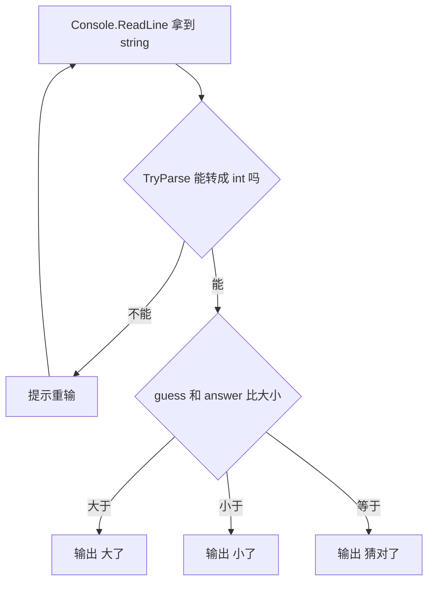
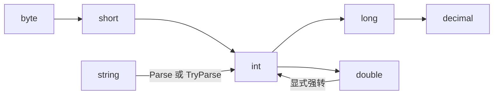

# C# 基础：变量、类型、运算符、输入输出、分支


---


这一节只干一件事：把「输入一个数 → 比较 → 输出结果」这条链走通，然后把这条链上每一颗螺丝都拆开看清楚。

走通了，猜数字就是最小的完整程序；走不通，后面循环、数组、面向对象全是空中楼阁。

整条链长这样：



> [!NOTE]
> 本文按「先会用 → 再用对 → 最后知道坑在哪」三层写，所有代码都能直接跑。
> 题目全部附答案，答案里带解释和常见错误写法。

## 一、变量与类型

变量 = 一个贴了名字的盒子。类型决定了这个盒子能装什么、能干什么、装不下会怎样。

```c#
int age = 18;              // 整数
double price = 9.9;        // 双精度小数
decimal money = 9.9m;      // 十进制小数，钱用它
bool isReady = true;       // 真假，只有 true / false
char grade = 'A';          // 单个字符，单引号
string name = "小明";      // 一串字符，双引号
var count = 3;             // 让编译器自己推，这里推成 int
```

类型不是写给编译器看的，是写给下一个读代码的你：看到 `int` 就知道这里不会有小数。

`var` 只是省打字，不是「什么都能装」：

```c#
var n = 3;
n = 3.5;      // 编译错误：无法将 double 隐式转换为 int
```

### 值类型与引用类型

这是 C# 里第一个真概念，先记住两条就够用：

```c#
int a = 10;
int b = a;        // 值类型：把 10 复制一份给 b
b = 20;           // a 还是 10，两者互不影响

int[] arr1 = { 1, 2, 3 };
int[] arr2 = arr1;   // 引用类型：两个变量指向同一个数组
arr2[0] = 99;        // arr1[0] 也变成 99
```

> [!IMPORTANT]
> 值类型（`int` `double` `bool` `char` `decimal`）复制的是**内容**。
> 引用类型（`string` 数组 `class`）复制的是**地址**，改一个等于改两个都看的那个东西。

`string` 是引用类型里最特殊的一个：它不可变。任何「修改」都是造了一个新字符串，原字符串一个字都没动。这也是为什么后面讲字符串拼接性能时会踩坑。

### 默认值

```c#
int x;                     // 局部变量：未赋值就使用，编译报错「使用了未赋值的局部变量」
int[] nums = new int[3];   // 数组元素：自动填 0
```

| 类型 | 默认值 | 说明 |
| --- | --- | --- |
| `int` `long` `short` `byte` | `0` | 数字零 |
| `double` `float` `decimal` | `0` | 注意是 0 不是 null |
| `bool` | `false` | 假 |
| `char` | `'\0'` | 编码 0 的空字符 |
| `string` 和所有 `class` | `null` | 没有盒子，不是空盒子 |

> [!CAUTION]
> `null` 和 `""` 完全不是一回事：`null` 是「没有这个盒子」，`""` 是「盒子是空的」。
> 对 `null` 调 `.Length` 会抛 `NullReferenceException`，这是新手遇到最多的崩溃。

## 二、常量与命名

```c#
const int MaxTry = 5;      // 常量：编译期就固定，赋值之后不能再改
const double Pi = 3.14159;
```

`const` 只能修饰「编译时就能算出值」的基本类型。要装对象或者运行期才定，用 `static readonly`（后面再讲，现在用不着）。

命名约定（不遵守不报错，但一眼看出是不是新手）：

- 局部变量、参数：小驼峰 `userName`、`guessCount`
- 方法、类、属性、常量：大驼峰 `GetUserName`、`MaxTry`
- 私有字段：`_userName` 这种下划线开头，团队自己定，别一行一个风格

## 三、运算符

### 算术运算：整数和小数是两套规则

```c#
Console.WriteLine(7 / 2);           // 3    整数除整数，小数部分直接丢掉
Console.WriteLine(7 % 2);           // 1    取余，判奇偶全靠它
Console.WriteLine(7.0 / 2);         // 3.5  有一个是小数，结果才是小数
Console.WriteLine(7 / 2.0);         // 3.5  同上
Console.WriteLine((double)7 / 2);   // 3.5  强制把 7 先变成小数
Console.WriteLine(-7 / 2);          // -3   向零取整，不是 -4
Console.WriteLine(-7 % 2);          // -1   余数的符号跟着被除数走
```

这七行是整段最该背下来的，后面 90% 的「为什么算错了」都能归到这里。

### 自增与复合赋值

```c#
int x = 5;
x += 3;        // 等价于 x = x + 3，现在 8
x -= 1;        // 7
x *= 2;        // 14
x /= 4;        // 3   整数除法，14/4 = 3.5 → 3
x %= 2;        // 1

int i = 5;
int a = i++;   // a = 5，i = 6  先取值再自增
int b = ++i;   // i = 7，b = 7  先自增再取值
```

> [!TIP]
> `i++` 和 `++i` 单独成一句时没区别，混在表达式里才有区别。
> 真要用的时候建议拆成两句，别考验读代码的人（包括三个月后的你）。

### 比较与逻辑

```c#
Console.WriteLine(3 > 2);              // True
Console.WriteLine(3 != 3);             // False
Console.WriteLine(!true);              // False   取反
Console.WriteLine(true && false);      // False   与：两边都真才真
Console.WriteLine(true || false);      // True    或：一边真就真
```

`&&` 和 `||` 有短路特性：`&&` 左边已经是 `false`，右边根本不执行；`||` 左边已经是 `true`，右边也不执行。

```c#
// 安全的写法：list 是 null 时后半句压根不会跑
if (list != null && list.Count > 0)
{
    // ...
}
```

顺序写反成 `list.Count > 0 && list != null`，`null` 的时候第一句就已经崩了。

### 进阶：位运算、三元、空合并

```c#
Console.WriteLine(5 & 3);      // 1     按位与
Console.WriteLine(5 | 3);      // 7     按位或
Console.WriteLine(5 ^ 3);      // 6     按位异或：不同为 1
Console.WriteLine(1 << 3);     // 8     左移三位 = 乘 8
Console.WriteLine(8 >> 1);     // 4     右移一位 = 除以 2
Console.WriteLine(~5);         // -6    按位取反

int age = 20;
string label = age >= 18 ? "成年" : "未成年";   // 三元：条件 ? 真值 : 假值

string input = null;
string name = input ?? "无名";                  // 空合并：左边是 null 就取右边
name ??= "匿名";                                // C# 8：name 是 null 才赋值
```

位运算现在用不上，但看到 `flags & 1 == 1` 这种代码要知道它在判断奇偶。

> [!TIP]
> 三元表达式别嵌套超过一层，嵌套两层就该拆成 `if`，否则谁读谁头疼。

### 运算符优先级

从上到下，先算上面的：

| 优先级 | 运算符 |
| --- | --- |
| 1 | `()` 括号 |
| 2 | `!` `++` `--` 一元运算 |
| 3 | `*` `/` `%` |
| 4 | `+` `-` |
| 5 | `<<` `>>` |
| 6 | `<` `>` `<=` `>=` |
| 7 | `==` `!=` |
| 8 | `&` |
| 9 | `^` |
| 10 | `\|` |
| 11 | `&&` |
| 12 | `\|\|` |
| 13 | `?:` 三元 |
| 14 | `=` `+=` `-=` 等赋值 |

记不住没关系，加括号永远是对的，而且括号能让别人一遍读懂。

## 四、输入输出

```c#
Console.WriteLine("你叫什么？");        // 输出并换行
Console.Write("请输入年龄：");          // 输出不换行，适合当提示语
string name = Console.ReadLine();       // 读一整行，回车结束
Console.WriteLine($"你好，{name}！");   // $ 开头可以直接把变量塞进字符串
```

> [!WARNING]
> `Console.ReadLine()` 永远返回字符串。哪怕你输 `18`，拿到的也是 `"18"`，不是数字。
> 用户直接关窗口、或者按 Ctrl+Z 回车，它会返回 `null`，后面一用就崩。

### 输出格式控制

```c#
double ratio = 0.8567;
Console.WriteLine($"{ratio:F2}");       // 0.86    保留两位小数
Console.WriteLine($"{ratio:P1}");       // 85.7%   百分比
Console.WriteLine($"{123,8}");          // "     123"  右对齐，宽度 8
Console.WriteLine($"{123,-8}|");        // "123     |" 左对齐
Console.WriteLine($"{255:X}");          // FF      十六进制
Console.WriteLine("{0} + {1} = {2}", 1, 2, 3);   // 老式占位符写法，{0}{1}{2} 是参数序号
```

对齐和格式化在控制台程序里很有用，做九九乘法表时就靠它排整齐。

### 输入一个字符

```c#
ConsoleKeyInfo key = Console.ReadKey(true);   // true = 不把按的键显示在屏幕上
Console.WriteLine($"你按了 {key.KeyChar}");
```

`ReadKey` 只读一个键、不用回车，适合「按任意键继续」。

## 五、分支

### if 家族

```c#
if (score >= 90)
{
    Console.WriteLine("优秀");
}
else if (score >= 60)
{
    Console.WriteLine("及格");
}
else
{
    Console.WriteLine("不及格");
}
```

从上往下依次判断，第一个成立的执行完就跳出整个结构，后面的不再看。

> [!WARNING]
> 顺序很重要：把 `>= 60` 写在 `>= 90` 前面，95 分也会被判成「及格」。

### switch 语句

```c#
switch (day)
{
    case 1:                        // 多个 case 可以共用一个分支
    case 7:
        Console.WriteLine("休息");
        break;                     // 忘了 break 会继续往下跑
    case 2:
    case 3:
    case 4:
    case 5:
    case 6:
        Console.WriteLine("上班");
        break;
    default:                       // 都不匹配时进来
        Console.WriteLine("日期不对");
        break;
}
```

`switch` 只适合等值判断（等于几）；范围判断（`>= 90`）用 `if`。

字符串也能 switch：

```c#
switch (command)
{
    case "start":
        Console.WriteLine("启动");
        break;
    case "stop":
        Console.WriteLine("停止");
        break;
    default:
        Console.WriteLine("不认识的命令");
        break;
}
```

### 进阶：switch 表达式

不用写 `case` 和 `break`，直接返回值，写起来像表格：

```c#
string level = score switch
{
    >= 90 => "优秀",
    >= 60 => "及格",
    _ => "不及格"            // _ 是「其他所有情况」，必须有
};
```

按条件分组也行：

```c#
string type = n switch
{
    0 => "零",
    < 0 => "负数",
    > 0 and < 10 => "一位正数",   // and / or / not 是 C# 9 的模式组合
    _ => "较大的正数"
};
```

### 进阶：模式匹配 is

```c#
object obj = 42;

if (obj is int number)          // 是 int 就顺便把值装进 number
{
    Console.WriteLine(number + 1);
}

if (obj is int n && n > 10)     // 精准匹配
{
    Console.WriteLine("大于 10");
}

string desc = obj switch
{
    int i when i < 0 => "负整数",
    int i => $"整数 {i}",
    string s => $"字符串 {s}",
    null => "空",
    _ => "其他"
};
```

`when` 是守卫条件，写在模式后面当附加判断用。这些是后面面向对象和 LINQ 的地基，现在先混个脸熟。

## 六、四个必须踩过的坑

### 一、把字符串当数字比大小

```c#
string a = Console.ReadLine();   // 用户输入 50 → a 是 "50"
string b = Console.ReadLine();   // 用户输入 9  → b 是 "9"

Console.WriteLine(a > b);        // False
```

字符串比较按字符逐个比编码：先比第一个字符 `'5'`（编码 53）和 `'9'`（编码 57），53 < 57，直接判 `"50" < "9"`，后面的 `0` 根本不用看。

于是数值上 50 > 9，代码里却得到 `False`。

> [!CAUTION]
> `==` 比字符串是比内容（`string` 重载了 `==`），但 `<` `>` 大小比较是坑。
> 任何「看起来该进却进了、该进没进」的判断，先查有没有拿字符串在比。

正确做法是先转成数字再比：

```c#
int n = int.Parse(input);                      // 转不了直接抛 FormatException，程序崩
bool ok = int.TryParse(input, out int guess);  // 推荐：转不了返回 false，程序不崩
```

### 二、`=` 和 `==` 写反

```c#
if (guess = answer)   // 编译报错（int 不是 bool），算幸运
```

在 `bool` 上就没这么幸运：

```c#
bool isReady = true;
if (isReady = false)   // 不报错，但把 isReady 改成 false 了，条件永远是假
```

> [!TIP]
> 防御性写法：把常量写左边 `if (false == isReady)`，写错立刻编译报错。

### 三、整数除法悄悄丢小数

```c#
double avg = 7 / 2;            // 3，不是 3.5 —— 先算完 7/2 得 3，再存进 double
double avg2 = 7.0 / 2;         // 3.5
double avg3 = (double)7 / 2;   // 3.5
double avg4 = (double)(7 / 2); // 3  ← 括号位置决定一切
```

> [!WARNING]
> 两个整数相除，结果一定是整数。想留小数，先让其中一边变成小数，而且**必须在做除法之前**转。

### 四、`switch` 忘 `break`、`if` 少花括号

```c#
case 1:
    Console.WriteLine("一");
    // 忘了 break → 继续往下跑，把后面 case 的代码也执行一遍（叫贯穿）
```

这种情况编译器会直接拦你，比它更隐蔽的是单行 `if` 不加花括号：

```c#
if (ok)
    Console.WriteLine("成功");
    Console.WriteLine("结束了");   // 这句不在 if 里！缩进会骗人
```

```c#
if (ok)
{
    Console.WriteLine("成功");
    Console.WriteLine("结束了");   // 这样两句才都在 if 里
}
```

> [!CAUTION]
> 判断依据永远是花括号，不是缩进。养成「哪怕只有一句也写花括号」的习惯，能省掉以后一整类 bug。

## 七、数值进阶：溢出与精度

### int 装不下会怎样

```c#
Console.WriteLine(int.MaxValue);          // 2147483647
Console.WriteLine(int.MaxValue + 1);      // -2147483648  悄悄变成最小值，不报错
```

这叫溢出。默认不检查，直接绕回最小值，最要命的 bug 就是这个——数字突然变成负数。

想让它报错：

```c#
checked
{
    int x = int.MaxValue;
    int y = x + 1;      // 抛 OverflowException，程序明确告诉你超了
}
```

`long` 能装到约 9.2×10¹⁸，`int` 只有 21 亿。算大数（比如阶乘）必须提前换 `long`，否则 13! 就会绕回负数。

### double 有精度误差

```c#
Console.WriteLine(0.1 + 0.2);             // 0.30000000000000004
Console.WriteLine(0.1 + 0.2 == 0.3);      // False   ← 真的不相等
```

因为 `0.1` 和 `0.2` 在二进制里是无限循环小数，存进去就有微小误差。

涉及钱的比较，两条路：

```c#
decimal a = 0.1m, b = 0.2m, c = 0.3m;
Console.WriteLine(a + b == c);            // True   decimal 是十进制存储，没有这个坑

// 或者用容差判断
double x = 0.1 + 0.2, y = 0.3;
Console.WriteLine(Math.Abs(x - y) < 1e-9);   // True  差得足够小就算相等
```

> [!IMPORTANT]
> 算钱用 `decimal`，科学计算用 `double`，永远不要拿 `double` 直接 `==`。

### 类型范围速查

| 类型 | 范围 | 位数 |
| --- | --- | --- |
| `byte` | 0 ~ 255 | 8 |
| `short` | -32768 ~ 32767 | 16 |
| `int` | -21 亿 ~ 21 亿 | 32 |
| `long` | 约 ±9.2×10¹⁸ | 64 |
| `float` | 约 ±3.4×10³⁸，7 位有效数字 | 32 |
| `double` | 约 ±1.7×10³⁰⁸，15 位有效数字 | 64 |
| `decimal` | 约 ±7.9×10²⁸，28 位有效数字 | 128 |

## 八、类型转换全景

```c#
// 1) 隐式转换：小的自动变大的，不会丢信息
int i = 10;
long l = i;           // int → long，自动
double d = i;         // int → double，自动

// 2) 显式转换（强转）：大的变小，可能丢信息，要自己负责
double dd = 9.99;
int ii = (int)dd;     // 9，直接砍掉小数，不是四舍五入

// 3) Parse：字符串 → 数字，失败抛异常
int a = int.Parse("123");
// int.Parse("abc")  → FormatException
// int.Parse("")     → FormatException
// int.Parse(null)   → ArgumentNullException

// 4) TryParse：失败返回 false，绝不抛异常（推荐）
bool ok = int.TryParse("abc", out int b);   // ok = false，b = 0

// 5) Convert：会做一些 Parse 不做的兜底
int c = Convert.ToInt32(null);   // 0，不抛异常
int e = Convert.ToInt32("123");  // 123
int f = Convert.ToInt32(9.99);   // 10 ← 这个会四舍五入！

// 6) ToString：数字 → 字符串
string s1 = 123.ToString();
string s2 = 9.99.ToString("F1");   // "10.0"
```

转换的流向大概是这样：



三个容易混的点：

- `(int)9.99` 得 9（截断），`Convert.ToInt32(9.99)` 得 10（四舍五入）
- `int.Parse(null)` 崩，`Convert.ToInt32(null)` 得 0
- 用户输入一律用 `TryParse`，别用 `Parse`

字符和数字互转：

```c#
char c = 'A';
int code = c;           // 65，char 本质是数字，可以隐式转 int
char back = (char)66;   // 'B'
int digit = '7' - '0';  // 7  把字符数字转成真数字的常用技巧
```

## 九、字符串进阶

```c#
string s = "Hello";

Console.WriteLine(s.Length);              // 5
Console.WriteLine(s.ToUpper());           // HELLO
Console.WriteLine(s.Contains("ell"));     // True
Console.WriteLine(s[0]);                  // H   下标从 0 开始
Console.WriteLine(s.Substring(1, 3));     // ell
Console.WriteLine(s.Replace("l", "L"));   // HeLLo
Console.WriteLine("  a b  ".Trim());      // "a b"
Console.WriteLine(string.Join("-", new[] { "a", "b" }));   // a-b
Console.WriteLine("a,b,c".Split(',').Length);              // 3
```

字符串不可变，所有「修改」都是新对象：

```c#
string t = "a";
t += "b";        // 不是改 t，是造了一个 "ab"，t 指向新的它
```

所以在循环里拼字符串是性能灾难（每次都要复制整个串）：

```c#
// 慢：1 万次拼接 ≈ 复制 1 万次
string result = "";
for (int i = 0; i < 10000; i++)
{
    result += i;
}

// 快：StringBuilder 内部是可扩容的缓冲
var sb = new System.Text.StringBuilder();
for (int i = 0; i < 10000; i++)
{
    sb.Append(i);
}
string fast = sb.ToString();
```

> [!TIP]
> 一万次以内其实感觉不出来，但知道这个区别，以后看到 `+=` 出现在循环里就知道要留神。

空字符串判断：

```c#
string a = "";
Console.WriteLine(a == "");                            // True
Console.WriteLine(string.IsNullOrEmpty(a));            // True
Console.WriteLine(string.IsNullOrWhiteSpace("   "));   // True   连空格也算空
```

## 十、异常与调试

程序崩了不是「坏了」，是它告诉你「这里我没法处理」。

```c#
try
{
    int n = int.Parse(Console.ReadLine());
    Console.WriteLine(100 / n);
}
catch (FormatException)
{
    Console.WriteLine("这不是数字");
}
catch (DivideByZeroException)
{
    Console.WriteLine("不能除以零");
}
catch (Exception ex)          // 兜底，能捕获所有
{
    Console.WriteLine($"出错了：{ex.Message}");
}
finally
{
    Console.WriteLine("不管成功失败都会执行");
}
```

新手常见异常一览：

| 异常 | 什么时候出现 | 典型原因 |
| --- | --- | --- |
| `FormatException` | 字符串转数字失败 | `int.Parse("abc")` |
| `OverflowException` | 数字超出范围 | `checked` 下的 `int.MaxValue + 1` |
| `DivideByZeroException` | 整数除以 0 | `100 / 0` |
| `NullReferenceException` | 对 null 调用成员 | `null.Length` |
| `IndexOutOfRangeException` | 下标越界 | `arr[arr.Length]` |

> [!IMPORTANT]
> 能用 `TryParse` 就别用 `try/catch`。异常很重，用户乱输几次就崩几次，体验极差；
> `TryParse` 是正常的流程判断，`try/catch` 留给真正意外的情况。

调试三招：

1. 在可疑行左边点红点打断点，`F5` 启动，程序会在那里停住
2. 停住之后把鼠标放变量上，能看到它此刻的值
3. 实在不方便调试，就 `Console.WriteLine($"到这里了，x={x}")`，最土但最快

## 十一、猜数字：只猜一次

严格只用前面这些知识，先跑通最小的那条链。

```c#
using System;

class Program
{
    static void Main()
    {
        int answer = 42;                        // 先写死一个答案

        Console.Write("猜一个数字：");
        string input = Console.ReadLine();      // 拿到的是字符串
        int guess = int.Parse(input);           // 转成整数才能比大小

        if (guess > answer)
        {
            Console.WriteLine("大了");
        }
        else if (guess < answer)
        {
            Console.WriteLine("小了");
        }
        else
        {
            Console.WriteLine("猜对了！");
        }
    }
}
```

改哪里试什么：把 `42` 换成别的数、故意输字母看它怎么崩（`FormatException`）、把 `>` 和 `<` 换过来看看会发生什么。

## 十二、猜数字：能一直猜且不崩

```c#
using System;

class Program
{
    static void Main()
    {
        Random random = new Random();
        int answer = random.Next(1, 101);       // 1 到 100，上界 101 不含
        int count = 0;

        while (true)                            // 死循环，靠 break 出来
        {
            Console.Write("猜一个 1-100 的数字：");
            string input = Console.ReadLine();
            count++;

            if (input == null)                  // 用户按了 Ctrl+Z
            {
                Console.WriteLine("没读到输入，退出");
                break;
            }

            if (!int.TryParse(input, out int guess))
            {
                Console.WriteLine("这不是数字，再试一次");
                continue;                       // 跳回循环开头，重新问
            }

            if (guess < 1 || guess > 100)
            {
                Console.WriteLine("让你猜 1-100，重来");
                count--;                        // 越界的这次不算数
                continue;
            }

            if (guess > answer)
            {
                Console.WriteLine("大了");
            }
            else if (guess < answer)
            {
                Console.WriteLine("小了");
            }
            else
            {
                Console.WriteLine($"猜对了！你一共猜了 {count} 次");
                break;                          // 结束循环
            }
        }
    }
}
```

> [!WARNING]
> `random.Next(1, 101)` 第二个参数取不到：写 101 才可能出 100。
> 这是新手第一个必踩的坑，跟 `for (int i = 0; i <= arr.Length; i++)` 越界是同一类毛病。

想在调试时固定结果，用带种子的构造：

```c#
Random fixedRandom = new Random(12345);   // 同一个种子每次跑出来序列一样
```

## 十三、猜数字：拆成方法

方法 = 一段起了名字的代码，可以反复调用。这一版开始有「工程感」。

```c#
using System;

class Program
{
    const int MaxTry = 5;                 // 最多五次
    const int Min = 1;
    const int Max = 100;

    static void Main()
    {
        while (true)                      // 外层循环：一局玩完再来一局
        {
            PlayGame();

            Console.Write("再来一局？(y/n)：");
            string again = Console.ReadLine();
            if (again != "y" && again != "Y")
            {
                Console.WriteLine("bye");
                break;
            }
        }
    }

    static void PlayGame()
    {
        var random = new Random();
        int answer = random.Next(Min, Max + 1);   // 上界不含，所以 +1

        for (int tryCount = 1; tryCount <= MaxTry; tryCount++)
        {
            int guess = ReadInt($"第 {tryCount}/{MaxTry} 次，猜 {Min}-{Max}：", Min, Max);

            if (guess > answer)
            {
                Console.WriteLine("大了");
            }
            else if (guess < answer)
            {
                Console.WriteLine("小了");
            }
            else
            {
                Console.WriteLine($"猜对了！用了 {tryCount} 次");
                return;                    // 结束本局
            }
        }

        Console.WriteLine($"次数用完，答案是 {answer}");
    }

    // 读一个在 [min, max] 之间的整数，读不对就重新问
    static int ReadInt(string tip, int min, int max)
    {
        while (true)
        {
            Console.Write(tip);
            string input = Console.ReadLine();

            if (!int.TryParse(input, out int value))
            {
                Console.WriteLine("  要输数字");
                continue;
            }

            if (value < min || value > max)
            {
                Console.WriteLine($"  范围是 {min} 到 {max}");
                continue;
            }

            return value;                  // 只有合法值才 return 出去
        }
    }
}
```

> [!TIP]
> `ReadInt` 是这一节最值得抄走的东西：任何「要用户输入一个合法数字」的地方都能直接用。

方法里的 `return` 只能返回一个值，而且一执行就立刻离开方法，后面的代码不再跑。

## 十四、检查标准

三条判断标准，都做到才算过关，做不到就再练，别往下赶：

1. 不看教程，能写出 100 行以内的控制台程序
2. 能张嘴解释：`7 / 2`、`7 % 2`、`7.0 / 2`、`(double)(7 / 2)` 分别是多少，为什么
3. 看到一段陌生的 C# 代码不发怵，至少能说出它大概在干什么

## 十五、题目（全部附答案）

共 14 题。建议先自己在纸上或 VS Code 里写一遍，再对照答案。答案里的「为什么」比代码本身更值钱。

### 题 1：四个除法

求下面四个值：

```c#
Console.WriteLine(7 / 2);
Console.WriteLine(7 % 2);
Console.WriteLine(7.0 / 2);
Console.WriteLine((double)(7 / 2));
```

**答**：分别是 `3`、`1`、`3.5`、`3`。

- `7 / 2`：整数除整数，结果只能是整数，2.5 的小数部分直接丢掉，得 3（不是四舍五入）
- `7 % 2`：7 除 2 余 1
- `7.0 / 2`：有一个是 `double`，编译器按浮点除法算，3.5
- `(double)(7 / 2)`：括号先算，`7 / 2` 已经得 3，再转成 `3.0`。**转换发生在除法之后，所以救不回来**

> [!NOTE]
> 正确答案是 `3.5` 的写法：`(double)7 / 2` 或 `7 / 2.0`。

### 题 2：int 装不下

```c#
int x = int.MaxValue;
Console.WriteLine(x + 1);
```

打出什么？怎么让它报错？

**答**：打出 `-2147483648`（`int.MinValue`）。默认不检查溢出，最大值加一直接绕回最小值，不报错。

让它报错用 `checked`：

```c#
checked
{
    int y = x + 1;      // 抛 OverflowException
}
```

或者在 csproj 里开全局检查：

```xml
<CheckForOverflowUnderflow>true</CheckForOverflowUnderflow>
```

真需要装更大的数，把类型换成 `long`。

### 题 3：0.1 + 0.2

为什么 `0.1 + 0.2 == 0.3` 是 `False`？怎么改？

**答**：$0.1$、$0.2$、$0.3$ 在二进制里都是无限循环小数，`double` 只能存近似值，$0.1 + 0.2$ 实际得到 $0.30000000000000004$，和 $0.3$ 的近似值不是同一个数，所以不等。

两种改法，看场景：

```c#
// 算钱：用 decimal
decimal a = 0.1m + 0.2m;
Console.WriteLine(a == 0.3m);                   // True

// 算科学量：用容差
double x = 0.1 + 0.2;
Console.WriteLine(Math.Abs(x - 0.3) < 1e-9);    // True
```

结论：`double` 永远不要直接 `==` 比较。

### 题 4：ReadLine 返回什么

`Console.ReadLine()` 返回什么类型？直接拿它跟数字比大小会怎样？

**答**：返回 `string`，永远是字符串，哪怕用户输入的是 `50`。

```c#
string a = Console.ReadLine();   // 用户输入 50 → a 是 "50"
string b = Console.ReadLine();   // 用户输入 9  → b 是 "9"

Console.WriteLine(a > b);        // False
```

字符串比较按字符逐个比编码：先比第一个字符 `'5'`（编码 53）和 `'9'`（编码 57），53 < 57，直接判 `"50" < "9"`，后面的 `0` 根本不用看。

于是数值上 50 > 9，代码里却得到 `False`。这就是「把字符串当数字比」的坑。

正确写法：

```c#
int a = int.Parse(Console.ReadLine());          // 会崩
int.TryParse(Console.ReadLine(), out int b);    // 不会崩
```

### 题 5：输错不能崩

用户可能输入 `abc`、`12.5`、空行、只打空格，要求程序都不能崩，并提示重输。

**答**：

```c#
static int ReadIntSafe(string tip)
{
    while (true)
    {
        Console.Write(tip);
        string input = Console.ReadLine();

        if (string.IsNullOrWhiteSpace(input))
        {
            Console.WriteLine("  不能为空");
            continue;
        }

        if (!int.TryParse(input.Trim(), out int value))
        {
            Console.WriteLine("  只能是整数，小数点也不行");
            continue;
        }

        return value;
    }
}
```

要点：`TryParse` 不抛异常、`Trim()` 去掉前后空格、`12.5` 会被 `TryParse` 判为失败（这是对的，因为要的是整数）。

如果确实需要接受小数，就用 `double.TryParse`。

### 题 6：Next 的上界

`new Random().Next(1, 101)` 能取到哪些数？为什么不是 `Next(1, 100)`？

**答**：能取到 1 到 100。`Next(minValue, maxValue)` 的规则是「包含下界、不包含上界」，想要 1~100 就得写 `101`，写 `100` 只能取到 99。

记忆法：`Next(a, b)` 产生 $[a, b)$ 区间，左闭右开。

同类坑：`for (int i = 0; i <= arr.Length; i++)` 会越界，因为最后一个合法下标是 `Length - 1`。

### 题 7：判断闰年

输入年份，输出是否闰年。规则：能被 4 整除且不能被 100 整除，或者能被 400 整除。

**答**：

```c#
Console.Write("输入年份：");
int year = int.Parse(Console.ReadLine());

bool isLeap = (year % 4 == 0 && year % 100 != 0) || year % 400 == 0;

Console.WriteLine($"{year} 年" + (isLeap ? "是闰年" : "不是闰年"));
```

验证：2000 是（能被 400 整除）、1900 不是（能被 100 整除但不能被 400 整除）、2024 是。

> [!CAUTION]
> 常见错误写法：`year % 4 == 0 || year % 400 == 0`，漏掉了「不能被 100 整除」这个例外，1900 会被误判成闰年。

`&&` 的优先级比 `||` 高，所以括号其实可以省，但写上更清楚。

### 题 8：分数转等级

90 以上 A、80-89 B、70-79 C、60-69 D、60 以下 F，输入不在 0-100 报错。

**答**：

```c#
Console.Write("输入分数：");
if (!int.TryParse(Console.ReadLine(), out int score) || score < 0 || score > 100)
{
    Console.WriteLine("分数必须是 0-100 的整数");
    return;                       // Main 里用 return 直接结束程序
}

string grade = score switch
{
    >= 90 => "A",
    >= 80 => "B",
    >= 70 => "C",
    >= 60 => "D",
    _ => "F"
};

Console.WriteLine($"等级：{grade}");
```

关键点：`switch` 表达式从上往下匹配，第一个满足的就用，所以顺序必须从高到低。`_` 是兜底，必须写，否则编译器报「不完整」。

### 题 9：输出两个数里较大的

要求：输两个数，输出较大者；两个相等时说明一下。

**答**：

```c#
int a = ReadIntSafe("第一个数：");
int b = ReadIntSafe("第二个数：");

if (a > b)
{
    Console.WriteLine($"较大的是 {a}");
}
else if (b > a)
{
    Console.WriteLine($"较大的是 {b}");
}
else
{
    Console.WriteLine("两个一样大");
}

// 或者一行三元
Console.WriteLine(a == b ? "一样大" : $"较大的是 {Math.Max(a, b)}");
```

> [!CAUTION]
> 只写 `if (a > b) ... else ...`，相等时会走进 `else` 说 b 更大。

### 题 10：StringBuilder

下面这段代码有什么问题？怎么改？

```c#
string s = "";
for (int i = 0; i < 100000; i++)
{
    s += i.ToString();
}
```

**答**：`string` 不可变，每次 `+=` 都要造一个新字符串并把旧内容整个复制过去，10 万次就是 10 万次复制，越往后越慢（总开销约是平方级）。数据量大时肉眼可见卡顿，还可能吃掉大量内存。

改成 `StringBuilder`：

```c#
var sb = new System.Text.StringBuilder();
for (int i = 0; i < 100000; i++)
{
    sb.Append(i);
}
string s = sb.ToString();
```

`StringBuilder` 内部是一块可自动扩容的缓冲区，`Append` 是往里追加，扩容时才复制。

### 题 11：`=` 和 `==`

下面两段代码有什么不同？哪段是 bug？

```c#
bool isReady = true;
if (isReady == false) { Console.WriteLine("A"); }

bool isReady2 = true;
if (isReady2 = false) { Console.WriteLine("B"); }
```

**答**：第一段正确，条件成立时输出 A。

第二段是 bug，而且不报错：`isReady2 = false` 是**赋值**，把 `isReady2` 改成 `false`，表达式的值也就是 `false`，所以 `if` 永远不进，B 永远不输出。

防御写法把常量写左边：

```c#
if (false == isReady2)   // 误写成 = 会变成给常量赋值 → 编译报错，当场抓住
```

### 题 12：单行 if 的陷阱

```c#
bool ok = false;
if (ok)
    Console.WriteLine("成功");
    Console.WriteLine("结束了");
```

会输出什么？为什么？

**答**：输出「结束了」。

`if` 后面不加花括号，只管辖紧跟着的**那一条语句**。缩进不影响语法，第二句 `Console.WriteLine("结束了")` 根本不在 `if` 里，无条件执行。

正确写法：

```c#
if (ok)
{
    Console.WriteLine("成功");
    Console.WriteLine("结束了");
}
```

结论：无论几句都写花括号。

### 题 13：写一个温度转换器

输入摄氏温度，输出华氏温度，保留一位小数。公式：

$$F = C \times \frac{9}{5} + 32$$

**答**：

```c#
Console.Write("摄氏温度：");
if (!double.TryParse(Console.ReadLine(), out double c))
{
    Console.WriteLine("不是数字");
    return;
}

double f = c * 9 / 5 + 32;
Console.WriteLine($"{c:F1}℃ = {f:F1}℉");
```

> [!WARNING]
> 陷阱在 `9 / 5`：如果 `c` 是 `int`，`c * 9 / 5` 里全是整数，`9 / 5` 会先算成 1，结果全错。
> 这里 `c` 是 `double`，`c * 9` 已经是小数，除 5 也按小数算，所以没问题。想稳妥可以写 `c * 9.0 / 5`。

验证：0℃ = 32℉，100℃ = 212℉，-40℃ = -40℉（唯一相等的一点）。

### 题 14：综合题——猜数字加难度

要求：

1. 开局让玩家选难度：1 = 1-50 且 5 次机会，2 = 1-100 且 7 次机会，3 = 1-500 且 10 次机会
2. 非法输入要重问，不能崩
3. 每轮提示「大了/小了」，并显示还剩几次
4. 次数用完公布答案，问是否再玩

**答**：

```c#
using System;

class Program
{
    static void Main()
    {
        while (true)
        {
            PlayGame();

            Console.Write("再来一局？(y/n)：");
            string again = Console.ReadLine();
            if (again != "y" && again != "Y") break;
        }
        Console.WriteLine("bye");
    }

    static void PlayGame()
    {
        int max = ReadChoice() switch
        {
            1 => 50,
            2 => 100,
            _ => 500
        };

        int maxTry = max switch { 50 => 5, 100 => 7, _ => 10 };
        int answer = new Random().Next(1, max + 1);

        for (int i = 1; i <= maxTry; i++)
        {
            int guess = ReadInt($"第 {i}/{maxTry} 次，猜 1-{max}：", 1, max);
            int left = maxTry - i;

            if (guess > answer)
            {
                Console.WriteLine($"大了，还剩 {left} 次");
            }
            else if (guess < answer)
            {
                Console.WriteLine($"小了，还剩 {left} 次");
            }
            else
            {
                Console.WriteLine($"猜对了！用了 {i} 次");
                return;
            }
        }

        Console.WriteLine($"次数用完，答案是 {answer}");
    }

    static int ReadChoice()
    {
        while (true)
        {
            Console.Write("难度 1(1-50/5次) 2(1-100/7次) 3(1-500/10次)：");
            if (int.TryParse(Console.ReadLine(), out int c) && c >= 1 && c <= 3)
            {
                return c;
            }
            Console.WriteLine("  只能输 1、2、3");
        }
    }

    static int ReadInt(string tip, int min, int max)
    {
        while (true)
        {
            Console.Write(tip);
            if (int.TryParse(Console.ReadLine(), out int v) && v >= min && v <= max)
            {
                return v;
            }
            Console.WriteLine($"  请输入 {min}-{max} 的整数");
        }
    }
}
```

几个值得注意的点：

- `ReadChoice()` 用 `switch` 表达式把「难度编号」转成「范围」，比一长串 `if` 好读
- `new Random()` 放在 `PlayGame` 里，每局都重新播种；如果怕同一毫秒内算出的序列重复，把它提到 `Main` 外面做成静态字段更稳
- `PlayGame` 里用 `return` 结束本局，外层 `while` 继续问要不要再来
- 输入校验全走 `TryParse`，一次都不会崩

## 十六、接下来学什么

`for` / `while` / `break` / `continue` / 数组 / 字符串处理，把猜数字升级成完整版，顺便用九九乘法表把循环练熟。

这一节的东西（变量、类型转换、比较、分支、方法）会一直用到后面每一个项目里，别急着跳。

> [!IMPORTANT]
> 尤其是三个点：**整数除法**、**ReadLine 返回字符串**、**TryParse 优于 Parse**。
> 这三条会在你后面所有程序里反复出现。
