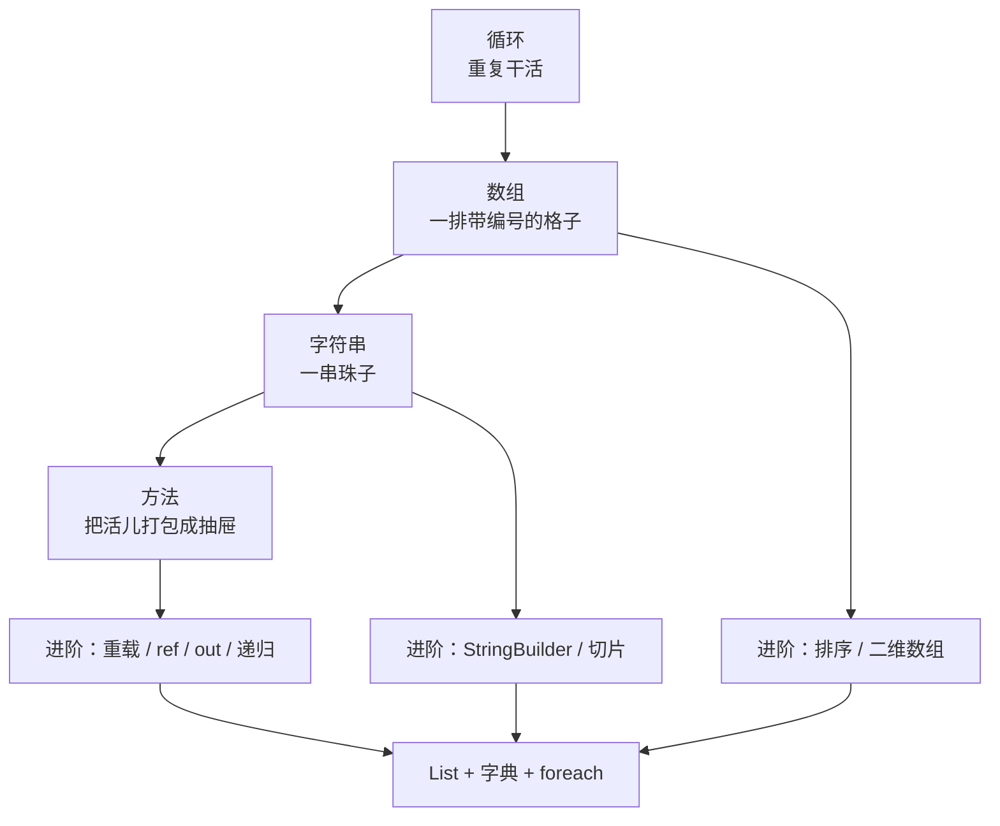
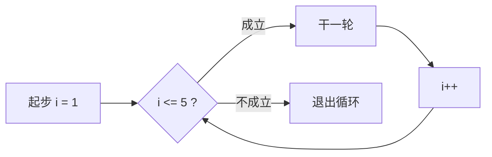

# C# 第 2 周（进阶版）：循环、数组、字符串与方法

---

> [!NOTE]
> 这是**进阶版**：基础篇讲「怎么写」，这一篇多讲一层「**为什么这样写、什么时候不能这么写**」。
> 每节末尾带 `【进阶】` 的小节可以先跳过，等你把基础写顺了再回来啃。
> 全篇代码都能直接跑：复制进 `D:\C#\test1\` 的 `.cs` 文件，`dotnet run` 就行。



## 一、循环：让程序重复干活

### 1.1 `for` 的三段

```c#
for (int i = 1; i <= 5; i++)
{
    Console.WriteLine($"第{i}次");
}
```

| 位置 | 作用 | 例子 |
| --- | --- | --- |
| 第一段 | 起步 | `int i = 1` |
| 第二段 | 干到什么时候为止 | `i <= 5` |
| 第三段 | 每轮怎么变 | `i++` |

执行顺序（照这个顺序在脑子里走一遍，循环就再也不会写错）：



### 1.2 `while` 与死循环

```c#
int n = 1;
while (n <= 5)
{
    Console.WriteLine(n);
    n++;              // ← 忘了这句就是死循环
}
```

> [!CAUTION]
> `while` 卡死几乎只有一个原因：**条件里用到的变量没被改变**。
> 自查一句：「这个循环每轮都在靠近终点吗？」

### 1.3 `break` 与 `continue`

```c#
for (int i = 1; i <= 10; i++)
{
    if (i == 4) continue;   // 这一轮跳过
    if (i == 7) break;      // 整个循环收工
    Console.WriteLine(i);
}
```

```text
1
2
3
5
6
```

- `continue` = 本轮不干了，**还在循环里**
- `break` = 全都别干了，**直接出循环**

> [!TIP]
> 只从一层循环出去：`break` 只会跳出**它所在的那一层**。两层嵌套时，内层 `break` 出来以后，外层照旧继续。

### 1.4 嵌套循环：外层管行，内层管列

```c#
for (int i = 1; i <= 9; i++)      // 行
{
    for (int j = 1; j <= i; j++)  // 列：跟着行号走 → 三角形
    {
        Console.Write($"{j}×{i}={j * i}\t");
    }
    Console.WriteLine();
}
```

> [!WARNING]
> 内层写 `j <= 9` 就变正方形：`1×2` 与 `2×1` 同时出现。
> 那不是 bug，是**乘法的交换律**。三角形的关键只有一处：`j <= i`。

### 1.5【进阶】三种循环怎么选

| 循环 | 什么时候用 | 特点 |
| --- | --- | --- |
| `for` | 知道要转几圈，或需要下标 | 三段写在头部，一目了然 |
| `while` | 只知道"什么时候停" | 条件在变化时更自然 |
| `do…while` | **至少干一次**再判断 | 先干后判，用的少但要知道 |

```c#
int input;
do
{
    Console.Write("输入一个正数：");
    int.TryParse(Console.ReadLine(), out input);
} while (input <= 0);      // 输入不合法就一直问
```

`int.TryParse` 是"温和版"的转换：转成功返回 `true`，失败返回 `false` 并把结果给 `0`，**不会把程序炸掉** —— 这正是第 3 周 `try / catch` 要接手的地方。

## 二、数组：一排带编号的格子

```c#
int[] nums = new int[5];         // 开 5 个空坑
int[] scores = { 90, 85, 77 };   // 开坑就装好
string[] names = new string[3];
```

- `nums.Length`：格子数
- `nums[0]` 第一个，`nums[4]` 第五个 —— **编号从 0 开始**
- 长度一旦定下就改不了（要变长用下一节的 `List`）

```c#
int[] a = { 7, 8, 9 };
for (int i = 0; i < a.Length; i++)   // 注意是 < 不是 <=
{
    Console.WriteLine($"a[{i}] = {a[i]}");
}
```

> [!CAUTION]
> `i <= a.Length` 是经典越界，抛 `IndexOutOfRangeException` —— **运行时才炸**，编辑器不会提前提醒。

### 2.1 字符串也能按下标取珠子

```c#
string word = "CSharp";
Console.WriteLine(word.Length);   // 6
Console.WriteLine(word[2]);       // S
```

数组和字符串取元素是同一套路：**从 0 起，最后一个编号 = 长度 - 1**。

### 2.2【进阶】数组是"引用类型" —— 复印件 vs 钥匙

这是理解方法传参的关键一层：

```c#
static void ChangeNumber(int n)     // 值类型：拿到复印件
{
    n = 100;                        // 涂改复印件
}

static void ChangeArray(int[] arr)  // 引用类型：拿到"钥匙"
{
    arr[0] = 100;                   // 改抽屉里的东西 → 外面看得见
}

int x = 5;
ChangeNumber(x);
Console.WriteLine(x);               // 5 —— 原件没动

int[] nums = { 5, 6, 7 };
ChangeArray(nums);
Console.WriteLine(nums[0]);         // 100 —— 外面也变了
```

> [!IMPORTANT]
> 口诀：**改内容会中，换整把钥匙不中。**
> 方法里写 `arr[0] = 100` 会影响到外面；但写 `arr = new int[] { 0 }`（换掉整把钥匙）外面什么都不会变。

### 2.3【进阶】排序、查找、统计

```c#
int[] nums = { 5, 1, 9, 3, 7 };

Array.Sort(nums);                       // 原地排序：1 3 5 7 9
Array.Reverse(nums);                    // 原地反转：9 7 5 3 1
int idx = Array.IndexOf(nums, 5);       // 找到返回下标，找不到返回 -1

Console.WriteLine(nums.Max());          // 9   ← 来自 LINQ
Console.WriteLine(nums.Sum());          // 25
Console.WriteLine(nums.Average());      // 5
```

> [!WARNING]
> `Array.Sort` 会**改变原数组**，不是还你一个新的。想保住原顺序先复制一份：
> ```c#
> int[] copy = (int[])nums.Clone();
> ```

> [!TIP]
> `Max` / `Sum` / `Average` 是 LINQ 的方法，文件顶部要能看见 `using System.Linq;`（新建控制台项目默认已开启，一般不用管）。

### 2.4【进阶】二维数组与交错数组

```c#
int[,] grid = new int[3, 4];      // 3 行 4 列，像一张表
grid[1, 2] = 5;                   // 第 2 行第 3 列
Console.WriteLine(grid.GetLength(0));   // 3 —— 行数
Console.WriteLine(grid.GetLength(1));   // 4 —— 列数
Console.WriteLine(grid.Length);         // 12 —— 总格子数
```

```c#
int[][] jag = new int[3][];       // 交错数组：每行长度可以不同
jag[0] = new int[] { 1 };
jag[1] = new int[] { 2, 3 };
jag[2] = new int[] { 4, 5, 6 };
```

> [!NOTE]
> `int[,]` 是"矩形表格"，每行一样长；`int[][]` 是"一行行长短不一"。
> 想在控制台画棋盘、表格，用第一种；想按需给每行不同长度，用第二种。

## 三、字符串：一串珠子

### 3.1 字符串是只读的

```c#
string name = "dafeiyu";

name.ToUpper();          // ❌ 白写：还你一个新串，没人接住
name = name.ToUpper();   // ✅ 接住才算改到
```

> [!IMPORTANT]
> 字符串是**不可变**（immutable）的。所有"修改"方法一律返回新串，原串永远不动。
> 这一条到进阶部分（`StringBuilder`）会变得很重要。

### 3.2 插值：`$` 是填空题开关

```c#
int age = 18;
Console.WriteLine($"年龄：{age}");        // 年龄：18
Console.WriteLine($"1 + 2 = {1 + 2}");    // 1 + 2 = 3
Console.WriteLine("年龄：{age}");         // 年龄：{age}  ← 没 $ 就原样打印
```

- `{ }` 里可以放变量、数组元素、属性、算式
- 真要打印花括号：写 `{{` 和 `}}`
- 还可以控制格式：`$"{3.14159:F2}"` → `3.14`（保留两位小数）

其他两种"拼字符串"的老写法（知道就行，新代码优先用 `$`）：

```c#
Console.WriteLine("年龄：" + age);                          // 加号拼
Console.WriteLine(string.Format("年龄：{0}", age));         // 占位符拼
```

### 3.3 比较：`==` 比内容

```c#
"abc" == "abc"    // true
"abc" == "ABC"    // false  大小写不同
```

### 3.4 查找：只回答"有 / 没有"

```c#
"Hello CSharp".Contains("Sharp")     // true
"Hello CSharp".StartsWith("Hello")   // true
"Hello CSharp".EndsWith("sharp")     // false（大小写不同）
string.IsNullOrEmpty("")             // true
```

这些方法返回 `true` / `false`，能直接塞进 `if`。

### 3.5 `Split`：把一句话切成数组

```c#
string line = "张三,18,男";
string[] parts = line.Split(',');

Console.WriteLine($"切出 {parts.Length} 块");                 // 切出 3 块
Console.WriteLine($"{parts[0]} / {parts[1]} / {parts[2]}");   // 张三 / 18 / 男
```

> [!IMPORTANT]
> **分隔符是刀，不是菜。**
> `"11111".Split('1')` 得到的不是 5 个 `"1"`，而是 **6 个空字符串**。
> 规律：**n 个刀口 → n+1 段，两头的空段也算**。
> `"a,b,c,".Split(',')` = 4 段，最后一段是空串。

```c#
"11111".Split('1').Length                                        // 6（全是空串）
"11111".Split('1', StringSplitOptions.RemoveEmptyEntries).Length // 0（空段被丢掉）
```

拼回去：`string.Join("-", parts)` → `张三-18-男`

### 3.6【进阶】切片、查找位置、替换、修剪

```c#
string s = "  Hello CSharp  ";

Console.WriteLine(s.Trim());              // "Hello CSharp"  去掉两端空白
Console.WriteLine(s.IndexOf("CSharp"));   // 8   找不到返回 -1
Console.WriteLine(s.Substring(8, 6));     // "CSharp"  从第 8 位取 6 个
Console.WriteLine(s.Replace("C", "K"));   // 还你一个新串
Console.WriteLine("42".PadLeft(5, '0'));  // "00042"  左边补零
```

> [!WARNING]
> `Substring(start, length)` 里的 `length` 是**取几个**，不是"取到第几位"。
> 长度超出范围同样会抛 `ArgumentOutOfRangeException`。

`char` 与 `string` 不是一回事：

```c#
char c = 'A';        // 单引号 = 一个字符
string t = "A";      // 双引号 = 一串（哪怕只有一个）

foreach (char ch in "abc")   // 逐颗珠子看
{
    Console.WriteLine(ch);
}
```

### 3.7【进阶】拼字符串为什么要用 `StringBuilder`

```c#
// ❌ 慢：每一轮都造一根新绳子，把旧的丢掉
string result = "";
for (int i = 0; i < 10000; i++)
{
    result += i.ToString();
}

// ✅ 快：一根绳子反复接长
var sb = new StringBuilder();
for (int i = 0; i < 10000; i++)
{
    sb.Append(i);
}
string text = sb.ToString();
```

**为什么**：字符串不可变，`+=` 每次都新建一个对象、把旧内容整个搬过去。循环一万次就是搬一万次 —— 数据量一大，慢得非常明显。`StringBuilder` 要 `using System.Text;`。

### 3.8【进阶】忽略大小写的正规比较

```c#
string.Equals("abc", "ABC")                                          // false
string.Equals("abc", "ABC", StringComparison.OrdinalIgnoreCase)      // true
"abc".Equals("ABC", StringComparison.OrdinalIgnoreCase)              // true
```

> [!TIP]
> `ToLower()` 两边都比也能凑合，但它会真的造两个新串；`StringComparison` 是直接比，更快也更规范。

## 四、方法：把一段活儿打包成抽屉

### 4.1 长什么样

```c#
static void SayHello()            // 不要东西，也不还东西
{
    Console.WriteLine("你好啊");
}

static void Greet(string name)    // 要一个名字，不还东西
{
    Console.WriteLine($"你好，{name}");
}

static int Add(int a, int b)      // 要两个数，还一个数
{
    return a + b;
}
```

```c#
SayHello();
Greet("张三");
int sum = Add(3, 5);
Console.WriteLine(sum);           // 8
```

### 4.2 写之前先问三个问题

1. **要给它什么？** → 参数 `(int a, int b)`
2. **它还不还东西？** → 返回类型 `void` 还是 `int` / `bool` / `string`
3. **叫什么名字？** → 动词开头、见名知意

> [!WARNING]
> `void` = 空手回来，里面不能 `return 值;`
> 报错原文：`CS0127 由于"Add"返回 void，return 关键字后面不能跟随对象表达式`
> 修法：把 `void` 换成类型 `static int Add(int a, int b)`。

### 4.3 参数是"复印件"（值类型）

```c#
static void Change(int n)
{
    n = 100;                 // 只涂改了复印件
}

int x = 5;
Change(x);
Console.WriteLine(x);        // 5
```

### 4.4 练手：找最大值（擂主法）

```c#
static int Max(int[] nums)
{
    int max = nums[0];                      // 立擂主
    for (int i = 1; i < nums.Length; i++)   // 逐个挑战
    {
        if (nums[i] > max)                  // 打得过就换人
        {
            max = nums[i];
        }
    }
    return max;                             // 打完报名字
}
```

四步口诀：**立擂主 → 逐个挑战 → 打得过就换人 → 打完报名字**。

### 4.5【进阶】同名不同参数：重载

```c#
static int Add(int a, int b)              { return a + b; }
static int Add(int a, int b, int c)       { return a + b + c; }
static double Add(double a, double b)     { return a + b; }

Console.WriteLine(Add(1, 2));             // 3
Console.WriteLine(Add(1, 2, 3));          // 6
Console.WriteLine(Add(1.5, 2.5));         // 4
```

编译器看**参数个数和类型**决定叫哪个 —— 名字一样但参数不同，叫**重载**（overload）。

> [!WARNING]
> 只改返回类型、参数一模一样，**不算重载**，会报错：`CS0111 类型已定义了一个名为"Xxx"且具有相同参数类型的成员`。

### 4.6【进阶】可选参数与 `params`

```c#
static void Greet(string name, string prefix = "你好")   // 可选参数放最后
{
    Console.WriteLine($"{prefix}，{name}");
}

Greet("张三");            // 你好，张三
Greet("张三", "晚上好");   // 晚上好，张三
```

```c#
static int SumAll(params int[] nums)   // 想传几个传几个
{
    int total = 0;
    foreach (int n in nums) total += n;
    return total;
}

Console.WriteLine(SumAll(1, 2, 3));    // 6
Console.WriteLine(SumAll(1, 2, 3, 4)); // 10
```

### 4.7【进阶】`ref` 与 `out`：真的要改原件

```c#
static void AddOne(ref int n)
{
    n = n + 1;             // 这次改的是原件
}

int x = 5;
AddOne(ref x);
Console.WriteLine(x);      // 6
```

```c#
static bool TryHalf(int n, out int result)
{
    result = n / 2;        // out 参数必须在方法里赋值
    return true;
}

TryHalf(10, out int half);
Console.WriteLine(half);   // 5
```

> [!NOTE]
> `ref` = 把原件借出去（进方法前必须有值）；`out` = 专门用来往外送结果（进方法前可以没值，但方法里必须给它赋值）。
> 日常写代码优先用 `return`；`ref` / `out` 是"要返回多个值"时的补丁。

### 4.8【进阶】递归：方法自己叫自己

```c#
static int Factorial(int n)
{
    if (n <= 1) return 1;          // ① 出口：必须有
    return n * Factorial(n - 1);   // ② 把事情变小一号，再叫自己
}

Console.WriteLine(Factorial(5));   // 120 = 5×4×3×2×1
```

递归只要抓住两件事：**出口** + **每层把问题缩小**。

> [!CAUTION]
> 没有出口，或者永远不会碰到出口，就会一层层堆积，最后抛 `StackOverflowException` —— 这个错误**连 try/catch 都救不了**，程序直接死。

## 五、坑点专区

### 坑 1：`<= Length` → 越界

```c#
int[] a = { 1, 2, 3 };
for (int i = 0; i <= a.Length; i++)   // 最后一轮 i = 3
    Console.WriteLine(a[i]);          // 💥 IndexOutOfRangeException
```

**根因**：长度 3 的数组，合法编号只有 0、1、2。
**一句话记住**：**长度 3 的数组，最大编号是 2。**

### 坑 2：以为 `Split` 会留下分隔符

**现象**：`"11111".Split('1')` 想着得到 5 个 "1"，实际是 6 个空串。
**根因**：把"刀"当成了"菜"。
**一句话记住**：**n 个刀口 → n+1 段，分隔符不留。**

### 坑 3：字符串方法"白调用"

```c#
string s = "abc";
s.ToUpper();
Console.WriteLine(s);   // 还是 abc
```

**根因**：字符串不可变，方法返回新串。
**一句话记住**：**没接住 = 没改。**

### 坑 4：忘了写 `$`

```c#
Console.WriteLine("年龄：{age}");    // 年龄：{age}
```

**一句话记住**：**`$` 是填空题开关。**

### 坑 5：`void` 里 `return` 一个值

**报错原文**：`CS0127 由于"Add"返回 void，return 关键字后面不能跟随对象表达式`
**一句话记住**：**要么空手回，要么说清还什么。**

### 坑 6：数组名写错（`num` / `nums[]`）

```c#
int[] nums = { 3, 5, 1 };
int max = num[0];                        // 💥 CS0103 名称"num"不存在
for (int i = 0; i < num[].Length; i++)   // 💥 语法错
```

**一句话记住**：**取元素才用 `[]`，问长度不写 `[]`。**

### 坑 7【进阶】：`Array.Sort` 把原数组改了

```c#
int[] nums = { 5, 1, 9 };
int[] copy = (int[])nums.Clone();   // 先备份
Array.Sort(copy);                   // 排备份，原数组保持 5 1 9
```

**一句话记住**：**排序是原地改，想保原样先复制。**

### 坑 8【进阶】：循环里用 `+=` 拼字符串

**根因**：字符串不可变，每轮都在造新对象。
**正确做法**：`StringBuilder`。
**一句话记住**：**循环拼串用 StringBuilder。**

### 坑 9【进阶】：`out` 参数忘了赋值

```c#
static bool TryHalf(int n, out int result)
{
    return true;      // 💥 CS0177 控件离开方法之前必须赋值
}
```

**一句话记住**：**`out` 出门前必须装满。**

## 六、第 2 周复盘（六段模板）

### 卡点 1：乘法表里出现了"重复"

- **我卡在哪**：内层写成 `j <= 9`，表变正方形，`1×2` 和 `2×1` 一起出现，看着像重复。
- **根因**：把"完整乘法表"和"九九乘法表三角形"搞混；重复来自**乘法的交换律**。
- **怎么定位的**：内层改回 `j <= i`，输出立刻变回直角三角形。
- **正确做法**：外层管行 `i`，内层管列 `j` 且 `j <= i`。
- **验收判据**：第 1 行 1 个式子、第 9 行 9 个，整体是直角三角形。
- **一句话记住**：内层跟着外层走，才是三角。

### 卡点 2：`Split` 的空段

- **我卡在哪**：以为 `"11111".Split('1')` 能切出 5 个"1"。
- **根因**：把分隔符当成了要保留的内容。
- **怎么定位的**：跑一遍打印 `p.Length`，得到 6，每一段都是空串。
- **正确做法**：`n 刀 → n+1 段`；不要空段加 `StringSplitOptions.RemoveEmptyEntries`。
- **验收判据**：能说清 `"a,b,c,".Split(',')` 是 4 段、末段为空。
- **一句话记住**：分隔符是刀，不是菜。

### 卡点 3：数组越界

- **我卡在哪**：`words[4]` 想当然地取第 4 个。
- **根因**：编号从 0 开始，长度 4 的数组最大编号是 3。
- **怎么定位的**：数一遍编号 0、1、2、3，共 4 个。
- **正确做法**：最后一个用 `words[words.Length - 1]`。
- **验收判据**：看到 `IndexOutOfRangeException` 能立刻想到"下标超了"。
- **一句话记住**：长度 4 的数组，最大编号 3。

### 卡点 4：不认识 `$`

- **我卡在哪**：照抄 `$"切出 {parts.Length} 块"`，不知道 `$` 干嘛的。
- **根因**：没人讲过它是"开关"。
- **怎么定位的**：去掉 `$` 跑一遍，输出变成 `切出 {parts.Length} 块`。
- **正确做法**：`$` 开头，`{ }` 里放要算的东西。
- **验收判据**：能独立写出 `$"共 {parts.Length} 色"` 并预测输出。
- **一句话记住**：`$` 是填空题开关。

### 卡点 5：以为改参数能改到外面

- **我卡在哪**：觉得 `Change(x)` 里 `n = 100`，外面 `x` 会变 100。
- **根因**：参数是值的**副本**（值类型）。
- **怎么定位的**：跑一遍，输出还是 `5`。
- **正确做法**：要拿结果就 `return` 接住；确实要改原件才用 `ref`。
- **验收判据**：值传递的题都能答出原件不变；数组传进去改元素会变。
- **一句话记住**：复印件涂改，不动原件。

### 卡点 6：`void` 里写 `return 值`

- **我卡在哪**：`static void Add(...)` 里写了 `return a + b;`
- **根因**：`void` 表示不返回值。
- **怎么定位的**：编译器直接报 `CS0127`。
- **正确做法**：写清返回类型 `static int Add(int a, int b)`。
- **验收判据**：一眼能从方法头部看出"要不要给它、它还什么"。
- **一句话记住**：要么空手回，要么说清还什么。

## 七、练习题

### 基础档（必须会）

**1.** 下面输出什么？
```c#
for (int i = 1; i <= 3; i++) Console.Write(i);
```
**答**：`123`（`Write` 不换行）。

**2.** 下面的循环打几行？
```c#
int n = 3;
while (n > 0) { Console.WriteLine("哈"); n--; }
```
**答**：3 行。

**3.** 输出什么？
```c#
for (int i = 1; i <= 6; i++)
{
    if (i % 2 == 0) continue;
    Console.WriteLine(i);
}
```
**答**：`1 3 5`。

**4.** `int[] a = { 7, 8, 9 };` 那 `a.Length` 是几？`a[3]` 会怎样？
**答**：`3`；`a[3]` 越界抛 `IndexOutOfRangeException`。

**5.** `"CSharp".Length` 和 `"CSharp"[2]` 分别是什么？
**答**：`6` 和 `'S'`。

**6.** `"abc" == "ABC"` 是什么？为什么？
**答**：`false`，`==` 比内容且区分大小写。

**7.** `"张,李,王".Split(',').Length` 是几？
**答**：3（两刀三段）。

**8.** `"a,b,".Split(',')` 几段？最后一段是什么？
**答**：3 段，最后一段是**空串**。

**9.** `Console.WriteLine($"1+2={1 + 2}");` 输出什么？
**答**：`1+2=3`。

**10.** 写一个 `IsEven` 判断偶数。
**答**：
```c#
static bool IsEven(int n) => n % 2 == 0;
```
（`=>` 是"表达式方法体"，等价于 `{ return n % 2 == 0; }`。注意别把 `false` 拼成 `flase`。）

**11.** 下面打印几？为什么？
```c#
static void Change(int n) { n = 100; }
int x = 5; Change(x); Console.WriteLine(x);
```
**答**：`5`，参数是复印件。

**12.** `static void Add(int a, int b) { return a + b; }` 能编译吗？
**答**：不能，`CS0127`。把 `void` 改成 `int`。

### 进阶档（会更好）

**13.** `"11111".Split('1').Length` 是几？
**答**：`6`——五个刀口、六段，全是空串。

**14.** `"11111".Split('1', StringSplitOptions.RemoveEmptyEntries).Length` 是几？
**答**：`0`——空段全被丢掉，什么都没剩。

**15.** 下面 `nums[0]` 打印几？
```c#
static void Fill(int[] arr) { arr[0] = 99; }
int[] nums = { 1, 2, 3 };
Fill(nums);
Console.WriteLine(nums[0]);
```
**答**：`99`。数组是引用类型，方法里改元素会影响到外面。

**16.** 那下面呢？
```c#
static void Reassign(int[] arr) { arr = new int[] { 0 }; }
int[] nums = { 1, 2, 3 };
Reassign(nums);
Console.WriteLine(nums[0]);
```
**答**：`1`。方法里只是把"钥匙"换成了另一把，外面的 `nums` 还是指向原来那排格子。

**17.** 写一个方法，返回数组里的最小值。
**答**：
```c#
static int Min(int[] nums)
{
    int min = nums[0];
    for (int i = 1; i < nums.Length; i++)
        if (nums[i] < min) min = nums[i];
    return min;
}
```

**18.** 判断：`static int Add(int a, int b)` 和 `static double Add(int a, int b)` 构成重载吗？
**答**：不构成。参数列表一模一样、只有返回类型不同，会报 `CS0111`。

**19.** `static int SumAll(params int[] nums)`，那 `SumAll(1, 2, 3)` 合法吗？
**答**：合法，`params` 就是为"想传几个传几个"准备的；也可以直接传一个数组 `SumAll(new int[] { 1, 2, 3 })`。

**20.** `Factorial(4)` 返回几？递归的出口是什么？
**答**：返回 `24`；出口是 `if (n <= 1) return 1;`。

### 挑战档（做到就是真懂了）

**21.** 一个方法，把数组**从大到小**排序（不许用 `Array.Sort` 之后 `Reverse` 这种取巧，要自己写双重循环）。
**答**：
```c#
static void SortDesc(int[] nums)
{
    for (int i = 0; i < nums.Length - 1; i++)
    {
        for (int j = i + 1; j < nums.Length; j++)
        {
            if (nums[j] > nums[i])       // 大的往前换
            {
                int tmp = nums[i];
                nums[i] = nums[j];
                nums[j] = tmp;
            }
        }
    }
}
```

**22.** `Array.Sort(nums)` 之后 `nums` 会变吗？想保住原顺序怎么办？
**答**：会变，它是原地排序。先 `int[] copy = (int[])nums.Clone();` 再排副本。

**23.** 循环里 `result += i.ToString()` 一万次为什么慢？换什么？
**答**：字符串不可变，每轮都新建并搬运旧内容；换 `StringBuilder` 的 `Append`。

**24.** 写一个方法，把 `"张三,18,男"` 一行解析出来并打印，输入不合法（不是 3 段）时提示"格式错误"。
**答**：
```c#
static void ParseLine(string line)
{
    string[] parts = line.Split(',');
    if (parts.Length != 3)
    {
        Console.WriteLine("格式错误");
        return;                      // 提前收工
    }
    Console.WriteLine($"姓名：{parts[0]}，年龄：{parts[1]}，性别：{parts[2]}");
}
```

## 八、检查标准与下一节预告

### 检查标准

- [ ] 能一边写 `for` 一边说出三段在干什么
- [ ] 看到 `<= .Length` 立刻警觉
- [ ] 能解释 `Split` 段数为什么是"刀口 + 1"
- [ ] 知道字符串方法要"接住"
- [ ] 能从方法头部判断"给什么、还什么"
- [ ] 能区分"复印件"和"钥匙"（值类型 / 引用类型）
- [ ] 能默写擂主法 `Max`
- [ ] 独立完成 **100 行左右**的"成绩统计"小程序

### 第 2 周最终验收题

> [!IMPORTANT]
> **成绩统计**：输入一行逗号分隔的分数（例 `90,85,77,60,45`），输出总分、平均分、最高分、最低分、及格人数。
> 硬要求：`Split` 切数据；循环算总和；拆成 `Sum` / `Average` / `Max` / `Min` / `CountPass` 五个方法，每个不超过 10 行；不看教程。

### 下一节预告

**List / 字典 + `foreach`** —— 数组长度定死这个短板，`List` 来补；`foreach` 让你不再数下标；字典是"按名字取东西的柜子"。三样学完就能碰**文件读写**，让程序真的记住东西。
