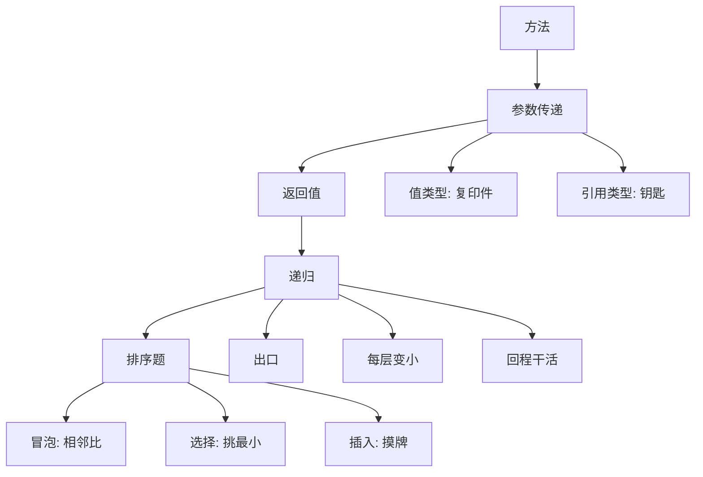
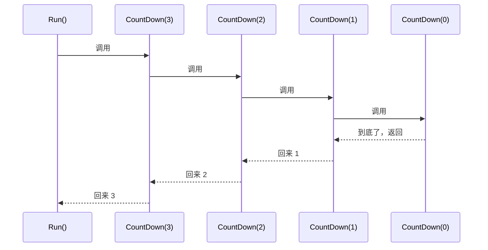

# C# 第 3 周：方法、参数传递、返回值、递归、三种排序

---

这周的主线特别干脆：先学会**把代码切块**（方法），再搞清**块与块之间怎么递东西**（参数传递），然后认识一个"自己叫自己"的怪东西（递归），最后拿它去解决一个正经问题——**给一堆数字排队**（三种排序）。

排序题看着像练习，其实是把方法、循环、数组、交换、边界判断全串起来的一次总攻。所以这周的博客分两大块：**方法篇**和**排序篇**。

> [!NOTE]
> 每节标了【进阶】的部分可以第一遍跳过，不影响后面。想一次吃透就顺着读。

## 0. 这周的学习地图



一句话概括这周：**方法是"给一段活起个名字"，递归是"让这个名字自己叫自己"，排序是"用它们把乱的东西排整齐"。**

## 1. 方法：给一段活起个名字

### 1.1 方法的形状

```csharp
public static int Add(int a, int b)   // 返回类型 方法名(参数列表)
{
    return a + b;                     // 干活 + 交结果
}
```

拆开看四块：

| 部位 | 叫法 | 人话 |
|---|---|---|
| `public` | 访问修饰符 | 谁能用（`public` 都能用，`private` 只有自己类里能用） |
| `static` | 静态修饰 | 挂在"图纸"上，不用 `new` 对象就能叫 |
| `int` | 返回类型 | 干完活交回什么类型；不交东西写 `void` |
| `(int a, int b)` | 参数列表 | 进门要带什么（可空） |

**为什么要有方法**：同样三行代码写第二遍就该起名了。起名之后，改逻辑只改一处，调用处一行读得懂，还能复用到别的文件。

### 1.2 返回值 vs `void`

- 有返回值的：**能被接住**、能参与计算 —— `int s = Add(3, 4);`
- `void` 的：干完就走，**不交东西** —— `Console.WriteLine()`、`PrintStars(5)`
- `void` 里也能"提前下班"：`return;`（注意后面没值），这就是递归出口的写法。

> [!WARNING]
> `void` 方法里写 `return 1;` 会报 **CS0127**：返回值为 void 的方法不能返回值。反过来，非 `void` 方法所有分支都必须有 `return`，否则 **CS0161**。

### 1.3 【进阶】方法的三种"变形"

**① 表达式体方法**（一行能干完就别写大括号）

```csharp
static int Double(int n) => n * 2;
static bool IsEven(int n) => n % 2 == 0;
```

**② 局部函数**（方法里再定义方法，只给这个方法用）

```csharp
static void Run()
{
    int Square(int x) => x * x;   // 只活在 Run 里面
    Console.WriteLine(Square(5));
}
```

**③ 方法重载**（同名不同参数，编译器按"带了几个、什么类型"自动挑）

```csharp
static int Area(int side) => side * side;                     // 正方形
static int Area(int w, int h) => w * h;                       // 长方形
static double Area(double r) => 3.14159 * r * r;              // 圆
```

> [!CAUTION]
> 重载看的是**参数列表**，不看返回类型。`int F(int a)` 和 `double F(int a)` 同时存在 → **CS0111**：类型已定义了一个具有相同参数类型的成员。

## 2. 参数传递：复印件 vs 钥匙

这节是整个第 3 周最容易翻车的地方，也是 Unity 里 C# 高频踩坑点。

### 2.1 值类型：递进去的是"复印件"

```csharp
static void AddOne(int n)
{
    n = n + 1;            // 改的是复印件
}

int a = 5;
AddOne(a);
Console.WriteLine(a);     // 还是 5
```

`int`、`double`、`bool`、`char`、`struct` 都是值类型。传参 = 复印一份递进去，方法里怎么改原件都不知道。

### 2.2 引用类型：递进去的是"钥匙"

```csharp
static void AddOne2(int[] nums)
{
    nums[0] = nums[0] + 1;   // 拿钥匙进门，改的是真房间
}

int[] arr = { 5, 2 };
AddOne2(arr);
Console.WriteLine(arr[0]);    // 6
```

**关键区别不在"能不能改"，而在"改了谁看得见"**：

| | 值类型 `int` | 引用类型 `int[]` |
|---|---|---|
| 递进去的是 | 复印件 | 钥匙（地址） |
| 方法里改 | 改复印件，外面不变 | 改房间里的东西，外面看得见 |
| 但整把钥匙换掉呢 | — | `nums = new int[]{9,9}` 只换掉方法里那份钥匙，外面数组不变 |

> [!IMPORTANT]
> `nums = new int[] { 9, 9 }` 在方法里**不会**影响外面的数组。因为它换的是"钥匙"本身，不是房间。真正想换掉外面的数组，得用 `ref int[] nums`。

### 2.3 【进阶】`ref` / `out` / `in` / `params`

```csharp
// ref：把真身递进去（能读能写）
static void Swap(ref int x, ref int y)
{
    int t = x; x = y; y = t;
}
int p = 1, q = 2;
Swap(ref p, ref q);            // p=2, q=1

// out：进门时不用初始化，出门前必须赋值（多返回值神器）
static bool TryHalf(int n, out int half)
{
    if (n % 2 != 0) { half = 0; return false; }
    half = n / 2; return true;
}
if (TryHalf(8, out int h)) Console.WriteLine(h);   // 4

// in：只读引用，大结构体传参省内存又不许改
static double DistIn(in int[] a) => a[0];

// params：一个参数吃下任意个数
static int Sum(params int[] xs)
{
    int s = 0;
    foreach (int x in xs) s += x;
    return s;
}
Sum(1, 2, 3, 4);              // 10
```

`int.TryParse` 就是 `out` 的标准范例 —— 您第 2 周已经用过很多次了，只是当时不知道它叫 `out`。

## 3. 递归：自己叫自己

### 3.1 三句话记住递归

1. **出口在哪？** —— 到这一层就别再往下叫了
2. **每层有没有变小？** —— 变小才够得到出口
3. **回来的路上谁在干活？** —— 每层的返回值怎么拼

```csharp
static int Factorial(int n)
{
    if (n <= 1) return 1;              // ① 出口
    return n * Factorial(n - 1);       // ② 变小（n-1）③ 回程乘 n
}
```

`Factorial(4)` 的真实展开：

```
4 * Factorial(3)
4 * 3 * Factorial(2)
4 * 3 * 2 * Factorial(1)
4 * 3 * 2 * 1            ← 撞到出口，开始回程
= 24
```

> [!CAUTION]
> 把 `n - 1` 写成 `n` 或 `n + 1` → 永远够不到出口 → 一直压栈 → **StackOverflowException**（栈溢出）。C# 不会救你，直接让进程崩，try/catch 都接不住。

### 3.2 看见"去"和"回"：V 字形

```csharp
static void CountDown(int n)
{
    if (n == 0) { Console.WriteLine("到底了"); return; }

    Console.WriteLine($"下去 {n}");   // 去程：一路下到底
    CountDown(n - 1);
    Console.WriteLine($"回来 {n}");   // 回程：撞到底后一层层退
}
```

`CountDown(3)` 的真实输出：

```text
下去 3
下去 2
下去 1
到底了
回来 1
回来 2
回来 3
```



**这张图就是递归的全部**：一路往里走（去程），撞到出口，再一路往外退（回程）。所有 `Console.WriteLine` 都发生在"退"的时候你才会看到反序。

### 3.3 递归动手题：`SumTo`

```csharp
static int SumTo(int n)
{
    if (n == 0) return 0;          // 出口：前面没人了
    return n + SumTo(n - 1);       // 我自己 + 前面那串
}
```

`SumTo(5)` = 15，跟循环版对得上。

### 3.4 【进阶】递归的代价与替代方案

- **每次调用都占栈**：一层一个栈帧，几千层就顶不住了。C# 默认线程栈 1MB 左右。
- **能写循环就别上递归**：`SumTo`、`Factorial` 循环版更快更省。
- **递归的地盘**：树、目录、图、分治（归并/快排）、回溯（走迷宫、八皇后）。
- **尾递归**：C# **没有**尾调用优化，写成尾递归也不会省栈，别指望。
- **记忆化**：斐波那契朴素递归是 $O(2^n)$，加个数组存算过的结果就降到 $O(n)$。

```csharp
static long Fib(int n, long[] memo)
{
    if (n <= 1) return n;
    if (memo[n] != 0) return memo[n];       // 算过就用
    memo[n] = Fib(n - 1, memo) + Fib(n - 2, memo);
    return memo[n];
}
```

## 4. 三种排序

统一用这组数据：`{ 5, 2, 9, 1, 5, 6 }`。三种都只解决"从小到大排"，改个比较符号就能倒序。

### 4.1 冒泡排序：相邻两人比个子

**人话**：从队头开始，相邻两人比，谁高谁往右挪；一轮走完，最高的那个必然被挤到最右边。像气泡冒到水面。

```csharp
static void BubbleSort(int[] nums)
{
    for (int round = 0; round < nums.Length - 1; round++)       // 最多 n-1 轮
    {
        bool swapped = false;                                   // 本轮换过没有

        for (int i = 0; i < nums.Length - 1 - round; i++)       // 尾巴上已定好的不再比
        {
            if (nums[i] > nums[i + 1])
            {
                int temp = nums[i];                             // 临时中转箱
                nums[i] = nums[i + 1];
                nums[i + 1] = temp;
                swapped = true;
            }
        }

        Console.WriteLine($"第{round + 1}轮后:" + string.Join(" ", nums));
        if (!swapped) break;                                    // 一轮没换 → 已排好，收工
    }
}
```

真实输出（注意第 4 轮之后没再跑）：

```text
排序前:5 2 9 1 5 6
第1轮后:2 5 1 5 6 9
第2轮后:2 1 5 5 6 9
第3轮后:1 2 5 5 6 9
第4轮后:1 2 5 5 6 9
排序后:1 2 5 5 6 9
```

**两个 `- round` 是干嘛的**：`nums.Length - 1` 里的 `-1` 是因为要跟"右边那一个"比，最后一位没有右边；`- round` 是因为每轮都在尾巴上定下一个人。

> [!TIP]
> `swapped` 开关让最好情况（本来就排好）从 $O(n^2)$ 降到 $O(n)$。数据基本有序时冒泡其实很快，这也是它唯一的亮点。

### 4.2 选择排序：每轮挑出最小的放前面

**人话**：老师每轮扫一眼剩下的人，**只在便签上记"最矮的站在第几号位"**，扫完把这位跟队首换位置。一轮定一个人，放前面。

**便签（`minIndex`）只记位置，不记身高** —— 这是跟"打擂台记最大值"最大的区别。

```csharp
static void SelectionSort(int[] nums)
{
    for (int round = 0; round < nums.Length - 1; round++)
    {
        int minIndex = round;                          // 便签：先假定队首最矮

        for (int i = round + 1; i < nums.Length; i++)   // 扫到队尾（不是 n-1-round！）
        {
            if (nums[i] < nums[minIndex]) minIndex = i; // 发现更矮的，只记位置
        }

        Console.WriteLine($"第{round + 1}轮：找到最小的 {nums[minIndex]}，在 {minIndex} 位");

        int temp = nums[round];                         // 真·交换（三行）
        nums[round] = nums[minIndex];
        nums[minIndex] = temp;

        Console.WriteLine("　　现在：" + string.Join(" ", nums));
    }
}
```

真实输出：

```text
排序前:5 2 9 1 5 6
第1轮：找到最小的 1，在 3 位
　　现在：1 2 9 5 5 6
第2轮：找到最小的 2，在 1 位
　　现在：1 2 9 5 5 6
第3轮：找到最小的 5，在 3 位
　　现在：1 2 5 9 5 6
第4轮：找到最小的 5，在 4 位
　　现在：1 2 5 5 9 6
第5轮：找到最小的 6，在 5 位
　　现在：1 2 5 5 6 9
排序后:1 2 5 5 6 9
```

> [!WARNING]
> 选择排序一轮**最多只交换一次**（先扫完再换），所以它比冒泡的交换次数少很多。但它的内层永远是 `nums.Length`，**没有"每轮少比一个"这回事** —— 因为定好的是队头，尾巴上还没定。

### 4.3 插入排序：摸牌理牌

**人话**：左手捏着一把排好的牌，右手摸一张新的，从右往左比，比它大的都往右让一格，腾出空位就插进去。

**唯一的硬坑**：新牌必须**先存进 `key`**，否则挪位会把它原来那个格子覆盖掉。

```csharp
static void InsertionSort(int[] nums)
{
    for (int i = 1; i < nums.Length; i++)          // 第 0 位算已在手上
    {
        int key = nums[i];                         // 先存起来（关键！）
        int j = i - 1;

        while (j >= 0 && nums[j] > key)            // 手上的牌更大 → 往右挪一格
        {
            nums[j + 1] = nums[j];                 // 挪位，不是交换 → 不需要 temp
            j--;
        }

        nums[j + 1] = key;                         // 空位就是新牌的家
        Console.WriteLine($"摸了 {key}，第{i}轮后：" + string.Join(" ", nums));
    }
}
```

真实输出：

```text
排序前:5 2 9 1 5 6
摸了 2，第1轮后：2 5 9 1 5 6
摸了 9，第2轮后：2 5 9 1 5 6
摸了 1，第3轮后：1 2 5 9 5 6
摸了 5，第4轮后：1 2 5 5 9 6
摸了 6，第5轮后：1 2 5 5 6 9
排序后:1 2 5 5 6 9
```

第 4 轮值得盯一眼：`nums[j] > key` 里 `5 > 5` 是 **false**，所以**相等的不挪** —— 这就是"稳定"的实现方式，相等的元素不会互相跨过去。

### 4.4 三种排序横向对比

| | 怎么做 | 每轮动作 | 要不要 `temp` | 每轮交换次数 | 稳定 | 最好情况 |
|---|---|---|---|---|---|---|
| **冒泡** | 相邻两人比高低 | 把最大的"推"到队尾 | 要 | 可能很多次 | 稳定 | $O(n)$（有 `swapped` 开关） |
| **选择** | 挑最小的放队首 | 扫一遍，最后换一次 | 要 | 最多 1 次 | **不稳定** | $O(n^2)$ |
| **插入** | 摸牌往左插 | 往后挪位腾空位 | 不要 | 挪位次数≈逆序对 | 稳定 | $O(n)$（本来就排好） |

> [!IMPORTANT]
> "稳定"= 两个相等元素**原来的先后顺序不变**。选择排序不稳定，因为它是"远处大跨度换位"：`[5a, 5b, 2]` 第一轮把 `2` 换到 0 位，两个 `5` 的相对顺序就反了。冒泡只跟邻居换，插入只挪位，都不会打乱。

### 4.5 【进阶】复杂度、`Array.Sort` 和更快的排序

**时间复杂度**（数据量翻倍时慢多少）：

| 算法 | 平均 | 最坏 | 空间 |
|---|---|---|---|
| 冒泡 | $O(n^2)$ | $O(n^2)$ | $O(1)$ |
| 选择 | $O(n^2)$ | $O(n^2)$ | $O(1)$ |
| 插入 | $O(n^2)$ | $O(n^2)$ | $O(1)$ |
| 归并 | $O(n\log n)$ | $O(n\log n)$ | $O(n)$ |
| 快排 | $O(n\log n)$ | $O(n^2)$ | $O(\log n)$ 栈 |
| 堆排 | $O(n\log n)$ | $O(n\log n)$ | $O(1)$ |

$n=10000$ 时，$n^2$ 是 1 亿次操作，$n\log n$ 是 13 万次 —— 差三个数量级，用户能直接感觉到卡与不卡。

**C# 自带的 `Array.Sort`** 内部是 **IntroSort**（内省排序）= 快速排序 + 堆排序 + 插入排序三合一：小数组直接插入排序（常数小、缓存友好）；递归深了换堆排序防退化；整体保证 $O(n\log n)$ 最坏。**生产代码一律用它**，手写排序是教学用的。

```csharp
int[] a = { 5, 2, 9, 1, 5, 6 };
Array.Sort(a);                          // 升序
Array.Reverse(a);                       // 换成降序（先升再翻）
Array.Sort(a, (x, y) => y.CompareTo(x)); // 一步到位降序（比较器）
```

**二分查找**是排序的最大受益人：排好序之后查一个数从 $O(n)$ 降到 $O(\log n)$。

```csharp
static int BinarySearch(int[] nums, int target)
{
    int lo = 0, hi = nums.Length - 1;
    while (lo <= hi)
    {
        int mid = lo + (hi - lo) / 2;      // 不用 (lo+hi)/2，防溢出
        if (nums[mid] == target) return mid;
        if (nums[mid] < target) lo = mid + 1;
        else hi = mid - 1;
    }
    return -1;
}
```

> [!NOTE]
> `mid = (lo + hi) / 2` 在 `lo`、`hi` 都很大时会整数溢出（虽然 C# 里数组长度够不到那个量级，但这是通用写法习惯）。`lo + (hi - lo) / 2` 永远安全。

## 5. 坑点专区（这周真踩过的）

### 坑 1：`int` 和 `int[]` 比大小 → CS0019

```csharp
foreach (int n in nums)
{
    ...
    if (n == nums) break;   // ❌ 运算符"=="无法应用于"int"和"int[]"类型的操作数
}
```

`n` 是单个数字，`nums` 是整个数组，类型对不上，编译器直接拦。**要比较的是"这一轮有没有换过"，那就该用 `bool` 开关。**

### 坑 2：多套一层 `foreach`，白算 n 倍

冒泡只需要**内外两个 `for`**。外面再套一层 `foreach`，等于每轮把内层整段跑 n 遍：逻辑没坏但白算、打印刷屏、还容易让人看不懂输出。

> [!TIP]
> 排错小习惯：打印出来的行数如果比"轮数"多好几倍，先怀疑循环层数。

### 坑 3：把"循环变量"当"要交换的值"

```csharp
// ❌ 选择排序里写成了这样
int temp = minIndex;
minIndex = i;
i = temp;            // 改的是循环计数器！
```

`i` 是 `for` 的计数器，改它等于强行改循环进度 → 跳元素、漏扫、甚至死循环。**打擂台更新便签只需要一句 `minIndex = i;`。**

### 坑 4：覆盖 ≠ 交换

```csharp
nums[round] = nums[minIndex];   // ❌ 只把最小值抄过去，round 位原值被冲掉
```

三行才算交换：

```csharp
int temp = nums[round];
nums[round] = nums[minIndex];
nums[minIndex] = temp;
```

> [!WARNING]
> 同理，插入排序里如果没有 `int key = nums[i];` 就先挪位，新的那张牌会被后面的值永久覆盖 —— 排序结果直接错。

### 坑 5：内层条件"抄隔壁算法"

- 冒泡：`i < nums.Length - 1 - round`（每轮尾巴少一个）
- 选择：`i < nums.Length`（队头定好，尾巴每轮都得扫）
- 插入：看 `j >= 0 && nums[j] > key`（往左比，越界就停）

三种排序的内层条件**不一样**，抄错了不会编译报错，只会结果不对 —— 这是最耗时间的一类 bug。

### 坑 6：打印时机放错了

```csharp
nums[round] = nums[minIndex];
Console.WriteLine($"最小值是 {nums[minIndex]}");   // ❌ 这里已经不是最小值了
```

要么在**交换前**打印，要么交换后打印 `nums[round]`。日志撒在错误的位置，会把你自己带进沟里。

### 坑 7：改完没保存，然后怀疑代码

编辑器里改得再漂亮，**磁盘上没保存就等于没改**。判断方法：重跑一次，报错还是老样子就去看文件修改时间。

> [!TIP]
> Zed 里没保存的标签页标题有个小圆点 `●`，`ctrl-s` 保存。想省事可以在设置里开 `autosave`。

### 坑 8：测试数据已经被前面的代码排好了

`Run()` 里先调了冒泡（把数组排好），再调选择排序 —— 选择排序拿到的是**有序数组**，每轮都找不到更小的，`minIndex` 永远等于 `round`，那记"覆盖"bug 完美藏住。

**教训：测每个算法时，先让数组保持乱序。**（测试数据要能区分对错，否则测了等于没测。）

### 坑 9：递归忘了"变小"

```csharp
return n * Factorial(n);   // ❌ 永远到不了出口
```

直接 `StackOverflowException`，进程崩，`try/catch` 接不住。写递归时手先摸一下：这一行的参数比上一行**小**了吗？

## 6. 六段复盘

> 这是这周真正花时间的地方。三个真实卡点，按"我卡在哪 → 根因 → 定位过程 → 正确做法 → 验收判据 → 一句话记住"写。

### 复盘一：冒泡排序里多出来的那层 `foreach`

**① 我卡在哪**
代码"看起来"能排序，但输出一堆重复行，而且加了"提前收工"之后编译直接失败（CS0019）。

**② 根因**
两件事叠在一起：多套了一层 `foreach (int n in nums)`，把内层循环整段重复跑了 n 遍；以及想"提前收工"却写成 `if (n == nums) break;` —— 拿单个 `int` 跟整个 `int[]` 比，类型根本不匹配。

**③ 定位过程**
看编译报错原文 `运算符"=="无法应用于"int"和"int[]"类型的操作数` → 定位到第 27 行类型错；再看输出行数比轮数多好几倍 → 定位到 `foreach` 那层多余。

**④ 正确做法**
删掉 `foreach`，只留内外两个 `for`；用 `bool swapped` 做开关，交换成功置 `true`，每轮末尾 `if (!swapped) break;`。

**⑤ 验收判据**
`{5,2,9,1,5,6}` 应在"第 4 轮后"就停，输出 6 行（排序前 + 4 轮 + 排序后），最终 `1 2 5 5 6 9`。

**⑥ 一句话记住**
**提前收工判断的是"这一轮有没有换过"，不是"哪个元素等于数组"。**

### 复盘二：选择排序的"便签"被写成了交换

**① 我卡在哪**
选择排序能跑出 `1 2 5 5 6 9`，看起来全对；但每轮打印"找到的最小值下标"全是 0、1、2、3、4，看着太整齐，不对劲。

**② 根因**
三处错：内层条件抄了冒泡的 `nums.Length - 1 - round`（选择排序要扫到队尾）；更新便签时写成 `int temp = minIndex; minIndex = i; i = temp;`（把循环变量 `i` 也改了）；交换写成 `nums[round] = nums[minIndex];`（覆盖而非交换）。

**③ 定位过程**
先看判据 —— "第一轮最小值应该是 `1`、下标 `3`"，而实际输出下标是 `0` → 说明便签压根没更新过。顺着"便签为什么不变"往回查，才看出 `i` 被 `temp` 搅乱、内层范围又少扫了尾巴。再回头发现有序数组是被前面冒泡排好的，bug 才被掩盖。

**④ 正确做法**
内层 `for (int i = round + 1; i < nums.Length; i++)`；便签只写一句 `minIndex = i;`；交换用 temp 三行；测试时先注释掉 `BubbleSort(nums);`。

**⑤ 验收判据**
五轮下标必须是 `3 / 1 / 3 / 4 / 5`，第一轮打印"找到最小的 1，在 3 位"。全部对上才算过。

**⑥ 一句话记住**
**便签只记"位置"，换位置要三行，测试数据得是乱的。**

### 复盘三：改了没保存，差点去改对的代码

**① 我卡在哪**
按建议改完再跑，报错一字不变，还以为改错了方向。

**② 根因**
编辑器里改了但没保存到磁盘（Zed 默认不自动保存），`dotnet build` 编译的还是旧文件。

**③ 定位过程**
看文件修改时间/长度没变 + 全盘只有一份 `SortDemo.cs` + 进程还在跑 → 判定"缓冲区未落盘"。`ctrl-s` 后编译 0 错误。

**④ 正确做法**
改完先 `ctrl-s` 再跑；判断有没有真保存，看"报错行号是否还是旧的"或直接看文件修改时间。

**⑤ 验收判据**
保存后 `dotnet build` 输出 `0 个错误`，且程序能跑出新输出（不是旧输出）。

**⑥ 一句话记住**
**编译器只认磁盘，不认你屏幕上看到的那份。**

## 7. 练习题

### 7.1 基础（8 题）

**1.** 写一个 `static int Max(int a, int b)`，返回较大的那个。

<details>
<summary>答</summary>

```csharp
static int Max(int a, int b)
{
    if (a > b) return a;
    return b;
}
// 或一行： static int Max(int a, int b) => a > b ? a : b;
```
</details>

**2.** 写一个 `static bool IsEven(int n)`，偶数返回 `true`。

<details>
<summary>答</summary>

```csharp
static bool IsEven(int n) => n % 2 == 0;
```
</details>

**3.** 下面的代码输出什么？为什么？

```csharp
static void AddOne(int n) { n = n + 1; }
int a = 5;
AddOne(a);
Console.WriteLine(a);
```

<details>
<summary>答</summary>

输出 `5`。`int` 是值类型，传参递进去的是**复印件**，方法里改的是复印件，外面的 `a` 一点没动。
</details>

**4.** 改成让 `AddOne` 真的能改到外面。

<details>
<summary>答</summary>

```csharp
static void AddOne(ref int n) { n = n + 1; }
int a = 5;
AddOne(ref a);          // 调用处也要写 ref
Console.WriteLine(a);   // 6
```
</details>

**5.** 写 `static void PrintStars(int n)`，打印 n 个 `*`（一行）。

<details>
<summary>答</summary>

```csharp
static void PrintStars(int n)
{
    for (int i = 0; i < n; i++) Console.Write("*");
    Console.WriteLine();
}
```
</details>

**6.** 数组传进方法里改元素，外面会变吗？为什么？

<details>
<summary>答</summary>

会变。数组是引用类型，传进去的是"钥匙"（地址），方法里通过钥匙改的是真房间里的东西。
</details>

**7.** 用递归写 `static int Factorial(int n)`，`Factorial(5)` 返回 120。

<details>
<summary>答</summary>

```csharp
static int Factorial(int n)
{
    if (n <= 1) return 1;            // 出口
    return n * Factorial(n - 1);     // 变小 + 回程乘
}
```
</details>

**8.** 把冒泡排序改成**从大到小**。

<details>
<summary>答</summary>

只改一个符号：`if (nums[i] < nums[i + 1])`。原来是"左边比右边大就换"，现在反过来。
</details>

### 7.2 进阶（8 题）

**9.** 写一个 `static bool TryHalf(int n, out int half)`：偶数返回 `true` 并输出一半，奇数返回 `false`。

<details>
<summary>答</summary>

```csharp
static bool TryHalf(int n, out int half)
{
    if (n % 2 != 0) { half = 0; return false; }   // out 参数在 return 前必须赋值
    half = n / 2;
    return true;
}
```
</details>

**10.** 用 `params` 写 `Sum`，能接任意个 `int`。

<details>
<summary>答</summary>

```csharp
static int Sum(params int[] xs)
{
    int s = 0;
    foreach (int x in xs) s += x;
    return s;
}
Sum(1, 2, 3);      // 6
Sum();             // 0（空数组也合法）
```
</details>

**11.** 写两个 `Area` 重载：一个接 `int side`（正方形），一个接 `int w, int h`（长方形）。

<details>
<summary>答</summary>

```csharp
static int Area(int side) => side * side;
static int Area(int w, int h) => w * h;
```
编译器按"传了几个参数"自动挑。注意不能只靠返回类型区分。
</details>

**12.** 朴素递归的斐波那契为什么慢？怎么改？

<details>
<summary>答</summary>

`Fib(n) = Fib(n-1) + Fib(n-2)` 会重复计算同一批子问题，复杂度 $O(2^n)$。加一个 `memo` 数组存算过的结果，降到 $O(n)$：

```csharp
static long Fib(int n, long[] memo)
{
    if (n <= 1) return n;
    if (memo[n] != 0) return memo[n];
    memo[n] = Fib(n - 1, memo) + Fib(n - 2, memo);
    return memo[n];
}
```
</details>

**13.** 写二分查找 `BinarySearch(int[] nums, int target)`，找不到返回 `-1`。

<details>
<summary>答</summary>

```csharp
static int BinarySearch(int[] nums, int target)
{
    int lo = 0, hi = nums.Length - 1;
    while (lo <= hi)
    {
        int mid = lo + (hi - lo) / 2;
        if (nums[mid] == target) return mid;
        if (nums[mid] < target) lo = mid + 1;
        else hi = mid - 1;
    }
    return -1;
}
```
前提：数组必须**已排好序**。
</details>

**14.** 举一个"选择排序不稳定"的例子。

<details>
<summary>答</summary>

`[5a, 5b, 2]`：第一轮找到最小的 `2`（下标 2），跟 0 位交换 → `[2, 5b, 5a]`。两个 `5` 的相对顺序反了，所以不稳定。
</details>

**15.** 为什么插入排序不需要 `temp`？

<details>
<summary>答</summary>

因为它做的是**挪位**不是交换：先把新牌存进 `key`（这个变量承担了 temp 的角色），然后把比它大的元素整体右移一格，最后把 `key` 填进空位。temp 的作用"暂存一个值"已经由 `key` 完成了。
</details>

**16.** 给三种排序各写一句"什么情况下用它"。

<details>
<summary>答</summary>

- 冒泡：数据基本有序时（有 `swapped` 开关，最好 $O(n)$），或教学演示。
- 选择：交换成本很高时（每轮最多换一次），例如移动大对象。
- 插入：数据少或基本有序（标准库小数组排序就爱用它）。
</details>

### 7.3 挑战（6 题）

**17.** 用递归实现汉诺塔：`Hanoi(int n, char from, char to, char via)`，打印每一步。

<details>
<summary>答</summary>

```csharp
static void Hanoi(int n, char from, char to, char via)
{
    if (n == 0) return;                 // 出口：没盘子了
    Hanoi(n - 1, from, via, to);        // 先把上面 n-1 个挪到中转柱
    Console.WriteLine($"把 {n} 号盘从 {from} 移到 {to}");
    Hanoi(n - 1, via, to, from);        // 再把 n-1 个挪到目标柱
}
```
步数是 $2^n - 1$，64 个盘子按每秒一次要 5800 亿年。
</details>

**18.** 写一个 `static bool IsSorted(int[] nums)`，一趟扫完判断是否升序。

<details>
<summary>答</summary>

```csharp
static bool IsSorted(int[] nums)
{
    for (int i = 1; i < nums.Length; i++)
        if (nums[i] < nums[i - 1]) return false;   // 发现逆序立刻返回
    return true;
}
```
提前 `return false` 让最好情况 $O(1)$，最坏 $O(n)$。
</details>

**19.** 写"稳定版选择排序"：每轮找到最小值后，用**挪位**而不是交换把它挪到前面。

<details>
<summary>答</summary>

```csharp
static void StableSelectionSort(int[] nums)
{
    for (int round = 0; round < nums.Length - 1; round++)
    {
        int minIndex = round;
        for (int i = round + 1; i < nums.Length; i++)
            if (nums[i] < nums[minIndex]) minIndex = i;

        int key = nums[minIndex];                   // 存起来
        for (int j = minIndex; j > round; j--)      // 中间整体右移一格
            nums[j] = nums[j - 1];
        nums[round] = key;
    }
}
```
代价：挪位次数变多，换来稳定性。
</details>

**20.** 用递归实现二分查找。

<details>
<summary>答</summary>

```csharp
static int BinarySearchRec(int[] nums, int target, int lo, int hi)
{
    if (lo > hi) return -1;                         // 出口
    int mid = lo + (hi - lo) / 2;
    if (nums[mid] == target) return mid;
    if (nums[mid] < target) return BinarySearchRec(nums, target, mid + 1, hi);
    return BinarySearchRec(nums, target, lo, mid - 1);
}
```
</details>

**21.** 冒泡排序"提前收工"还能更狠吗？提示：记录最后一次交换的位置。

<details>
<summary>答</summary>

可以。记 `lastSwap`（最后一次交换发生在哪），它之后的元素本来就排好了，下一轮只扫到 `lastSwap` 为止：

```csharp
static void BubbleSortFast(int[] nums)
{
    int end = nums.Length - 1;
    while (end > 0)
    {
        int lastSwap = 0;
        for (int i = 0; i < end; i++)
        {
            if (nums[i] > nums[i + 1])
            {
                int t = nums[i]; nums[i] = nums[i + 1]; nums[i + 1] = t;
                lastSwap = i;
            }
        }
        end = lastSwap;          // 下一轮只扫到这里
    }
}
```
最好情况 $O(n)$，且已经排好的尾巴完全不参与比较。
</details>

**22.** 用 `Action<int[]>` 把三种排序统一到一张表里调用。

<details>
<summary>答</summary>

```csharp
static void Run()
{
    Action<int[]>[] sorts =
    {
        BubbleSort,
        SelectionSort,
        InsertionSort
    };
    string[] names = { "冒泡", "选择", "插入" };

    for (int k = 0; k < sorts.Length; k++)
    {
        int[] data = { 5, 2, 9, 1, 5, 6 };   // 每组用新数组
        sorts[k](data);
        Console.WriteLine($"{names[k]}：{string.Join(" ", data)}");
    }
}
```
`Action<int[]>` = "接一个 int[]、不返回东西的方法"的类型。这就是**委托**，12 月讲类之后会正式学。
</details>

## 8. 检查标准

过完这周，您应该能**不查资料**做到：

- [ ] 说出方法的返回类型、`void`、参数列表各自负责什么
- [ ] 解释"值类型传复印件、引用类型传钥匙"，并各举一个例子
- [ ] 用 `out` 写出 `TryXxx` 风格的"成功/失败 + 结果"方法
- [ ] 递归三要素（出口、变小、回程）说清，并能手写阶乘、`SumTo`
- [ ] 画出递归的 V 字形输出，解释为什么打印是反序的
- [ ] 三种排序各写一遍（不看代码），并说明它们的内层边界为什么不同
- [ ] 用自己的话说清"稳定"是什么意思，并给出选择排序不稳的例子
- [ ] 说出 $O(n^2)$ 和 $O(n\log n)$ 的差别，知道生产代码该用 `Array.Sort`
- [ ] 遇到 CS0019 / CS0120 / StackOverflowException 能大致判断原因

**验收题**（第 3 周总验收，100 行以内）：
写一个控制台程序，读一行逗号分隔的数字，用**冒泡 + 选择 + 插入**三种排序各排一遍，打印三份结果和各自的比较/交换次数，最后断言三份结果一致。

## 9. 下一周预告

第 4 周：**类与对象**。会讲清"图纸"和"实物"、"字段"和"属性"、构造函数、`static` 与实例的真正边界，然后把一个"学生成绩管理"程序从"一堆方法"重写成"几个类" —— 12 月的面向对象就是从这里正式开始。
