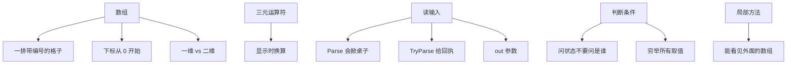

# C# 第 4 周：数组、循环、三元运算符、TryParse 与 out、局部方法

---

第 4 周是综合练习，我选了**控制台井字棋**。理由很实在：12 月学面向对象时要拿它当重构对象，现在先用手写一遍，到时候才知道类到底解决了什么问题。

结果是**71 行代码，卡了 6 次**，其中 4 次是同一个毛病 —— 判断条件问错了东西。

这周的博客分两大块：**工具篇**（数组、三元运算符、`TryParse`、局部方法）和**判断篇**（怎么写出一个「覆盖所有取值」的条件）。第二块才是这周真正的收获。

> [!NOTE]
> 标题带【进阶】的节第一遍可以跳过。完整 71 行代码在 `## 7`，可以先跑起来再回来看。

## 0. 这周的学习地图



一句话概括这周：**代码能跑不等于写对了 —— 判断条件要穷举所有取值，不能靠感觉。**

---

## 1. 数组：一排带编号的格子

### 1.1 形状

```csharp
char[] board = new char[9];        // 声明 + 分配 9 个格子

board[0] = 'X';                    // 下标从 0 开始
board[8] = 'O';                    // 最后一格是 8，不是 9

Console.WriteLine(board.Length);   // 9
```

```text
下标：  0    1    2    3    4    5    6    7    8
内容：'X'  ' '  ' '  ' '  ' '  ' '  ' '  ' '  'O'
```

| 特点 | 说明 |
|---|---|
| 长度固定 | `new char[9]` 就是 9 个，之后**不能变** |
| 下标从 0 开始 | 长度 9 的合法下标是 **0~8** |
| 默认值 | `char` 是 `'\0'`（打印出来**什么都看不见**） |
| 越界后果 | `IndexOutOfRangeException` 直接崩 |

### 1.2 一定要手动初始化

`char` 的默认值是 `'\0'`，不是空格。所以必须先填：

```csharp
char[] board = new char[9];
for (int i = 0; i < board.Length; i++)
    board[i] = ' ';                 // 全部填成空格
```

不填的话，`board[i] == ' '` 这个判断**永远不成立**，落子检查直接失效。

### 1.3 【进阶】数组的四种初始化写法

```csharp
char[] a = new char[9];                          // 全默认值
char[] b = new char[] { ' ', ' ', ' ' };         // 显式给初值
char[] c = { ' ', ' ', ' ' };                    // 简写（声明时才行）
char[] d = new char[9].Select(_ => ' ').ToArray(); // LINQ，第 11 周才学
```

> [!TIP]
> 业内主流：**知道长度 + 要默认值**就 `new T[n]`；**初始值固定**就直接 `{ ... }`。
> `for` 循环填充只在「默认值不是我要的」时才写 —— 但**读起来最直白**，初学阶段推荐。

---

## 2. 棋盘用一维 char[9] 还是二维 char[3,3]

### 2.1 第一反应是二维 —— 但它更麻烦

棋盘看着就是 3×3，所以第一反应是 `char[3,3]`。但**判赢**的时候就难受了：

```csharp
// 二维：8 条连线要写 8 段
bool Won(int r1,int c1,int r2,int c2,int r3,int c3) { ... }

Won(0,0, 0,1, 0,2);   // 横行 1
Won(1,0, 1,1, 1,2);   // 横行 2
// ... 还有 6 条
```

一维只要一个收 3 个下标的方法：

```csharp
bool Won(int a, int b, int c) { ... }

Won(0,1,2) || Won(3,4,5) || Won(6,7,8) ||   // 三横
Won(0,3,6) || Won(1,4,7) || Won(2,5,8) ||   // 三竖
Won(0,4,8) || Won(2,4,6)                    // 两斜
```

### 2.2 二维怎么压成一维

| 棋盘位置 | 二维 (行, 列) | 一维下标 = 行 × 宽 + 列 |
|---|---|---|
| 左上 | (0, 0) | 0 × 3 + 0 = **0** |
| 中间 | (1, 1) | 1 × 3 + 1 = **4** |
| 右下 | (2, 2) | 2 × 3 + 2 = **8** |

> [!IMPORTANT]
> **`索引 = 行 * 宽 + 列`** 这个公式在 Unity 里天天用 —— 网格、瓦片地图、背包格子，内部都是一维数组。
> 二维只是「用起来方便」，底层永远是一排。

---

## 3. 三元运算符：显示的时候才换算

### 3.1 形状

```csharp
char c = board[i] == ' ' ? (char)('1' + i) : board[i];
//       条件        ?    成立取这个     :   不成立取这个
```

读作：「如果是空格，就取编号；否则取格子里的值」。

### 3.2 数据与显示分离

**这一条比三元运算符本身重要得多。**

| 存进数组的 | 打印出来的 |
|---|---|
| `' '`（空格） | `1` |
| `'X'` | `X` |
| `'O'` | `O` |

**数组里只存「状态」，编号是画出来的时候现算的。** 这样落子、判赢全都是针对三种状态，不用管玩家看到的数字。

### 3.3 数字变字符要强转

```csharp
char c1 = (char)('1' + 0);     // '1'
char c2 = (char)('1' + 8);     // '9'

// 不加 (char) 会怎样？
'1' + 0   // 得到 int 49，不是字符 '1'
```

| 写法 | 类型 | 结果 |
|---|---|---|
| `'1' + i` | `int` | 49、50、51…（**ASCII 码**） |
| `(char)('1' + i)` | `char` | `'1'`、`'2'`、`'3'` |

**`char` 加一个 `int`，结果会自动升级成 `int`。** 想变回字符必须显式强转。

### 3.4 打印时的换行与竖线

```csharp
for (int i = 0; i < board.Length; i++)
{
    char c = board[i] == ' ' ? (char)('1' + i) : board[i];
    Console.Write(c);

    if ((i + 1) % 3 == 0)              // 行末：换行
    {
        Console.WriteLine();
        if (i != board.Length - 1)     // 后面还有行才画横线
            Console.WriteLine("---+---+---");
    }
    else
        Console.Write("  |");          // 不是行末：补竖线
}
```

输出：

```text
1  |2  |3
---+---+---
4  |5  |6
---+---+---
7  |8  |9
```

---

## 4. 读输入：Parse 会掀桌子，TryParse 给回执

### 4.1 两个方法的分工

| 方法 | 遇到 `"abc"` 时 | 适合 |
|---|---|---|
| `int.Parse(s)` | **抛异常**，程序崩 | 你已经确定它是数字 |
| `int.TryParse(s, out int n)` | 返回 `false`，`n` 被置 0，**不崩** | 用户输入 |

> [!NOTE]
> `int.Parse` 像「材料递进窗口，办不成直接掀桌子」；`int.TryParse` 像「办得成给你张回执写着成了 + 结果，办不成也给你张回执写着没成，不掀桌子」。
> 所以游戏里一律用 `TryParse`。

### 4.2 out 参数是什么

```csharp
bool ok = int.TryParse(Console.ReadLine(), out int pos);
//   ^^                                   ^^^^^^^
//   回执：成没成                          顺手塞给我一个结果
```

`out` 的意思是「**这个方法会往这个变量里写东西**」。所以：

1. 变量类型要写在 `out` 后面（`out int pos`），**不用先声明**；
2. 方法**必须**给它赋值（成功给解析结果，失败给 0）；
3. 变量在方法调用**之后**就能用了。

### 4.3 三个条件缺一不可

```csharp
if (!ok || pos < 1 || pos > 9)
{
    Console.WriteLine("请输入 1~9 的数字。");
    continue;
}
```

| 条件 | 挡住什么 |
|---|---|
| `!ok` | 字母、符号、空回车、超长数字 |
| `pos < 1` | `0`、`-1` |
| `pos > 9` | `10`、`999` |

> [!WARNING]
> **只写 `pos < 1 || pos > 9` 也能跑** —— 因为 `TryParse` 失败时把 `pos` 置 0，正好被 `pos < 1` 挡住。
> 但这是**碰巧对了**：依赖一个方法的副作用，而且 `ok` 变成没人用的死变量，编译器不会提醒。
> **靠巧合跑通的代码，是最难查的代码。**

---

## 5. 局部方法：能看见外面变量的函数

### 5.1 形状

```csharp
char[] board = new char[9];

bool Won(int a, int b, int c)      // 定义在顶层语句里，叫局部方法
{
    return board[a] != ' '         // 直接看见外面的 board，不用当参数传
        && board[b] != ' '
        && board[c] != ' '
        && board[a] == board[b]
        && board[b] == board[c];
}
```

| | 局部方法（local function） | 普通方法 |
|---|---|---|
| 定义在哪 | 方法体**里面** | 类里面 |
| 能看见外面变量 | ✅ 能 | ❌ 不能 |
| 适合 | 只在一个地方用的小工具 | 类的能力 |

> [!TIP]
> **为什么判赢不用写 8 个 `if`？** 因为 8 条线共用一套「三个格子一样且都不是空」的逻辑，抽成一个局部方法后，**改一处就够**。
> 这叫**消除重复**（DRY），是这周最值钱的一个习惯。

---

## 6. 写出一个「覆盖所有取值」的判断条件

这一节是这周真正的收获。**六次卡壳，四次都是判断条件问错了东西。**

### 6.1 问「状态本身」，不要问「是谁」

防重复落子，我第一版写的是：

```csharp
if (board[pos - 1] == 'X')      // 只挡 X，不挡 O
if (board[pos - 1] == player)   // 只挡「我自己」，更糟
```

实测：喂 `5,3,3`（X 落 5、O 落 3、X 又抢 3），**O 被盖掉了**；改成 `== player` 后，喂 `5,5` 连 X 都被 O 盖了。

**根因**：一直在从「谁」出发问问题，而「这格有人了」的真身是「**它不是空的**」。

| 出发点 | 要列几种情况 | 以后加第三位玩家 |
|---|---|---|
| 问「是谁」 | 2 种（X / O）→ 条件写成 2 个分支 | **要改** |
| 问「状态」 | 1 种（非空） | 不用改 |

**正确**：

```csharp
if (board[pos - 1] != ' ')     // 问状态本身：不是空的＝有人了
```

### 6.2 修条件最靠谱的办法是穷举，不是靠感觉

把「这个位置可能是什么值」和「该不该拒绝」列一张表，答案自己就浮出来了：

| `board[pos-1]` 的值 | 该不该拒绝 |
|---|---|
| `' '`（空位） | 不该 |
| `'X'` | 该 |
| `'O'` | 该 |

一眼就看出该写 `!= ' '`。

> [!TIP]
> **写判断条件前先列表。** 三行就能算清的事，靠感觉猜要试五轮。
> 这个习惯在判赢的守卫上也救了我一次 —— 见下面。

### 6.3 判断比的是「状态」，不是「下标」

判赢的守卫，我写成了这样：

```csharp
bool Won(int a, int b, int c)
{
    return a != ' ' && b != ' ' && c != ' '    // 比的是下标！
        && board[a] == board[b] && board[b] == board[c];
}
```

**这段能编译**，因为 `char` 会隐式转成 `int`（`' '` 就是 32），而下标 0~8 永远不等于 32 —— 于是三段守卫**恒为 true，等于没写**。

实测：只落一手 `5`，程序立刻打印 `X 赢了！`

| 写法 | 比的是什么 | 结果 |
|---|---|---|
| `a != ' '` | 下标 0~8 和 32 比 | **恒真** |
| `board[a] != ' '` | 格子里的内容和空格比 | 正确 |

> [!CAUTION]
> **类型放行了，意思没对上** —— 这类错编译器帮不了你，只能靠跑。
> 看到「守卫写了但没生效」，第一反应：**我是不是拿下标当内容用了**。

### 6.4 外层已经确认过的事，里层不要再问一遍

这是打印棋盘时的坑，我写了两版错的：

```csharp
// 第一版：恒假
if ((i + 1) % 3 == 0)          // 已经确定：现在是行末
{
    Console.WriteLine();
    if ((i + 1) % 3 != 0)      // 再问一次同一件事 → 永远 false
        Console.WriteLine("---+---+---");
}

// 第二版：恒真
if ((i + 1) % 3 == 0)
{
    Console.WriteLine();
    if (i % 3 == 2)            // 与 (i+1)%3==0 完全等价 → 永远 true
        Console.WriteLine("---+---+---");
}
```

`i % 3 == 2` 和 `(i + 1) % 3 == 0` 在 `i` 取 0~8 时**同时成立、同时不成立**，是同一个条件。既然能走进外层，再问一遍毫无信息量。

**真正该问的是完全无关的另一件事**：后面还有没有下一行。

```csharp
if (i != board.Length - 1)     // 后面还有行才画横线
    Console.WriteLine("---+---+---");
```

> [!WARNING]
> **恒假 / 恒真的条件 C# 编译器不报错、运行也不崩**，只是结果不对。
> IDE 会把表达式标灰提示「恒为 false / true」，但纯命令行 `dotnet run` 没这层提示。**唯一出路是把输出打出来跟预期对。**

### 6.5 一份代码只能有一套坐标系

判赢的 8 组下标，我前面几组写的是 0~8，后面两组切回了玩家看的 1~9：

```csharp
Won(0,1,2) || Won(3,4,5) || Won(6,7,8) ||   // 0~8（数组下标）✅
Won(1,5,9) || Won(3,5,7)                     // 1~9（棋盘编号）❌
```

实测直接崩：

```text
Unhandled exception. System.IndexOutOfRangeException: Index was outside the bounds of the array.
   at Program.<<Main>$>g__Won|0_0(Int32 a, Int32 b, Int32 c, ...)
```

**我在 `board[pos - 1]` 那儿换算得好好的，到判赢又切回去了。**

| 坐标系 | 范围 | 用在哪 |
|---|---|---|
| 玩家看到的 | 1~9 | 提示语、读输入 |
| 数组下标 | 0~8 | **所有内部逻辑** |

换算只在**一个地方**发生：`board[pos - 1]`。别的地方看见 1~9 就是 bug。

---

## 7. 产出物：71 行井字棋（完整代码）

顶层语句写法，不需要 `Main`。

```csharp
char[] board = new char[9];
for (int i = 0; i < board.Length; i++)
    board[i] = ' ';

char player = 'X';

// 局部方法：能直接看见外面的 board，不用当参数传进来
bool Won(int a, int b, int c)
{
    return board[a] != ' '
        && board[b] != ' '
        && board[c] != ' '
        && board[a] == board[b]
        && board[b] == board[c];
}

while (true)
{
    // ── 画棋盘：数据是 ' '/'X'/'O'，显示时把空位换算成编号 ──
    for (int i = 0; i < board.Length; i++)
    {
        char c = board[i] == ' ' ? (char)('1' + i) : board[i];
        Console.Write($"{c}");

        if ((i + 1) % 3 == 0)              // 行末：换行
        {
            Console.WriteLine();
            if (i != board.Length - 1)     // 后面还有行才画横线
                Console.WriteLine("---+---+---");
        }
        else
            Console.Write("  |");          // 不是行末：补竖线
    }

    // ── 先问，再读（顺序不能反） ──
    Console.Write($"轮到{player}，报个位置（1~9）：");
    bool ok = int.TryParse(Console.ReadLine(), out int pos);

    if (!ok || pos < 1 || pos > 9)         // 「不是数字」和「越界」都要挡
    {
        Console.WriteLine("请输入 1~9 的数字。");
        continue;
    }
    if (board[pos - 1] != ' ')             // 问状态本身：不是空的＝有人了
    {
        Console.WriteLine("这格有人了，换一个。");
        continue;
    }

    board[pos - 1] = player;

    if (Won(0, 1, 2) || Won(3, 4, 5) || Won(6, 7, 8)     // 三横
        || Won(0, 3, 6) || Won(1, 4, 7) || Won(2, 5, 8)  // 三竖
        || Won(0, 4, 8) || Won(2, 4, 6))                 // 两斜
    {
        Console.WriteLine($"{player} 赢了！");
        break;
    }

    int empty = 0;
    for (int i = 0; i < board.Length; i++)
        if (board[i] == ' ')
            empty++;

    if (empty == 0)
    {
        Console.WriteLine("平局！");
        break;
    }

    player = player == 'X' ? 'O' : 'X';
}
```

### 7.1 三个设计选择

**① 一维 `char[9]` 而不是二维 `char[3,3]`**

8 条连线可以直接写死成下标三元组；二维要写双重循环或 8 段长判断。

**② 数据与显示分离**

`board` 只存 `' '`/`'X'`/`'O'`，编号是**画出来的**，不是存进去的。

**③ 判赢用局部方法而不是 8 个 `if`**

8 条线共用一套逻辑，改一处就够。

### 7.2 平局判定为什么放在判赢之后

顺序反了的话，最后一手同时满足「连成线」和「棋盘满」时，**会先判平局，赢家就被吞掉了**。

| 顺序 | 最后一手既连成线又填满时 |
|---|---|
| 先判赢（对的） | 打印「X 赢了！」 |
| 先判平局 | 打印「平局！」，赢家被吞 |

### 7.3 continue 和 break 的分工

| 关键字 | 干什么 | 什么时候用 |
|---|---|---|
| `continue` | 这一轮到此为止，**回循环开头** | 输入不合法、格子被占 —— 都属「重新问一次」 |
| `break` | **彻底跳出循环** | 赢了 / 平局 |

---

## 8. 五个真踩过的坑

### 坑 1：恒假 / 恒真条件

```csharp
if ((i + 1) % 3 == 0)
{
    Console.WriteLine();
    if (i % 3 == 2)     // 和上面完全等价 → 永远 true
        Console.WriteLine("---+---+---");
}
```

**后果**：横线多一条（恒真）或一条都不出（恒假）。**编译器不报错、运行也不崩。**

**根因**：外层已经确认过的事，里层又问了一遍。

### 坑 2：占用校验只覆盖一种取值

```csharp
if (board[pos - 1] == 'X')      // 只挡 X
```

**后果**：O 的位置会被后来者盖掉。

**根因**：从「谁」出发问问题，而不是从「状态」出发。**该问「它不是空的」**。

### 坑 3：拿下标当内容用

```csharp
return a != ' ' && b != ' ' && c != ' '   // a b c 是下标，不是格子内容
```

**后果**：守卫恒真，只落一手就判赢。**能编译**（`char` 隐式转 `int`，`' '` 是 32）。

**正确**：`board[a] != ' '`。

### 坑 4：一份代码混两套坐标系

```csharp
Won(1,5,9)     // 1~9，但数组下标只有 0~8
```

```text
Unhandled exception. System.IndexOutOfRangeException: Index was outside the bounds of the array.
```

**根因**：在 `board[pos - 1]` 换算过，判赢那边又切回 1~9。

### 坑 5：先读输入，后打提示

```csharp
bool ok = int.TryParse(Console.ReadLine(), out int pos);   // 先读
Console.Write($"轮到{player}，报个位置（1~9）：");        // 后问
```

**后果**：屏幕上光标闪啊闪，玩家莫名其妙打了个数字，**然后**它才把问题打出来。

**根因**：程序是从上往下执行的 —— 想让玩家看见问题，提示必须写在读之前。

> [!CAUTION]
> 另外两个非技术坑：**改了不保存**（Zed 里改了三次没按 Ctrl+S，跑出来还是旧代码，白折腾两轮）、**只测一个方向**（测通一个例子就以为全对）。

---

## 9. 练习题（答案折叠，先自己写）

### 9.1 基础（6 题）

**1.** `char[] board = new char[9];` 之后，`board[0]` 是什么值？

<details>
<summary>答</summary>

是 `'\0'`（**空字符**），不是空格。

`'\0'` 打印出来**什么都看不见**，而且 `board[0] == ' '` 是 `false`。

所以必须先 `for` 循环填成 `' '`，否则落子检查全部失效。

</details>

**2.** 长度 9 的数组，合法下标范围是多少？写 `board[9]` 会怎样？

<details>
<summary>答</summary>

合法下标 **0~8**。`board[9]` 抛异常：

```text
System.IndexOutOfRangeException: Index was outside the bounds of the array.
```

**记法**：长度 9 的数组，最后一个下标是 `Length - 1`。

</details>

**3.** `'1' + 3` 的结果是什么？怎么才能得到字符 `'4'`？

<details>
<summary>答</summary>

`'1' + 3` 得到 **`int` 型的 52**（`'1'` 的 ASCII 是 49）。

```csharp
char c = (char)('1' + 3);      // '4'，必须显式强转
```

**为什么要有强转**：两个操作数里有一个是 `int`，结果类型就升级成 `int`。想变回 `char` 得自己说。

</details>

**4.** `int.Parse` 和 `int.TryParse` 有什么区别？

<details>
<summary>答</summary>

| | `int.Parse` | `int.TryParse` |
|---|---|---|
| 返回 | `int` | `bool` |
| 遇到 `"abc"` | **抛异常，程序崩** | 返回 `false`，不崩 |
| 结果怎么给 | 直接当返回值 | 通过 `out` 参数 |
| 适合 | 已确定是数字的地方 | **用户输入** |

</details>

**5.** `out` 参数是什么意思？为什么 `out int pos` 不用先声明 `pos`？

<details>
<summary>答</summary>

`out` 的意思是「**这个方法会往这个变量里写东西**」。

所以变量由被调用的方法负责赋值，调用方只要在参数位置声明就行。方法**必须**给它赋值（成功给结果，失败给 `0`）。

调用之后 `pos` 就能直接用了。

</details>

**6.** `continue` 和 `break` 在这个程序里各用在什么地方？

<details>
<summary>答</summary>

| 关键字 | 用在哪 | 为什么 |
|---|---|---|
| `continue` | 输入不合法、格子被占 | 都是「这一轮不算，重新问一次」 |
| `break` | 赢了、平局 | **彻底结束游戏** |

**判据**：还想让玩家继续玩 → `continue`；游戏结束 → `break`。

</details>

### 9.2 进阶（6 题）

**7.** 下面这段为什么「守卫写了但没生效」？

```csharp
bool Won(int a, int b, int c)
{
    return a != ' ' && b != ' ' && c != ' '
        && board[a] == board[b] && board[b] == board[c];
}
```

<details>
<summary>答</summary>

`a`、`b`、`c` 是**下标**（0~8），不是格子内容。

`' '` 是 `char`，比的时候隐式转成 `int` 32。下标 0~8 永远不等于 32 → **守卫恒为 true**。

**正确**：`board[a] != ' '`。

**这类错的特点**：能编译、能运行、不崩溃，只是逻辑错。

</details>

**8.** 棋盘改成 `char[3,3]` 之后，判赢该怎么写？

<details>
<summary>答</summary>

先写一个收 6 个参数的方法（3 个坐标配对），或者干脆算出扁平下标：

```csharp
char Get(int r, int c) => board[r, c];

bool Won(int r1,int c1,int r2,int c2,int r3,int c3)
    => Get(r1,c1) != ' ' && Get(r1,c1) == Get(r2,c2) && Get(r2,c2) == Get(r3,c3);

Won(0,0, 0,1, 0,2) || Won(1,0, 1,1, 1,2) || Won(2,0, 2,1, 2,2) ||   // 三横
Won(0,0, 1,0, 2,0) || Won(0,1, 1,1, 2,1) || Won(0,2, 1,2, 2,2) ||   // 三竖
Won(0,0, 1,1, 2,2) || Won(0,2, 1,1, 2,0)                            // 两斜
```

**8 行变 8 行，但每行多了 3 个参数。** 这就是为什么井字棋用一维更省事。

</details>

**9.** 为什么平局判定要放在判赢**之后**？

<details>
<summary>答</summary>

最后一手可能**同时**满足「连成线」和「棋盘满」。

| 顺序 | 结果 |
|---|---|
| 先判赢（对的） | 打印「X 赢了！」 |
| 先判平局 | 打印「平局！」，**赢家被吞掉** |

**通用原则**：「更特殊的条件」先判断。平局是「除了赢之外都满了」，逻辑上依赖「没有赢」。

</details>

**10.** `board[0] == board[1] == board[2]` 为什么编译不过？

<details>
<summary>答</summary>

C# 从左往右算：`board[0] == board[1]` 先得出 `bool`，再拿 `bool` 跟 `char` 比。

```text
error CS0019: 运算符"=="无法应用于"bool"和"char"类型的操作数
```

**必须拆开**：`a == b && b == c`。

</details>

**11.** `board[i] = board[i+1] = board[i+2]` 会怎样？

<details>
<summary>答</summary>

**编译通过**，然后把三个格子**都变成最后一个格子的值**。

因为赋值表达式本身有返回值（就是被赋的那个值），所以会从右往左一路赋过去。

实测输出 `333`，棋盘被改烂，**且没有任何报错**。

> 一个语句里只做一件事。

</details>

**12.** 为什么要用局部方法 `Won`，而不是写 8 个 `if`？

<details>
<summary>答</summary>

8 条线共用同一套「三个格子一样且都不空」的逻辑。

| 写法 | 要改几处 |
|---|---|
| 8 个 `if` | 发现守卫写错，**要改 8 处**（我实际改了 8 次） |
| 局部方法 | **改 1 处** |

这叫**消除重复**（DRY，Don't Repeat Yourself）。局部方法的好处是**能直接看见外面的 `board`**，不用当参数传。

</details>

### 9.3 挑战（4 题）

**13.** 把棋盘扩成 4×4，要改哪几处？

<details>
<summary>答</summary>

| 改哪儿 | 从什么改到什么 |
|---|---|
| 数组长度 | `new char[9]` → `new char[16]` |
| 行末判断 | `% 3` → `% 4` |
| 输入上限 | `pos > 9` → `pos > 16` |
| 判赢 8 组 | **全部要重算**（4×4 的连线多得多：4 行 + 4 列 + 2 斜 = 10 组，还加了对角线变体） |

**最麻烦的是判赢。** 这时候解法是**用循环算**而不是写死：

```csharp
bool Won();   // 内部检查所有行、所有列、两条对角线
```

> 这就是「写死数字」的代价 —— 但也**别提前抽象**。井字棋就该写死 8 组，能读懂的代码比「通用但绕」的代码值钱。

</details>

**14.** 加一个「悔棋」功能，思路是什么？（提示：第 8 周会用上）

<details>
<summary>答</summary>

**用一个栈（Stack）记录每一步的位置**，悔棋就是弹出一格、把它恢复成空格。

```csharp
Stack<int> history = new Stack<int>();

// 落子后
history.Push(pos - 1);

// 悔棋
if (history.Count > 0)
    board[history.Pop()] = ' ';
```

**为什么用栈不用数组**：悔棋永远是「撤最近一步」，正是「后进先出」（LIFO）—— 栈天生干这个。

> `Stack<T>` 是第 8 周的内容，这里先埋个伏笔。

</details>

**15.** 如果加一个「电脑玩家」，怎么让它是随机的且不会选已占的格子？

<details>
<summary>答</summary>

```csharp
var rnd = new Random();

int pos;
do
{
    pos = rnd.Next(0, 9);       // 0~8，注意是下标不是编号
} while (board[pos] != ' ');    // 撞到已占的就重摇
```

**注意**：`Random.Next(0, 9)` 的上限是**不含**的，所以正好是 0~8。

> 这个「重摇直到合法」的写法在棋盘快满时会变慢，专业做法是**先把空格收集起来再随机取一个** —— 这正是第 8 周 `List<T>` 的用武之地。

</details>

**16.** 为什么说「现在这份 71 行代码，数据和行为是散在一起的」？

<details>
<summary>答</summary>

看这段：

```csharp
char[] board = new char[9];              // 数据
bool Won(int a, int b, int c) { ... }    // 行为
board[pos - 1] = player;                 // 行为
```

`board` 和操作它的方法**在同一个缩进层级上并排放着**，谁都能改它，没有任何保护。

| 问题 | 后果 |
|---|---|
| 数据谁都能改 | 手滑写 `board[0] = 'Z'` 没人拦 |
| 方法不知道管什么 | `Won` 和打印都在顶层，分不清职责 |
| 想玩两盘 | **做不到**，全局只有一个 `board` |

> 最后一条最要命。**第 5 周要用类解决的问题，就是「想玩第二盘时怎么办」。**

</details>

---

## 10. 检查标准

过完这周，应该能**不查资料**做到：

- [ ] 说出 `char[]` 的默认值，并解释为什么必须手动初始化成空格
- [ ] 解释长度 9 的数组为什么合法下标只到 8
- [ ] 说清 `'1' + i` 和 `(char)('1' + i)` 的区别
- [ ] 解释「数据与显示分离」是什么意思，并说出它的好处
- [ ] 说清 `Parse` 和 `TryParse` 的分工，以及 `out` 参数的作用
- [ ] 解释为什么 `!ok || pos < 1 || pos > 9` 三个条件缺一不可
- [ ] 说出「问状态而不是问是谁」为什么更稳
- [ ] 用穷举表的方法写一个判断条件
- [ ] 解释「外层已确认的事，里层不要再问」
- [ ] 说清 `continue` 和 `break` 的分工

**验收题**（第 4 周总验收，80 行以内）：

> 不看教程，从零手写出这个 71 行井字棋，并且**11 条行为判据全过**（6 条非法输入 + 3 种赢法 + O 赢 + 平局）。

| # | 输入 | 期望 |
|---|---|---|
| 1 | `a` | 提示「请输入 1~9 的数字。」，不崩 |
| 2 | 直接回车 | 同上 |
| 3 | `10` | 同上（合法数字但越界） |
| 4 | `0` | 同上 |
| 5 | `-1` | 同上 |
| 6 | `999999999999` | 同上 |
| 7 | `5,1,3,7,4,6,2,8,9` | `平局！` |
| 8 | `1,4,2,5,3` | `X 赢了！`（横线） |
| 9 | `1,2,4,3,7` | `X 赢了！`（竖线） |
| 10 | `3,2,5,4,7` | `X 赢了！`（斜线） |
| 11 | `1,2,3,5,4,8` | `O 赢了！`（**O 也要能赢**） |

第 11 条最容易漏 —— 我前面就栽在「只想着 X」。

---

## 11. 下一周预告

第 5 周：**类与对象 / 字段属性 / 构造函数 / this**。

这周这份 71 行有两个致命限制：

1. **数据谁都能改** —— 没有任何保护
2. **想玩第二盘做不到** —— 全局只有一个 `board`

下周把 `board` 和 `player` 变成**字段**，把打印/落子/判赢变成**方法**，收进三个类里 —— `Board` / `Player` / `Game`。

> 那时候会冒出一堆新问题：什么时候写 `Board.Cells`、什么时候光写 `Cells`？`Current` 里装的是名字还是玩家？—— **那正是第 5 周的全部内容。**
