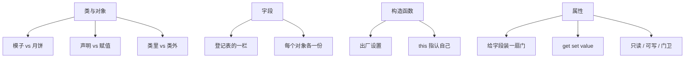

# C# 第 5 周：类与对象、字段与属性、构造函数、this

---

上周那个 71 行的井字棋，一个文件从头糊到尾，所有变量都堆在顶层。这周的任务是把它拆成三个类：`Board`、`Player`、`Game`。

**拆是拆出来了，编译错误报了七轮。** 但真正卡住我的不是某个语法，而是一个说不清的问题：

> 代码我**看得懂**，可让我**自己写**，手就停在键盘上不知道敲什么。

这周的博客分两大块：**「名字是谁的」**（决定你写 `Cells` 还是 `Board.Cells`）和**「东西怎么造」**（构造函数、`this`、属性）。这两块搞定了，类就写顺了。

> [!NOTE]
> 标题带【进阶】的节第一遍可以跳过。本周的产出物在 `## 5`，边读边跑。

## 0. 这周的学习地图



一句话概括这周：**类负责造东西，字段负责存东西，构造函数负责填东西，属性负责管谁能碰东西。**

---

## 1. 类与对象：模子和月饼

### 1.1 形状

```csharp
class Player
{
    public string Name;          // 字段
    public char Mark;

    public Player(string name, char mark)   // 构造函数
    {
        Name = name;
        Mark = mark;
    }
}

// 顶层
Player p1 = new Player("玩家1", 'X');
Player p2 = new Player("玩家2", 'O');
```

| 概念 | 是什么 | 有几个 |
|---|---|---|
| **类**（class） | 模子、图纸、空白的登记表 | 1 个（代码里只写一次） |
| **对象**（object） | 用模子压出来的月饼 / 填好的一张表 | 想要几个要 `new` 几次 |
| **字段**（field） | 表上的某一栏 | **每个对象各一份** |

> [!IMPORTANT]
> **`new` 一次 = 领一张新的空白表，当场填好。** 所以 `p1` 和 `p2` 的 `Name` 互不影响 —— 它们是两张表。

### 1.2 三个问题其实是三个

我当时把这三件事**当成一个问题**在混着猜，所以怎么改都是错：

| 问题 | 真正的判据 |
|---|---|
| 什么时候写 `Board.Cells`，什么时候光写 `Cells`？ | **在有这个字段的类里**还是外面 |
| `Cells = new char[9];` 前面为啥不用写 `char[]`？ | 这是**赋值**还是**声明** |
| `Current` 里装的是名字还是玩家？ | 看**它的类型**是 `string` 还是 `Player` |

### 1.3 声明 vs 赋值

| 你要做的事 | 写法 |
|---|---|
| **声明**一个新东西 | `Player p = new Player("甲", 'X');` ← 带类型 |
| 给**已有**的赋值 | `p = new Player("乙", 'O');` ← 不带类型 |

**判据是「是不是新东西」，跟「在类里还是类外」一点关系都没有。**

我当时的错误理解是「在类里面就不用写类型了」。所以在构造函数里写 `Cells = new char[9];` 时，我以为是因为「在类里」；**真正的原因是 `Cells` 上面已经声明过了**。

> [!WARNING]
> 同一个写法（不带类型），在完全不同的两个理由下都成立 —— 这就是绕不出来的地方。
> 判断依据要盯住「**这东西是不是新的**」，不要盯「我在哪儿」。

### 1.4 类里 vs 类外

| 在哪 | 怎么写 |
|---|---|
| 在类**里面**用自己身上的字段 | 直接写 `Cells` |
| 在类**外面**用别人身上的字段 | `b.Cells` —— 得说清楚是**哪个对象** |

写成 `Board.Cells` 会炸：

```text
error CS0120: 对象引用对于非静态的字段、方法或属性"Board.Cells"是必需的
```

**因为 `Board` 是类名，是模子，模子上没有那一栏。**

> [!CAUTION]
> `Player.mark` 和 `Current.mark` 只差一个词，但前者是**类型**、后者是**对象**。
> 看到 `CS0120`，第一反应就去看「点号前面那个词，是类名还是对象」。

> [!TIP]
> 框架速查表（这周所有「不知道怎么写」的总答案）：
> | 你要做的事 | 写法 |
> |---|---|
> | 声明一个新东西 | `Board b = new Board();` |
> | 给已有的赋值 | `b = new Board();` |
> | 在类里用自己的字段 | `Cells` |
> | 在类外用别人的字段 | `b.Cells` |
> | 调用方法 | `b.Print()` |
> 
> 每次卡住就问一句：**「这个名字，是谁的？」**

---

## 2. 构造函数：出厂设置

### 2.1 它是什么

构造函数 = **在 `new` 那一刻自动跑一次的方法**，作用是「把新表填好」。

```csharp
class Player
{
    public string Name;
    public char Mark;

    public Player(string name, char mark)   // 名字必须跟类名一样，没有返回类型
    {
        Name = name;
        Mark = mark;
    }
}
```

| 特征 | 说明 |
|---|---|
| 名字 | **必须和类名一模一样** |
| 返回类型 | **不写**（连 `void` 都不写） |
| 什么时候跑 | `new` 的那一刻，**自动**，且只跑一次 |
| 能不能省 | 不写也能编译 —— 编译器送你一个无参的空构造函数 |

### 2.2 两种给字段赋值的地方

```csharp
// A：字段初始化器
public char[] Cells = new char[9];

// B：构造函数里赋值
public char[] Cells;
public Board() { Cells = new char[9]; }
```

| 写法 | 什么时候用 |
|---|---|
| A 字段初始化器 | 值固定、**不依赖别的字段** |
| B 构造函数 | 值要**从参数算出来**，或**字段之间有先后依赖** |

比如 `Game` 里 `Current = P1;` 就必须等 `P1` 造好 —— 这种有依赖的，放构造函数最清楚。

> [!WARNING]
> **字段初始化器按书写顺序执行，而且全部早于构造函数体。**
> 混着写容易踩「用到还没初始化的字段」这种顺序坑。

### 2.3 忘了给字段赋值会怎样

| 类型 | 默认值 |
|---|---|
| `int` / `double` | `0` |
| `bool` | `false` |
| `char` | `'\0'`（空字符，**打印出来什么都看不见**） |
| `string` / 数组 / 任何类 | `null` |

**`null` 是最危险的** —— 用它就 `NullReferenceException`。

### 2.4 【进阶】方法重载与构造函数链

同一个类可以有**多个构造函数**，参数不同即可（叫**重载** overload）：

```csharp
class Player
{
    public string Name { get; }
    public int Hp { get; }

    public Player(string name) : this(name, 100) { }   // 转交给下面那个

    public Player(string name, int hp)
    {
        Name = name;
        Hp = hp;
    }
}

Player a = new Player("甲");        // Hp 默认 100
Player b = new Player("乙", 50);    // Hp 50
```

**`: this(...)` 的意思是「我这边不干活，交给另一个构造函数」** —— 避免把填表逻辑抄两遍。

---

## 3. this：指认「我自己这张表」

### 3.1 什么时候必须写 this

```csharp
class Player
{
    public string name;           // 字段（小写）

    public Player(string name)    // 参数也叫 name
    {
        this.name = name;         // 左边是字段，右边是参数
    }
}
```

**两边名字撞车了**，不写 `this.` 就分不清。

| 写法 | 结果 |
|---|---|
| 字段小写、参数小写 | **必须写** `this.name = name;` |
| 字段大写 `Name`、参数小写 `name` | **不用写**，直接 `Name = name;` |

> [!TIP]
> **C# 大小写敏感**，`Name` 和 `name` 是两个不同的名字 —— 天然不撞车。
> 所以业内主流写法是：**属性/字段大写开头，参数小写开头**，`this.` 基本就不用写了。

### 3.2 this 的第二个用法

| 用法 | 意思 |
|---|---|
| `this.Name` | 我自己这张表的 Name 那一栏 |
| `: this(...)` | 转交给本类的另一个构造函数 |
| `return this;` | 把整个自己交出去（链式调用用） |

### 3.3 一个类的三条视野规则

> **方法能看见的，只有自己身上的字段，和别人递进来的参数。**

```csharp
class Player
{
    public string Name;

    public void Print()
    {
        Console.WriteLine(Name);   // 能：自己身上的
        // Console.WriteLine(P1);  // 不能：P1 是别人的局部变量，看不见
    }
}
```

我一开始写 `Dog.Print()` 的时候，里面直接去引用外面的 `d` 和 `D` 两个变量，打印出来两条狗 —— 就是这个规矩没立住。

---

## 4. 属性：给字段装一扇门

### 4.1 public 字段的问题

上面 `Player` 里一开始用的是 `public` 字段：

```csharp
public string Name;
public char Mark;
```

**`public` 字段 = 一张敞开的登记表，谁路过都能涂改：**

```csharp
p1.Mark = 'Z';    // 编译通过，运行也没人拦 —— 游戏就这么废了
```

### 4.2 四档属性的判断依据

| 写法 | 外面能读 | 外面能写 | 什么时候用 |
|---|---|---|---|
| `public string name;` | ✅ | ✅ 随便改 | ❌ 别用 |
| `public string Name { get; }` | ✅ | ❌ 只有构造函数里 | 造好就不该变的东西 |
| `public string Name { get; private set; }` | ✅ | ❌ 外面不行，**自己类里能改** | 只有我自己能改的状态 |
| `public string Name { get; set; }` | ✅ | ✅ 但要过门卫 | 外面要改、又得检查 |

### 4.3 { get; } 到底做了什么

**`{ get; }` 叫自动属性**（auto-property）：编译器悄悄帮你造了个看不见的私有字段，你只写 `get;` 就等于说「**只给读，不给写**」。

```csharp
public char Mark { get; }    // 外面只能读，赋值只允许在构造函数里

// 外面这么写就炸：
```

```text
error CS0200: 无法为属性或索引器"Player.Mark"赋值 - 它是只读的
```

### 4.4 get / set / value 三个词

| 词 | 什么时候执行 | 干什么 |
|---|---|---|
| `get` | 别人**读**的时候 | 把值**拿出来**（`return`） |
| `set` | 别人**写**的时候 | 把值**放进去**（用 `value`） |
| `value` | —— | **系统送的**，代表「别人想写进来的那个值」，**不用自己声明** |

要加「门卫」就得把两个都写全：

```csharp
private int score;
public int Score
{
    get { return score; }
    private set
    {
        if (value < 0) value = 0;   // 门卫：不许为负
        score = value;
    }
}
```

> [!IMPORTANT]
> 属性最大的价值：**把错误从「运行时悄悄坏掉」提前到「编译期直接拦住」。**
> 只读属性让「手滑改棋子」这种事在编译时就被挡下，而不是玩到一半发现棋子里出现一个 'Z'。

### 4.5 字段到底要不要留

| | 自动属性 `{ get; set; }` | 手写字段 + 属性 |
|---|---|---|
| 代码量 | 一行 | 十来行 |
| 能加校验 | ✅ 用 `init` / 在 set 里 | ✅ 最灵活 |
| 什么时候用 | **绝大多数情况** | 需要在 set 里做逻辑，或要和 Unity 序列化配合 |

> [!TIP]
> 业内主流写法：**能写自动属性就写自动属性**，只在真需要门卫逻辑时才展开成字段 + 手写属性。
> （Unity 例外：Inspector 只序列化 `public` 字段或带 `[SerializeField]` 的私有字段，自动属性反而不出现在面板上。）

---

### 4.6 【进阶】init 访问器

**`{ get; }` 只允许在构造函数里赋值，有时候太死**：想用「对象初始化器」一口气填好几个值时就不行了。

C# 9 起有 `init`：

```csharp
class Player
{
    public string Name { get; init; } = "";
    public char Mark { get; init; }
}

// 对象初始化器：new 完当场花括号填
Player p1 = new Player { Name = "玩家1", Mark = 'X' };

// p1.Name = "改一下";   // 炸：init 只允许在初始化阶段赋值
```

1

| 访问器 | 谁能写 | 什么时候用 |
|---|---|---|
| `get;` | 只有构造函数 | 最简单，绝大多数只读字段用它 |
| `get; init;` | 构造函数 + `new X { ... }` | 想用对象初始化器 |
| `get; private set;` | 构造函数 + 自己类里任何方法 | 内部会变的状态 |
| `get; set;` | 谁都能写 | 纯粹的数据容器（DTO） |


---

## 5. 产出物：三个类的井字棋

### 5.1 职责划分

| 类 | 管什么 | 里面有什么 |
|---|---|---|
| `Board` | 只管**棋盘**：打印、判断空不空、落子、判赢 | 字段 `Cells` |
| `Player` | 只管**一个玩家**：是谁、下什么 | 属性 `Name` / `Mark` |
| `Game` | 只管**流程**：轮到谁、读输入、换人 | 字段 `Board` / `P1` / `P2` / `Current` |

> [!IMPORTANT]
> **一个类里装另一个类的对象，这叫「组合」（composition）。**
> `Game` 里有 `Board` 和 `Player`，就像一台电脑里有主板和硬盘 —— 拆开每一件又都是独立的东西。

### 5.2 三个类

```csharp
class Board
{
    public char[] Cells = new char[9];

    public Board()
    {
        for (int i = 0; i < Cells.Length; i++)
            Cells[i] = (char)('1' + i);       // '1'..'9'
    }

    public void Print()
    {
        for (int i = 0; i < Cells.Length; i++)
        {
            Console.Write($" {Cells[i]} ");
            if (i % 3 == 2) { Console.WriteLine(); }
            else { Console.Write("|"); }
            if (i != Cells.Length - 1 && i % 3 == 2)     // 只在行末画横线
                Console.WriteLine("---+---+---");
        }
    }

    public bool IsEmpty(int pos) => Cells[pos] != 'X' && Cells[pos] != 'O';

    public void Set(int pos, char mark) => Cells[pos] = mark;

    public bool Won(int a, int b, int c)
        => Cells[a] != ' ' && Cells[a] == Cells[b] && Cells[b] == Cells[c];
}
```

```csharp
class Player
{
    public string Name { get; }
    public char Mark { get; }

    public Player(string name, char mark)
    {
        Name = name;
        Mark = mark;
    }
}
```

### 5.3 重构之后的 Run()

```csharp
public void Run()
{
    while (true)
    {
        Board.Print();                                   // 打印归棋盘自己
        Console.Write($"轮到{Current.Name}（{Current.Mark}），报个位置（1~9）：");

        bool ok = int.TryParse(Console.ReadLine(), out int pos);
        if (!ok || pos < 1 || pos > 9)                   // 三个条件缺一不可
        {
            Console.WriteLine("请输入 1~9 的数字。");
            continue;
        }
        if (!Board.IsEmpty(pos - 1))                     // 问棋盘：这格空吗
        {
            Console.WriteLine("这格有人了，换一个。");
            continue;
        }

        Board.Set(pos - 1, Current.Mark);                // 落子交给棋盘

        if (Board.Won(0,1,2) || Board.Won(3,4,5) || Board.Won(6,7,8)   // 三横
         || Board.Won(0,3,6) || Board.Won(1,4,7) || Board.Won(2,5,8)   // 三竖
         || Board.Won(0,4,8) || Board.Won(2,4,6))                      // 两斜
        {
            Console.WriteLine($"{Current.Name} 赢了！");
            break;
        }

        int empty = 0;
        for (int i = 0; i < Board.Cells.Length; i++)
            if (Board.IsEmpty(i)) empty++;
        if (empty == 0)
        {
            Console.WriteLine("平局！");
            break;
        }

        Current = Current == P1 ? P2 : P1;               // 换人
    }
}
```

对比一下：上周 `Main` 里那 15 行打印棋盘的代码，现在就是第一行 `Board.Print();`。

> [!TIP]
> 判断重构成不成功，有个很土但很准的判据：**主流程的方法有没有变短。**
> 变短了说明东西真的搬走了；变长了说明你只是把代码抄了一份。

### 5.4 搬代码的坑：机械搬运 vs 思考搬运

重构的时候我把上周的代码整段整段往 `Game` 里搬，结果把**打印棋盘的 15 行**也搬进去了 —— 而它已经被搬进 `Board.Print()` 了。

> [!WARNING]
> **搬代码之前，先逐段问一句「这句现在还归谁管」。** 归别人管的，就删掉、改成一句调用；归自己的，才留下来。

---

```text
error CS8852: 只能在对象初始值设定项中或在实例构造函数内的 "this" 或 "base" 上分配 init-only 属性或索引器 "Player.Name"
```
## 6. 五个真踩过的坑

### 坑 1：`Board.Cells` —— 把类名当对象用

```csharp
Console.WriteLine(Board.Cells[0]);    // 想拿棋盘第一格
```

```text
error CS0120: 对象引用对于非静态的字段、方法或属性"Board.Cells"是必需的
```

**根因**：`Board` 是**类名**（模子），`Board.Cells` 读作「Board 这个**类型**身上的 Cells」—— 可模子上什么都没有。

**正确**：得说清是**哪个对象**的 —— `b.Cells[0]` 或 `Board.Cells` 改成 `game.Board.Cells`。

**这个错我犯了三次**，第三次是写成 `Player.mark`（想拿当前玩家下的棋子，正确的是 `Current.Mark`）。

### 坑 2：恒假条件 —— 编译通过，输出全错

```csharp
if (Cells.Length - 1 != 8)
    Console.WriteLine("---+---+---");
```

`Cells.Length` 是 9，9 - 1 = 8，所以这是 `8 != 8` → **永远 false** → 横线一条都画不出来。

实际输出：

```text
1  |2  |3
4  |5  |6      <- 横线全没了
7  |8  |9
```

**编译器对这种错一声不吭。** 语法没错、类型没错，只是永远不会执行。

**正确**：问「**现在是不是最后一行**」：

```csharp
if (i != Cells.Length - 1)
    Console.WriteLine("---+---+---");
```

> [!WARNING]
> **恒假条件只能靠输出抓，编译器抓不到。** 改完必须把程序跑起来，用眼睛看输出。

### 坑 3：机械搬运，把打印搬了两份

重构时把上周代码整段往 `Game` 里搬，结果把打印棋盘的 15 行也搬进去了 —— 而它已经在 `Board.Print()` 里了。

**判据**：改完 `Run()` 应该比之前**短**，而不是更长。

### 坑 4：给只读属性赋值

```csharp
p1.Mark = 'Z';        // Mark 是 { get; }
```

```text
error CS0200: 无法为属性或索引器"Player.Mark"赋值 - 它是只读的
```

**这不是坏事** —— 正是这行报错挡住了「棋子被中途改掉」这类静默 bug。想改就在构造函数里传参。

### 坑 5：以为「没报错」就是「对了」

改完 `Board.Cells` → `Cells` 之后编译通过了，心想「搞定了」。结果棋盘渲染塌了（就是坑 2）。

> [!CAUTION]
> **0 error 只是入场券。** 重构完必须重跑上周**所有**行为判据 —— 横线赢、竖线赢、斜线赢、平局、非法输入。

---

## 7. 练习题（答案折叠，先自己写）

### 7.1 基础（6 题）

**1.** 下面哪种写法是对的？为什么？

```csharp
// A
public char[] Cells = new char[9];

// B
public char[] Cells;
public Board() { Cells = new char[9]; }
```

<details>
<summary>答</summary>

**两种都对**，适用场景不同：

- **A（字段初始化器）**：值固定、不依赖别的字段时用。
- **B（构造函数里）**：值要从参数算、或字段之间有先后依赖时用。

比如 `Game` 里 `Current = P1;` 必须等 `P1` 造好 —— 这种放构造函数最清楚。

</details>

**2.** `Player.Print()` 里能直接写 `Name` 吗？`Game.Show()` 里能吗？

<details>
<summary>答</summary>

- **`Player.Print()` 里：能。** `Name` 是「我自己这张表上的那一栏」。
- **`Game.Show()` 里：不能。** `Game` 里没有 `Name` 这一栏，得写 `P1.Name`。

**一句话**：自己的东西直接叫名字，别人的东西必须带对象。

</details>

**3.** `Current` 里装的是什么？要拿到当前玩家下的棋，怎么写？

<details>
<summary>答</summary>

装的是**一个 `Player` 对象**（整个盒子），不是名字。拿棋子写 **`Current.Mark`**。

三条判据：

1. 它的类型是 `Player`，不是 `string`；
2. 代码里写 `Current == P1 ? P2 : P1` —— 这是在**比对象**；
3. 要用 `Current.Name` 才能拿出名字 —— **得先有盒子，才能拿盒子里那颗**。

</details>

**4.** `public char Mark { get; }` 和 `public char Mark { get; set; }`，外面用起来有什么区别？

<details>
<summary>答</summary>

| | `{ get; }` | `{ get; set; }` |
|---|---|---|
| 外面能读 | ✅ | ✅ |
| 外面能写 | ❌ 只允许构造函数里 | ✅ |
| 适合 | 造出来就不该变的东西（玩家名、棋子） | 外面确实要改、且不需检查 |

</details>

**5.** 构造函数能不能写返回类型？能不能写 `void`？

<details>
<summary>答</summary>

**都不能。** 构造函数名字必须和类名一样，返回类型一个字都不写。

一旦写了 `void Player()`，编译器就当你是**普通方法**了 —— 那它就永远不会在 `new` 时自动跑。

</details>

**6.** 下面这段能不能编译？

```csharp
class Player
{
    public string name;

    public Player(string name)
    {
        name = name;          // 少了 this.
    }
}
```

<details>
<summary>答</summary>

**能编译，但字段永远是 `null`。** `name = name;` 两边都是参数，自己赋值给自己。

C# 编译器会报 **警告** `CS1717`：对同一变量进行赋值。

```text
warning CS1717: 对同一变量进行赋值；是否希望改为赋值其他内容?
```

**修法**：写 `this.name = name;`，或把字段改成大写的 `Name`。

</details>
### 7.2 进阶（6 题）

**7.** 为什么 `Game` 里要写 `Board.IsEmpty(pos - 1)`，而不是把判断写在 `Run()` 里？

<details>
<summary>答</summary>

**因为「这格空不空」是棋盘的内部知识，不是流程的知识。**

写在 `Run()` 里就要写 `Board.Cells[pos-1] != 'X' && ...` —— 主流程开始摸棋盘的内部结构，一旦棋盘改成二维数组，主流程全部要改。

**判据（看方法签名）**：

| 方法 | 里面不许出现 |
|---|---|
| `bool IsEmpty(int pos)` | `Console.` |
| `void Set(int pos, char mark)` | `while` |
| `void Print()` | 任何跟输赢判断有关的逻辑 |

**名字只说一件事，方法体就只能有那一件事。**

</details>

**8.** `Board.Won` 里的 `Cells[a] != ' '` 这句话有什么用？去掉会怎样？

<details>
<summary>答</summary>

**它挡掉了「三个空格算赢」。**

开局时 `Cells` 装的是 `'1'`~`'9'`，但如果改用空格表示「没下」，那么 `Cells[0]==Cells[1]==Cells[2]==c` 全等于 `' '`'` 时，会判成有人赢了。

**正确写法**：先确认这一格**已经被下过**（不是空、不是原始数字），再比相等。

</details>

**9.** 下面这样写，`p1` 和 `p2` 会互相影响吗？

```csharp
Player p1 = new Player("甲", 'X');
Player p2 = p1;
p2.Name = "乙";
```

<details>
<summary>答</summary>

**会。** `p1` 和 `p2` 现在指向**同一个对象**（同一个盒子），不是两个。

改 `p2.Name` 就是改那个盒子里的东西，`p1.Name` 也变了。

| 类型 | `=` 复制什么 |
|---|---|
| 值类型（`int` / `char` / `bool` / `struct`） | 复制**值本身** |
| 引用类型（`class` / 数组 / `string`） | 复制**地址**（两张纸条写同一个门牌号） |

**想真的复制一份**：得自己写一个复制构造函数 `new Player(p1.Name, p1.Mark)`。

</details>

**10.** 为什么 `Board` 的 `Cells` 标成 `public` 不好？

<details>
<summary>答</summary>

因为外面可以绕过 `Board` 的所有方法直接改：

```csharp
game.Board.Cells[0] = 'Z';     // 编译通过，棋盘废了
```

**分层被穿透了** —— `Board` 的规则（只能下 X/O、只能下空格）全被跳过。

**改法**：

```csharp
private readonly char[] _cells = new char[9];

public char this[int i] => _cells[i];        // 只读索引器，能看不能改
public int Length => _cells.Length;
```

（`this[int i]` 叫**索引器**，让对象能像数组一样用 `board[0]` 访问。）

</details>

**11.** `static` 成员和实例成员，用对象能不能访问 `static` 的？

<details>
<summary>答</summary>

**能**（但编译器会给警告）。真正不能的是反过来：**`static` 方法里摸实例字段**。

```text
error CS0120: 对象引用对于非静态的字段、方法或属性"Counter._count"是必需的
```

**判据**：看有没有 `this`。`static` 方法没有 `this`，不知道操作哪个对象。

</details>

**12.** 能不能让 `Board` 的构造函数接收「棋盘大小」，把 9 变成参数？

<details>
<summary>答</summary>

能，但要注意三件事：

```csharp
class Board
{
    private readonly char[] _cells;
    private readonly int _size;

    public Board(int size = 9)
    {
        _size = size;
        _cells = new char[size];
        for (int i = 0; i < size; i++) _cells[i] = (char)('1' + i);
    }

    public int Size => _size;
}
```

1. **数组长度要从参数算**，不能再写死 9；
2. **判赢的 8 组下标写死了**，9 变 16 就全错 —— 得改成算出来；
3. **打印时的 `% 3` 得改成 `% Math.Sqrt(size)`**。

> 这就是「**写死数字**」的代价。行内术语叫**魔法数字**（magic number），专业写法是提成具名常量或参数 —— 但**别提前做**，等真要改的时候再抽。

</details>

### 7.3 挑战（4 题）

**13.** 写一个 `Counter` 类，能 `Add()` 加一、能读当前值，但不允许外面直接改成负数。

<details>
<summary>答</summary>

```csharp
class Counter
{
    private int _value;

    public int Value => _value;          // 只读属性：外面只能看

    public void Add() => _value++;

    public void Reset()
    {
        if (_value < 0) _value = 0;
    }
}
```

**关键**：`Value` 用 `=>` 写成只读，外面写 `c.Value = -5` 直接 `CS0200`。

</details>

**14.** 如果想让 `Player` 造出来之后名字不能改、但分数能改，属性怎么写？

<details>
<summary>答</summary>

```csharp
class Player
{
    public string Name { get; }              // 只读：只有构造函数能赋值
    public int Score { get; private set; }   // 外面只读，自己类里能改

    public Player(string name)
    {
        Name = name;
        Score = 0;
    }

    public void AddScore(int n) => Score += n;   // <- 唯一的修改入口
}
```

**`private set` 的意义**：外面看到的是「只读」，但类内部的方法（`AddScore`）还能改。

这样「`p.Score = 99999`」被挡住，只能通过 `AddScore` 加 —— 规则集中在一处。

</details>

**15.** `Board` 里加一个 `Reset()`，要改哪几处、注意什么？

<details>
<summary>答</summary>

```csharp
public void Reset()
{
    for (int i = 0; i < _cells.Length; i++)
        _cells[i] = (char)('1' + i);
}
```

**注意两点**：

1. **构造函数里那段初始化要抽成 `Reset()` 复用**，不能抄两遍（抄两遍必然有一天改漏一处）；
2. **`_cells` 是 `readonly`，但 `Reset` 只改内容不换对象** —— 完全合法。这正是 `readonly` 的正确用法。

</details>

**16.** 什么叫「一个类只该有一个改它的理由」？用本周的 `Board` 举例。

<details>
<summary>答</summary>

业内叫**单一职责原则**（SRP）。意思是：一个类应该只有**一类**变化原因。

反例 —— 把打印也塞进 `Board.Print()` 已经是「两个理由」了：

| `Board` 现在管 | 谁会要求改它 |
|---|---|
| 棋盘规则（能不能落子、谁赢） | 游戏策划 |
| 怎么在屏幕上画出来 | UI 设计师 |

**更干净的分法**是再拆一个 `BoardRenderer` 只管画，但**本周不用拆** —— 拆过头叫「过度设计」，8 行的打印不值得单开一个类。

> 判据：**当「另一个人的需求」真的出现时再拆**，不要提前。

</details>

---

## 8. 检查标准

过完这周，应该能**不查资料**做到：

- [ ] 说清类、对象、字段三者的关系，并说出一句话类比
- [ ] 一秒分清「声明」和「赋值」，并解释为什么构造函数里不用写类型
- [ ] 说出什么情况下必须写 `对象名.字段`，什么情况下光写字段名
- [ ] 看到 `CS0120` 立刻知道是「类名当对象用了」
- [ ] 写出带参数的构造函数，并说清它什么时候跑、能跑几次
- [ ] 说清字段初始化器和构造函数体的执行顺序
- [ ] 解释 `this.` 什么时候必须写、什么时候可以省
- [ ] 说出四种属性写法的区别，并为每种举一个使用场景
- [ ] 解释为什么 `public` 字段是坏习惯
- [ ] 说出「主流程方法变短」为什么是重构成功的判据

**验收题**（第 5 周总验收，80 行以内）：

> 把上周的井字棋拆成 `Board` / `Player` / `Game` 三个类，字段全部改成属性，**重跑上周所有行为判据**（三横/三竖/两斜/平局/非法输入），一个都不能退化。

---

## 9. 下一周预告

第 6 周：**封装 / 继承 / 多态 / virtual·override**。

这周的三个类是**平级**的：`Board` 认识 `Player` 吗？不认识。它们靠 `Game` 串起来。

下周要学**类与类的血缘关系** —— 一个基类，几个子类，同一句 `a.Speak()` 出来三种声音。产出物是「动物叫」，其中一道进阶题是员工工资（多态 + `ToString`）。

> 顺带一提：这周的井字棋 **129 行**，比上周的 71 行长了快一倍 —— 但**主流程反而更短了**。这就是面向对象。
