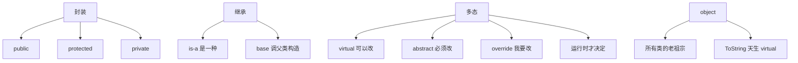

# C# 第 6 周：封装、继承、多态、virtual·override、abstract

---

上周把井字棋拆成三个类，学的是**一个类怎么用**。这周学**类与类之间的关系**：谁能看见谁的数据、谁从谁那里拿东西、同一个命令为什么会有不同反应。

前两个问题对应**封装**和**继承**，第三个问题对应**多态** —— 而多态这件事，是整个面向对象里唯一一个「不看代码根本想不到它能这么干」的特性。

这周的博客分两大块：**规矩篇**（谁能看见谁、谁能从谁那里继承）和**多态篇**（同一个命令，三种反应）。

> [!NOTE]
> 标题带【进阶】的节第一遍可以跳过。两套产出物（动物叫 + 员工工资）都在后面，建议边读边跑。

## 0. 这周的学习地图



一句话概括这周：**封封装管「谁能看见」，继承管「谁能拿走」，多态管「同一个动作不同人做出不同结果」。**

---

## 1. 封装：三档「谁看得见」

### 1.1 保护级别表

| 修饰符 | 自己类里 | 派生类里 | 类外面 |
|---|---|---|---|
| `public` | ✅ | ✅ | ✅ |
| `protected` | ✅ | ✅ | ❌ |
| `private` | ✅ | **❌** | ❌ |
| （不写） | ✅ | ❌ | ❌ |

### 1.2 最容易错的一条：private 连子类都不给看

```csharp
class Animal
{
    private string name;                 // 私有字段
    public Animal(string n) { name = n; }
}

class Dog : Animal
{
    public Dog(string n) : base(n) { }

    public void Show()
    {
        Console.WriteLine(name);         // 炸：子类也摸不到 private
    }
}
```

```text
error CS0122: "Animal.name"不可访问，因为它具有一定的保护级别
```

**「保护级别」这四个字就是判据。**

> [!IMPORTANT]
> `private` 的意思就是**「连亲儿子也不给看」**。
> 儿子继承的是「老爸这个人」，不是「老爸的所有秘密」—— 日记本拿到手了，打不开。

### 1.3 protected 和 private 在类外表现一模一样

```csharp
// 站在 Program 里，用 Dog 对象
Dog d = new Dog("旺财");

Console.WriteLine(d.name);     // 读：炸（如果 name 是 protected 或 private）
d.name = "x";                 // 写：也炸
```

**判据：站在类外面，受保护的成员既读不到也写不了。** 唯一的例外是「在派生类的方法体里」能访问。

### 1.4 【进阶】属性 vs 字段的封装

```csharp
class Player
{
    private int _hp;                              // 字段：永远 private
    public int Hp                                  // 属性：给外面的「窗口」
    {
        get => _hp;
        set => _hp = value < 0 ? 0 : value;        // 可以在 set 里做校验
    }
}
```

| | 字段 `private int _hp;` | 属性 `public int Hp { get; set; }` |
|---|---|---|
| 外面能看 | ❌ | ✅ |
| 能在赋值时校验 | ❌ | ✅ |
| 相当于 | 私房钱 | 贴在门口的账单 |

> [!TIP]
> 口诀：**字段永远 private，需要给外面看才开属性。**
> 属性的真正价值不是「能读能写」，是**能在 get/set 里加逻辑** —— 比如血量不许小于 0。

---

## 2. 继承：只有 is-a 才用它

### 2.1 形状

```csharp
class Animal                       // 基类（父类）
{
    protected string Name;         // protected：子类能用，外面不能

    public Animal(string name) { Name = name; }
}

class Dog : Animal                 // 派生类（子类）
{
    public Dog(string name) : base(name) { }   // base(...) 把值递上去
}
```

### 2.2 三种关系的判断法

```csharp
class Dog : Animal            // 狗「是一种」动物        -> 继承
class Car { Engine _e; }      // 车「有一个」引擎        -> 组合（字段）
class Board : ISaveable       // 棋盘「能被保存」        -> 接口
```

> [!IMPORTANT]
> **能说通「X 是一种 Y」才用继承。** 说不通就老老实实放字段（组合）。
> 车不是一种引擎，狗是一种动物 —— 这一句话能挡掉 80% 的错误继承。

### 2.3 base(name) 传的是「值」不是「字段」

```csharp
new FullTime("老王", 8000)
      |
      v
参数 name = "老王"              <- 暂时住在子类构造函数里
      |
      v
: base(name)                    <- 把「老王」这个值递上去
      |
      v
基类构造函数：Name = name        <- 基类存进自己的属性
      |
      v
子类构造函数体：_salary = salary
```

**传的是值，不是变量** —— 像把数字抄到另一张表上，两张表各存一份。

### 2.4 【进阶】this 和 base

| 关键字 | 指谁 | 常见用法 |
|---|---|---|
| `this` | 当前对象 | `this.Name = name;`、构造函数之间互调 `: this(...)` |
| `base` | 父类那一份 | `: base(name)`、调父类方法 `base.Speak()` |

```csharp
class Dog : Animal
{
    public Dog(string name) : base(name) { }       // 调父类构造

    public override void Speak()
    {
        base.Speak();                              // 先执行父类的版本
        Console.WriteLine("汪汪");                 // 再加自己的
    }
}
```

---
## 3. 多态：同一个命令，三种反应

### 3.1 三件套

| 关键字 | 写在哪 | 意思 |
|---|---|---|
| `virtual` | 基类 | 有默认实现，**可以被改** |
| `abstract` | 基类 | **没有**实现，子类**必须改** |
| `override` | 派生类 | 我**要改** |

```csharp
abstract class Animal
{
    protected string Name;
    public Animal(string name) { Name = name; }

    public abstract string Speak();      // 只有签名，没有身体
}

class Dog : Animal
{
    public Dog(string name) : base(name) { }

    public override string Speak() => $"{Name} 汪汪";
}

class Cat : Animal
{
    public Cat(string name) : base(name) { }

    public override string Speak() => $"{Name} 喵";
}
```

> [!TIP]
> `virtual` 的基类 = **一份填好的表格**，儿子不改也能交。
> `abstract` 的基类 = **只印了标题的空白表格** —— 儿子必须填，而且空白表格本身交不上去。

### 3.2 多态到底在干什么

```csharp
Animal[] zoo = { new Dog("旺财"), new Cat("咪咪"), new Cow("牛牛") };

foreach (Animal a in zoo)
{
    Console.WriteLine(a.Speak());        // 同一句，三种声
}
```

```text
旺财 汪汪
咪咪 喵
牛牛 哞
```

**注意：`a` 的类型全是 `Animal`，但每句调用的方法不同。**

| 情况 | 调哪个方法由谁决定 | 什么时候决定 |
|---|---|---|
| 有 `virtual`/`override` | 「盒子里**实际装的是什么**」 | **运行时** |
| 没有它们 | 「**变量的类型**」 | **编译时** |

> [!IMPORTANT]
> **多态 = 把「做什么」的决定时间，从编译时推迟到运行时。**
> 这就是为什么一个 `foreach (Animal a in zoo)` 能同时处理十种动物 —— 它不需要认识任何一个具体类型。

### 3.3 不写 override 会怎样：警告 CS0114

```csharp
class Dog : Animal
{
    public string Speak() => "汪汪";     // 少写了 override
}
```

```text
warning CS0114: "Dog.Speak()"隐藏继承的成员"Animal.Speak()"。若要使当前成员重写该实现，请添加 override 关键字。否则，请添加 new 关键字。
```

**注意这是警告不是错误，程序照样跑** —— 但结果**看着像对的**（不崩、有输出）。

```csharp
Animal a = new Dog("旺财");
Console.WriteLine(a.Speak());     // 走的是父类那版，不是狗的
```

**编译器已经把答案写在脸上了：「隐藏」。** 你是在隔壁又开了一个同名的门，老门还在。

> [!WARNING]
> 「能跑」和「跑对」是两回事。`CS0114` 把这句话钉死了。
> **看到 warning 一定要读**，它常常指向真正的 bug。

### 3.4 常见报错速查

| 报错 | 说明 | 怎么修 |
|---|---|---|
| `CS0114` | 隐藏了父类成员（警告） | 加 `override` 或 `new` |
| `CS0115` | 写了 override 但父类没有可重写的成员 | 父类加 `virtual`/`abstract` |
| `CS0534` | 子类没实现抽象成员 | 补上实现 |
| `CS0144` | 想 new 抽象类或接口 | 只能 new 具体子类 |
| `CS0508` | override 的返回类型跟父类不一致 | 改成一样 |
| `CS0621` | 虚拟成员被标成 private | 改 `public`/`protected` |


### 3.5 【进阶】object 是所有类的老祖宗

```csharp
object                     // 天生带 virtual ToString()
  +-- Employee             // 这里 override，改的是老祖宗那份
        +-- FullTime       // 不用写，直接继承 Employee 那份
```

**C# 里所有类都默认继承 `object`** —— 那个 `:` 是自动加上的，你看不见。

```csharp
public abstract class Employee
{
    public string Name { get; }

    protected Employee(string name) { Name = name; }

    public abstract int Pay();                    // 我不管你怎么算，你总得能算

    public override string ToString() => $"{Name} {Pay()}";
}
```

**为什么 Base 里能写 `Pay()`？** 因为它标了 `abstract` —— **基类不知道具体算法，但知道每个子类都会算。**

> 基类负责「格式」，子类负责「算法」。

| 你在哪 | 上面是谁 | 要不要 override |
|---|---|---|
| `Employee` 里的 `ToString()` | `object`（隐式） | ✅ 要 |
| `FullTime` 里的 `Pay()` | `Employee` | ✅ 要 |
| `FullTime` 里的 `ToString()` | `Employee`（已重写好） | 不用，继承即可 |

---
## 4. 产出物一：动物叫（多态的最小完整例子）

### 4.1 完整代码

```csharp
abstract class Animal
{
    protected string Name;

    public Animal(string name) { Name = name; }

    public abstract string Speak();              // 只有签名
}

class Dog : Animal
{
    public Dog(string name) : base(name) { }
    public override string Speak() => $"{Name} 汪汪";
}

class Cat : Animal
{
    public Cat(string name) : base(name) { }
    public override string Speak() => $"{Name} 喵";
}

class Cow : Animal
{
    public Cow(string name) : base(name) { }
    public override string Speak() => $"{Name} 哞";
}

// 顶层
Animal[] zoo = { new Dog("旺财"), new Cat("咪咪"), new Cow("牛牛") };

string longest = "";                            // 声明在循环外面！

foreach (Animal a in zoo)
{
    string voice = a.Speak();                    // 叫一次，存起来
    Console.WriteLine(voice);

    if (voice.Length > longest.Length)
        longest = voice;
}
Console.WriteLine($"叫声最长的是：{longest}");
```

实测输出：

```text
旺财 汪汪
咪咪 喵
牛牛 哞
叫声最长的是：旺财 汪汪
```

### 4.2 为什么叫声要「返回」而不是「打印」

一开始我把叫声写进构造函数：

```csharp
class Dog : Animal
{
    public Dog(string name) : base(name)
    {
        Console.WriteLine("汪汪!");       // 叫声写在这儿了
    }
}
```

三个子类里 `Speak()` **一个字都没写**。这带来两个问题：

1. **叫声只在 new 的时候响一次** —— 想再听一次得重新造对象
2. **没法比较长短** —— 打印出去的东西回不来，你拿不到那个字符串

> [!TIP]
> **能返回就别打印。** 返回的值可以打印、可以比大小、可以存文件、可以拼成一句话 —— 打印出去就只剩「看了一眼」。
> 这个原则在 Week 7 的 `string ToData()` 又出现了一次，是同一个思路。

---

## 5. 产出物二：员工工资（多态 + ToString + 字段设计）

### 5.1 题目

> 全职存月薪，兼职存时薪 + 工时。要求用 `Employee[]` 统一处理，打印出名字和工资。

### 5.2 完整代码

```csharp
public abstract class Employee
{
    public string Name { get; }             // 只读属性：构造里赋值，外面只能看

    protected Employee(string name)         // 抽象类的构造函数用 protected
    {
        Name = name;
    }

    public abstract int Pay();              // 我不管你怎么算，你总得能算

    public override string ToString() => $"{Name} {Pay()}";
}

class FullTime : Employee
{
    private readonly int _salary;           // 只有全职才有的字段

    public FullTime(string name, int salary) : base(name)
    {
        _salary = salary;
    }

    public override int Pay() => _salary;
}

class PartTime : Employee
{
    private readonly int _hour;             // 只有兼职才有的字段
    private readonly int _rate;

    public PartTime(string name, int hour, int rate) : base(name)
    {
        _hour = hour;
        _rate = rate;
    }

    public override int Pay() => _hour * _rate;
}

// 顶层
Employee[] workers =
{
    new FullTime("老王", 8000),
    new PartTime("小李", 50, 120)
};

foreach (Employee a in workers)
{
    Console.WriteLine(a);       // 直接打印对象，自动调 ToString()
}
```

实测输出：

```text
老王 8000
小李 6000
```

### 5.3 字段为什么不能全塞基类

| 放法 | 结果 |
|---|---|
| 全塞基类 | 基类变**杂物间** —— 全职对象里躺着一个用不到的「工时」 |
| 各家自己装（对的） | 基类只装**所有子类都需要的**（这里只有 `Name`） |

> [!IMPORTANT]
> **基类的判断标准：这个字段是不是「所有子类都需要」？** 不是就放子类。

### 5.4 `_` 前缀 + `readonly`

```csharp
private readonly int _hour;
```

| 写法 | 作用 |
|---|---|
| `_` 前缀 | 一眼分清「字段」和「参数」，.NET 官方源码也这么写 |
| `readonly` | 只有构造函数能赋值一次 |

手滑想改它：

```text
error CS0191: 无法分配到只读字段（除非在定义了该字段的类型的构造函数中…）
```

**这是好事** —— 编译器帮你挡掉「本该不变的字段被改了」。

### 5.5 【进阶】别把 readonly 用过头

| 场景 | 用 `readonly` 还是 `set` |
|---|---|
| 构造后永远不变（Id、出生日期、月薪） | `readonly` / `{ get; }` |
| 状态会变（血量、是否完成） | `{ get; set; }` |
| 集合内容会变但引用不变 | `private readonly List<T> _items = new();` |

**第三个最容易看错**：`readonly` 锁的是「这个字段指向哪个对象」，**不锁对象内部**。所以 `_items.Add(x)` 完全合法。

---
## 6. 五个真踩过的坑

### 坑 1：以为继承 = 搬家，东西都归子类了

```csharp
class Animal
{
    private string name;         // private
}

class Dog : Animal
{
    public void Show() => Console.WriteLine(name);   // 子类想用
}
```

```text
error CS0122: "Animal.name"不可访问，因为它具有一定的保护级别
```

**根因**：继承 = **使用权的分配**，不是搬家。`private` 连亲儿子也不给看。

### 坑 2：以为不写 override 就是把原来的改掉了

```text
warning CS0114: "Dog.Speak()"隐藏继承的成员"Animal.Speak()"
```

**根因**：不写 `override` 是在隔壁又开了一个同名的门，老门还在。用父类变量调用时走的是老门。

### 坑 3：把叫声写进构造函数

```csharp
class Dog : Animal
{
    public Dog(string name) : base(name)
    {
        Console.WriteLine("汪汪!");     // 放这儿了
    }
}
```

**后果**：叫声只在 `new` 那一刻响一次，而且你拿不到那个字符串去比较。

**根因**：构造函数 = **出厂设置**，只在 `new` 那一刻跑一次。它不是「这个类会做什么」的地方。

### 坑 4：找最值的变量声明在循环里

```csharp
foreach (Animal a in zoo)
{
    string longest = "";              // 每轮重置，上一圈记的全丢

    if (a.Speak().Length > longest.Length) longest = a.Speak();
}
```

**正确**：声明在循环外面。

> [!IMPORTANT]
> 口诀：**「跨轮要用的东西，都在圈外面」。**
> 这个坑在第 3 周排序（`int max`）、第 8 周编号（`int i` 和 `history`）反复出现 —— **它是最容易复发的错**。

### 坑 5：循环条件里用了循环体会改的东西

```csharp
for (int i = 0; i < nums[i] - 1; i++)   // 恒假 / 越界
```

**根因**：`nums[i]` 会被循环体改动，导致条件忽真忽假 —— 条件必须是**稳定的**。

> [!CAUTION]
> **循环条件里不许出现「会被循环体改动的东西」。**
> 这条和第 3 周的 `(i + 1) % 3 != 0`、第 8 周的 `i < nums[i] - 1` 是同一个毛病。

---

## 7. 练习题（答案折叠，先自己写）

### 7.1 基础（6 题）

**1.** 三个保护级别各谁能访问？

<details>
<summary>答</summary>

| 修饰符 | 自己 | 派生类 | 外面 |
|---|---|---|---|
| `public` | ✅ | ✅ | ✅ |
| `protected` | ✅ | ✅ | ❌ |
| `private` | ✅ | ❌ | ❌ |

</details>

**2.** 写一个抽象类 `Shape`，有抽象方法 `double Area()`，再写两个子类。

<details>
<summary>答</summary>

```csharp
abstract class Shape
{
    public abstract double Area();
}

class Circle : Shape
{
    private readonly double _r;
    public Circle(double r) { _r = r; }
    public override double Area() => 3.14159 * _r * _r;
}

class Rect : Shape
{
    private readonly double _w, _h;
    public Rect(double w, double h) { _w = w; _h = h; }
    public override double Area() => _w * _h;
}
```

</details>

**3.** `virtual` 和 `abstract` 有什么区别？

<details>
<summary>答</summary>

| | `virtual` | `abstract` |
|---|---|---|
| 有没有默认实现 | **有** | **没有** |
| 子类必须重写吗 | 不必 | **必须** |
| 所在类能否 new | 能 | **不能** |

</details>

**4.** 下面这段能编译吗？为什么？

```csharp
Animal a = new Animal("x");    // Animal 是 abstract class
```

<details>
<summary>答</summary>

不能。

```text
error CS0144: 无法创建抽象类型或接口的实例
```

但抽象类型的**变量**可以声明，装具体子类的对象：

```csharp
Animal a = new Dog("旺财");     // 合法
```

</details>

**5.** 在子类构造函数里写 `: base(name)`，这个 `name` 传的是字段还是值？

<details>
<summary>答</summary>

传的是**值**（参数变量里的那个值）。像把数字抄到另一张表上，两张表各存一份。

所以子类里叫 `paramName`、基类里叫 `name`，只要值对得上就行。

</details>

**6.** 为什么 `ToString()` 前面要写 `override`？

<details>
<summary>答</summary>

因为 **C# 里所有类都默认继承 `object`**，而 `object` 天生带一个 `virtual ToString()`。你不写 `override` 就是「隐藏」，会得到 `CS0114` 警告。

```text
warning CS0114: "Employee.ToString()"隐藏继承的成员"object.ToString()"
```

</details>
### 7.2 进阶（6 题）

**7.** 下面这段为什么输出不对？

```csharp
class Dog : Animal { public string Speak() => "汪汪"; }

Animal a = new Dog("旺财");
Console.WriteLine(a.Speak());     // 输出 Animal 的默认文本
```

<details>
<summary>答</summary>

因为 `Dog.Speak()` 没写 `override`，它只是**隐藏**了父类的版本（`CS0114` 警告）。

用父类变量调用时，编译器按**变量的类型**（`Animal`）去找方法，走的是父类那版。

修法：给 `Dog.Speak()` 加 `override`。

</details>

**8.** 基类写了 `public virtual void Speak()`，子类能不能完全不重写？

<details>
<summary>答</summary>

**能。** `virtual` 有默认实现，子类不重写就继承父类那版。

这是 `virtual` 和 `abstract` 的关键区别 —— **`abstract` 不重写会报 `CS0534`**。

</details>

**9.** 什么时候必须用 `abstract` 而不是 `virtual`？

<details>
<summary>答</summary>

**当「基类根本给不出一个合理的默认实现」时。**

比如 `Shape.Area()` —— 一个「抽象的图形」没有面积可言，给个 0 是错的，反而会让忘记重写的子类悄悄返回错误值。

| 情况 | 用 |
|---|---|
| 有合理默认值（`Speak()` 默认「沉默」） | `virtual` |
| 没有合理默认值（`Area()`） | `abstract` |

</details>

**10.** 如果一个类实现了接口又继承了基类，冒号后面怎么写？

<details>
<summary>答</summary>

**基类必须写在最前面**，接口跟在后面：

```csharp
class Player : Human, ISaveable, IComparable<Player>
{
    // ...
}
```

顺序写反会报错 —— 编译器要求「类的直接基类」只能有一个且必须排第一。

</details>

**11.** 下面两段代码，哪段会在运行时崩溃？为什么？

```csharp
// A
Animal a = new Dog("旺财");
string s = a.Speak();

// B
Animal b = null;
string s2 = b.Speak();
```

<details>
<summary>答</summary>

**B 会崩**，报 `NullReferenceException`。

多态只解决「调哪个方法」，不解决「对象在不在」。变量是 `null` 时根本没有对象，谈不上「哪个版本的方法」。

防法：用 `b?.Speak()`（Week 7 学的空条件运算符）。

</details>

**12.** 为什么 `private readonly List<int> _items` 还能 `_items.Add(1)`？

<details>
<summary>答</summary>

因为 `readonly` 锁的是**「这个字段指向哪个对象」**，不锁对象内部。

```csharp
private readonly List<int> _items = new();

_items.Add(1);          // 合法：没换对象，只是往对象里塞
_items = new List<int>();  // 炸：换对象了（CS0191）
```

</details>

### 7.3 挑战（4 题）

**13.** 写一个 `Player` 基类，派生 `Warrior` 和 `Mage`，各有自己的 `Attack()`，要求用数组统一遍历。

<details>
<summary>答</summary>

```csharp
abstract class Player
{
    public string Name { get; }
    protected Player(string n) { Name = n; }
    public abstract int Attack();
    public override string ToString() => $"{Name} 攻击 {Attack()}";
}

class Warrior : Player
{
    public Warrior(string n) : base(n) { }
    public override int Attack() => 80;          // 物理攻击高
}

class Mage : Player
{
    private readonly int _mp;
    public Mage(string n, int mp) : base(n) { _mp = mp; }
    public override int Attack() => _mp * 3;     // 看蓝量
}

Player[] team = { new Warrior("阿强"), new Mage("小美", 30) };
foreach (var p in team) Console.WriteLine(p);
```

```text
阿强 攻击 80
小美 攻击 90
```

</details>

**14.** 让子类能扩展父类的方法（先执行父类的，再加自己的），怎么写？

<details>
<summary>答</summary>

用 `base.Method()`：

```csharp
class Dog : Animal
{
    public override string Speak()
    {
        string parent = base.Speak();          // 先拿父类的
        return parent + " + 摇尾巴";           // 再加自己的
    }
}
```

**注意**：只有父类那版是 `virtual` 或 `abstract` 时，子类才能 `override`；也只有这样 `base.` 才有东西可调。

</details>

**15.** 抽象类能不能有构造函数？它有什么用？

<details>
<summary>答</summary>

**能，而且必须有**（如果你想让基类的那部分字段被初始化）。

```csharp
public abstract class Employee
{
    public string Name { get; }

    protected Employee(string name)        // protected：只有子类能调
    {
        Name = name;
    }
}
```

虽然抽象类不能 `new`，但 **子类 new 的时候会先执行基类的构造函数** —— 这就是 `: base(name)` 在干的事。

标 `protected` 是因为「只有子类该调它」，外面不该 `new` 抽象类自然也调不到。

</details>

**16.** 什么叫「面向抽象编程」？举一个本周代码里的例子。

<details>
<summary>答</summary>

**代码里只依赖抽象（抽象类/接口），不依赖具体类。**

本周的例子就是 `Employee[] workers` —— 这个数组不认识 `FullTime` 也不认识 `PartTime`，它只知道「你总得能 `Pay()`」。

好处：**以后加 `Intern`（实习生）、`Contractor`（外包），这个 foreach 一行都不用改。**

```csharp
foreach (Employee a in workers)   // 加多少种都行
    Console.WriteLine(a);
```

Week 7 的 `ILogger` 是同一个思路的更进一步 —— 连「是一种」的关系都不需要了，只要「能做到」。

</details>

---

## 8. 检查标准

过完这周，应该能**不查资料**做到：

- [ ] 说出三个保护级别各谁能访问，并解释为什么 private 连子类都不给
- [ ] 说清「继承 = is-a，组合 = has-a」，并各举一个反例
- [ ] 解释 `: base(name)` 传的是值还是字段
- [ ] 说清 `virtual` / `abstract` / `override` 三者的分工
- [ ] 解释「什么时候该用 abstract 而不是 virtual」
- [ ] 解释多态是怎么把「做决定」推迟到运行时的
- [ ] 说出 `CS0114`（隐藏）和 `override`（重写）的区别
- [ ] 解释 `ToString()` 前面为什么要写 `override`（答案在 object）
- [ ] 说清字段该放基类还是放子类的判断标准
- [ ] 解释 `readonly` 为什么挡不住 `List.Add`

**验收题**（第 6 周总验收，100 行以内）：

> 写一个抽象类 `Shape`，派生圆、矩形、三角形，各自实现 `Area()`；用 `Shape[]` 统一遍历打印「名字 + 面积」（用 `ToString()`）；再找出面积最大的那个。

---

## 9. 下一周预告

第 7 周：**接口 / 静态成员 / 命名空间 / partial**。

这周学的继承解决的是「**是一种**」—— 狗是一种动物。但有些能力没法用血缘描述：棋盘「**能被保存**」，这跟它是不是图形毫无关系。

下周学接口：**一个类能同时答应无数份合同**，而继承只能有一个爹。产出物是一套「能换引擎的日志系统」—— 一行代码不改，把日志从屏幕换到文件。
