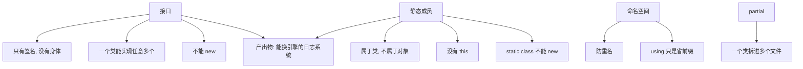

# C# 第 7 周：接口、静态成员、命名空间、partial

---

上周学的都是**类与类的关系**（谁继承谁、谁能替换谁）。这周学一个完全不同的东西：**类与承诺的关系**。

继承说的是「你**是**什么」，接口说的是「你**能**做什么」。狗是动物（继承），棋盘能被保存（接口）—— 两句话都在描述棋盘，但第二句可以在任何类身上成立，哪怕它跟棋盘毫无血缘关系。

这周的博客分两大块：**契约篇**（接口怎么定、怎么实现、跟继承怎么分工）和**全局篇**（静态成员、命名空间、partial 这些「不属于某个对象」的东西）。

> [!NOTE]
> 标题带【进阶】的节第一遍可以跳过。最后那套「能换引擎的日志系统」是这周的产出物，建议做完再回头读一遍进阶。

## 0. 这周的学习地图



一句话概括这周：**接口是「你必须能做到」，静态是「全程序共用一份」，using 只是「省得写全名」。**

---

## 1. 接口：一份只写「能做到什么」的合同

### 1.1 形状

```csharp
interface ISaveable
{
    string ToData();        // 只有签名，没有函数体，结尾是分号
}
```

拆开看：

| 部位 | 说明 |
|---|---|
| `interface` | 关键字，声明「这是个接口」 |
| `ISaveable` | 名字。**行业约定：接口名以大写 I 开头** |
| `string` | 返回类型 |
| `ToData()` | 方法签名 + **分号**（不是花括号） |

> [!WARNING]
> 接口里写分号，类里写花括号。在**类**里写 `public static void SetLogger(ILogger logger);` 会报 `CS0501: 必须声明主体` —— 编译器以为你要声明一个方法但没有身体。

### 1.2 实现它：必须写 public

```csharp
class Board : ISaveable              // 冒号后面写接口名
{
    public string ToData()           // 必须 public，签名必须一致
        => $"棋盘 {_cells.Length} 格";
}
```

| 位置 | 要不要写 `public` |
|---|---|
| 接口里面 | **不用**（隐式就是 public；写 `private` 反而报 `CS0501`） |
| 实现类里面 | **必须写**，否则 `CS0737: 无法实现接口成员，因为它不是公共的` |

> [!IMPORTANT]
> **接口是公开的承诺，实现就必须跟着公开。** 不许「偷偷实现」。

### 1.3 名字一样 ≠ 实现了接口

```csharp
class Board
{
    public string ToData() => "...";     // 方法名一模一样，但没写 : ISaveable
}

ISaveable[] items = { new Board() };      // 炸
```


error CS0266: 无法将类型"Board"隐式转换为"ISaveable".


**接口是显式签的合同。** 你的方法碰巧同名，编译器根本不知道你「答应过」。

## 2. 接口 vs 继承：一句话分清

| | 继承 | 接口 |
|---|---|---|
| 表达的关系 | **是一种**（is-a） | **能做**（can-do） |
| 一个类能有几个 | **只有 1 个** | **不限** |
| 内容 | 可以有实现、可以有字段 | **只有签名** |
| 能不能 new | 抽象基类不能 | **绝对不能** |

三种关系的判断法：

```csharp
class Dog : Animal            // 狗「是一种」动物        -> 继承
class Car { Engine _e; }      // 车「有一个」引擎        -> 组合（字段）
class Board : ISaveable       // 棋盘「能被保存」        -> 接口
```

实测「想用继承代替接口」会撞墙：


error CS1721: 类"Car"不能具有多个基类: "Engine" 和 "Wheel"


**想给一个类加两种能力，继承根本不够用 —— 只有接口能无限叠加。**

> [!TIP]
> 判断口诀：**「是一种」-> 继承；「有一个」-> 字段；「能做到」-> 接口。**

### 2.1 【进阶】接口方法该返回值还是该自己干活

一开始我把接口写成 `void Save(string path)`。结果两个类都往同一个文件写，**后写的把先写的覆盖了**。

改成 `string ToData()`：**类只交出数据，不负责存哪。**

| 接口长什么样 | 类要操心什么 | 调用方能干什么 |
|---|---|---|
| `void Save(string path)` | 得知道往哪存 | 只能存文件 |
| `string ToData()` | 只负责拼字符串 | 存文件 / 打印 / 发网络 / 比对 |

```csharp
ISaveable[] items = { new Board(), new Player() };

// 同一批 ToData()，四种用法
File.AppendAllText("save.txt", item.ToData());   // 存文件
Console.WriteLine(item.ToData());                  // 打印
if (a.ToData() == b.ToData()) { }                   // 比对
```

> [!TIP]
> 这叫**职责分离**：**类管「数据长什么样」，调用方管「数据去哪」。**
> `void Save(path)` 是「东西给你了，我不管你去哪」；`string ToData()` 是「数据给你，你怎么用自己定」。
## 3. 静态成员：属于类，不属于对象

### 3.1 形状

```csharp
static class LogManager                  // 类前加 static = 不能 new
{
    private static ILogger? _current;    // 全程序共用这一个

    public static void SetLogger(ILogger logger) => _current = logger;

    public static void Write(string msg) => _current?.Log(msg);
}
```

| | 实例成员 | 静态成员 |
|---|---|---|
| 属于谁 | **每个对象一份** | **全类共用一份** |
| 怎么调 | `对象.方法()` | `类名.方法()` |
| 有没有 `this` | 有 | **没有** |
| 常见例子 | `player.Name` | `Console.WriteLine`、`Math.Max`、`File.ReadAllText` |

### 3.2 静态方法摸不到实例字段

```csharp
class Counter
{
    private int _count;                      // 实例字段

    public static void Reset()
    {
        _count = 0;                          // 炸
    }
}
```

```text
error CS0120: 对象引用对于非静态的字段、方法或属性"Counter._count"是必需的
```

**为什么不可能**：想想这段代码

```csharp
Counter a = new Counter();
Counter b = new Counter();
Counter.Reset();          // 清谁的？a 的还是 b 的？
```

**编译器不让你回答这个问题。** 静态方法属于类本身，类只有一个，对象可以有无数个 —— 所以它**无从知道**该操作哪个对象的数据。

> [!IMPORTANT]
> **静态方法里没有 `this`。** 没有 `this` 就摸不到任何对象的数据。

### 3.3 static class 与普通 class 的区别

```csharp
static class Math2                        // 不能 new
{
    public static int Square(int x) => x * x;
}

class Math3                               // 能 new，也能直接调静态方法
{
    public static int Square(int x) => x * x;
}

Math2.Square(3);        // 对
new Math3().Square(3);  // 对（虽然没意义）
new Math2();            // 炸：CS0720 无法创建静态类的实例
```

**判据**：`static class` 的全部成员必须都是静态的，且永远不能实例化。专门放工具函数的类才这么写。

> [!WARNING]
> **静态的危险**：谁都能改。`SetLogger` 一调，全程序行为都变。
> 适合工具函数和全局配置，**不适合装业务数据** —— `static int playerHp` 会让所有玩家共用一管血。

### 3.4 【进阶】静态初始化的顺序

```csharp
class Config
{
    public static int Level = Load();     // 静态字段初始化器

    static Config()                       // 静态构造函数：类型第一次被用到时跑一次
    {
        Console.WriteLine("Config 被初始化了");
    }

    static int Load()
    {
        Console.WriteLine("Load 跑了");
        return 1;
    }
}

Console.WriteLine(Config.Level);          // 先 Load 跑 / 再静态构造 / 再打印 1
Console.WriteLine(Config.Level);          // 第二次什么都不跑，值已缓存
```

**要点：静态初始化只发生一次**（第一次访问这个类型时）。所以别把「需要每次刷新」的东西放静态字段 —— 它只跑一遍。

## 4. 命名空间：只是给名字加个前缀

### 4.1 它解决什么问题

```csharp
namespace Shop
{
    class Order { public static int No = 1001; }
}

namespace School
{
    class Order { public static int No = 2002; }
}

Console.WriteLine(Shop.Order.No);      // 1001
Console.WriteLine(School.Order.No);    // 2002
```

**命名空间 = 姓氏。** 同名的人靠姓氏区分，同名的类靠命名空间区分。

### 4.2 using 到底在干什么（最常见的误解）

**错误理解**：`using Shop;` 是「把 Shop 那个文件引入进来」。

**实际**：`using` 只是**省前缀**。所有代码早就在程序集里了，跟文件没有半点关系。

反证一：去掉 using 报的不是「找不到类」，而是「不知道你说的是谁」——

```text
error CS0103: 当前上下文中不存在名称"Order"
```

而 `Shop.Order.No` **完全能跑**。它明明存在，只是你没说姓什么。

反证二：两个 using 一起用反而坏事儿——

```csharp
using A;
using B;

Console.WriteLine(new Logger());
```

```text
error CS0104: "Logger"是"A.Logger"和"B.Logger"之间的不明确的引用
```

**结论：using 只是省字的便利，冲突时它帮不上忙，还会帮倒忙。** 重名就写完整名字。

### 4.3 【进阶】using 别名

```csharp
using LgB = B.Logger;      // 给 B.Logger 起个别名

var a = new Logger();      // A.Logger
var b = new LgB();         // B.Logger，不冲突了
```

## 5. partial：把一个类拆进多个文件

```csharp
// File1.cs
partial class Player
{
    public void Move() { }
}

// File2.cs
partial class Player
{
    public void Jump() { }
}

// 两半合成一个 Player，有 Move 也有 Jump
```

**用途**：工具自动生成的代码（Unity 的序列化代码、WinForms 的设计器代码）单独放一个文件，人工改的和机器生成的分开，互不覆盖。

> [!NOTE]
> `partial` 只是**编译期的拼装**，不影响运行。所有部分必须：同一个命名空间、同一个类名、都标 `partial`。
## 6. 产出物：一套能换引擎的日志系统

前面四块知识到这里合成一个东西：**一行代码不改，把日志从屏幕换到文件。**

```csharp
interface ILogger
{
    void Log(string message);        // 唯一的约定：你得能记一条消息
}

class ConsoleLogger : ILogger
{
    public void Log(string message) => Console.WriteLine($"[INFO] {message}");
}

class FileLogger : ILogger
{
    public void Log(string message)
        => File.AppendAllText("log.txt", $"{DateTime.Now:HH:mm:ss} {message}\n");
}

static class LogManager              // 静态：全程序共用这一个「插座」
{
    private static ILogger? _current;

    public static void SetLogger(ILogger logger) => _current = logger;

    public static void Write(string msg) => _current?.Log(msg);
}

// 顶层：换引擎只改一行
LogManager.SetLogger(new ConsoleLogger());
LogManager.Write("第一条");          // 屏幕：[INFO] 第一条

LogManager.SetLogger(new FileLogger());
LogManager.Write("第二条");          // 文件：17:58:23 第二条
```

实测输出：

```text
[INFO] 第一条
log.txt 里：17:58:23 第二条
```

### 6.1 为什么 new ConsoleLogger() 能塞进 ILogger 参数

```csharp
SetLogger(ILogger logger)        // 参数声明的类型是接口
SetLogger(new ConsoleLogger())   // 传进去的是具体类
```

**因为 ConsoleLogger 实现了 ILogger，编译器允许这一步隐式转换。**

> 就像「招一个会开车的」，来的人开自己的车 —— 只要你确实会开车，招人的不在乎你开什么车。

### 6.2 新语法：? 和 ?.

```csharp
private static ILogger? _current;      // ? 表示这个变量可以是 null

public static void Write(string msg) => _current?.Log(msg);   // ?. 空就跳过，不报错
```

没有 `?.` 的话，一旦没人 `SetLogger` 就直接：

```text
NullReferenceException: Object reference not set to an instance of an object.
```

> [!TIP]
> `?.` 是**空条件运算符**：左边是 null 就整个表达式短路成 null，不执行右边。比 if 判空少写四行。

### 6.3 => 不完全是 return

```csharp
int Twice(int x) => x * 2;                     // 等价于 { return x * 2; }
void Log(string m) => Console.WriteLine(m);    // void 没返回值，只是「执行这一句」
```

| 情况 | `=>` 右边那一句等价于 |
|---|---|
| 有返回类型 | `{ return 表达式; }` |
| `void` | `{ 表达式; }`（**不是 return**） |
| 只读属性 | `{ get { return 表达式; } }` |

> [!IMPORTANT]
> **`=>` 的意思是「这个成员的身体就是右边这一句」。** 有返回值时顺便当 return；`void` 时就只是「只有这一句」。
> 它只能用在**成员**上（方法、属性、构造函数），不能用在 `if` / `for` 上 —— 那些不是成员，会报 `CS1001: 应输入标识符`。

### 6.4 【进阶】为什么这套设计叫「可插拔」

加第三个 logger（比如发微信），要改几处？

```csharp
class WeChatLogger : ILogger
{
    public void Log(string message) => Console.WriteLine($"[微信] {message}");
}

// 使用处只改一行
LogManager.SetLogger(new WeChatLogger());
```

**其余代码零改动。** 这就是接口 + 静态组合出来的「可插拔」：

```text
LogManager        <- 只认 ILogger 这个合同，不认具体是谁
  |
  +-- ConsoleLogger
  +-- FileLogger
  +-- WeChatLogger   <- 以后加多少个都不用动 LogManager
```

> [!NOTE]
> 这个模式在真实项目里叫**策略模式（Strategy）**，Unity 里叫「依赖注入」的简化版。第 9 周的事件、第 11 周的 LINQ 都会再用到同一种「面向接口写，不面向具体类写」的思路。

---

## 7. 五个真踩过的坑

### 坑 1：以为方法名一样就算实现了接口

```csharp
class Board
{
    public string ToData() => "...";     // 名字一样，但没写 : ISaveable
}

ISaveable[] items = { new Board() };
```

```text
error CS0266: 无法将类型"Board"隐式转换为"ISaveable"。存在一个显式转换(是否缺少强制转换?)
```

**根因**：接口是**显式签的合同**。名字碰巧相同，编译器不知道你「答应过」。

### 坑 2：static 方法想改实例字段

```text
error CS0120: 对象引用对于非静态的字段、方法或属性"Counter._count"是必需的
```

**根因**：静态方法没有 `this`，不知道该操作哪个对象。

### 坑 3：把 using 当成「加载文件」

**错误说法**：「using 就是引入一个文件，文件里有很多类」。

**实际**：using 只是省前缀，所有代码早就在程序集里。判据是 `CS0103`（不知道你说谁）而不是「找不到文件」，而且写全名 `Shop.Order.No` 一直都能跑。

### 坑 4：属性和方法写混了

```csharp
public static int Count { get; set { return _count; } }   // 想出来的写法
```

```text
error CS0127: 由于"Player.Count.set"返回 void，返回关键字后面不得有对象表达式
```

**根因**：`get` 往外拿（用 `return`），`set` 往里放（用 `value`，**不能 return**）。

**正确**：

```csharp
public static int Count => _count;                     // 只读属性，=> 展开成 get
```

### 坑 5：类里写了分号

```csharp
public static void SetLogger(ILogger logger);    // 少了大括号
```

```text
error CS0501: "LogManager.SetLogger(ILogger)"必须声明主体，因为它未标记为 abstract、extern 或 partial
```

**根因**：**分号是接口的写法，类的写法必须是 `{ }`。**

---

## 8. 练习题（答案折叠，先自己写）

### 8.1 基础（6 题）

**1.** 接口里的方法和实现类里的方法，各要不要写 `public`？

<details>
<summary>答</summary>

- **接口里不用写** —— 隐式就是 public；写 `private` 反而报 `CS0501`。
- **实现类必须写** —— 不写就是私有，报 `CS0737: 无法实现接口成员，因为它不是公共的`。

</details>

**2.** 静态方法为什么不能访问实例字段？

<details>
<summary>答</summary>

因为静态方法属于类，不属于对象。类只有一个，对象可以有无数个 —— 它没有 `this`，不知道该操作哪个对象的数据。

```text
error CS0120: 对象引用对于非静态的字段、方法或属性"Counter._count"是必需的
```

</details>

**3.** 一个类能实现多个接口吗？能继承多个类吗？

<details>
<summary>答</summary>

**接口：可以很多个。** `class Foo : Bar, ISaveable, IDisposable`
**类：只能一个。** 多继承报 `CS1721: 类不能具有多个基类`。

</details>

**4.** 接口能 new 吗？抽象类能 new 吗？

<details>
<summary>答</summary>

都不能。报 `CS0144: 无法创建抽象类型或接口的实例`。

但两者都能「声明变量、装实现类的对象」：

```csharp
ILogger a = new ConsoleLogger();     // 声明类型是接口，实际对象是具体类
```

</details>

**5.** 给 `ISaveable` 实现一个 `Player` 类，让它也能被保存。

<details>
<summary>答</summary>

```csharp
class Player : ISaveable
{
    public string Name { get; } = "玩家";
    public int Hp { get; set; } = 100;

    public string ToData() => $"{Name}|{Hp}";
}

ISaveable[] items = { new Board(), new Player() };
foreach (var it in items)
    File.AppendAllText("save.txt", it.ToData() + "\n");
```

</details>

**6.** `static class` 里能不能有实例字段？

<details>
<summary>答</summary>

不能。实测：

```text
error CS0708: "LogManager._current": 不能在静态类中声明实例成员
```

静态类里所有成员都必须是静态的。

</details>
### 8.2 进阶（6 题）

**7.** `void Save(string path)` 和 `string ToData()` 有什么区别？为什么后者更好？

<details>
<summary>答</summary>

| | `void Save(path)` | `string ToData()` |
|---|---|---|
| 类要操心什么 | 得知道往哪存 | 只负责拼字符串 |
| 调用方能干什么 | 只能存文件 | 存文件 / 打印 / 发网络 / 比对 |
| 想改成存数据库 | 每个类都得改 | 改调用处一处 |

**职责分离**：类管「数据长什么样」，调用方管「数据去哪」。

</details>

**8.** 下面这段能编译吗？为什么？

```csharp
class Logger { public void Log(string m) { } }
class FileLogger : Logger { public void Log(string m) { } }   // 没写 override / new
```

<details>
<summary>答</summary>

能编译，但**只是警告** `CS0114`：

```text
warning CS0114: "FileLogger.Log(string)"隐藏了继承的成员"Logger.Log(string)"。若要使当前成员重写该实现，请添加 override 关键字。否则，请添加 new 关键字。
```

**这是「隐藏」不是「重写」**：用 `Logger` 变量指向 `FileLogger` 对象时，调的还是父类那个。

</details>

**9.** 为什么 `new Math3().Square(3)` 能跑？明明 `Square` 是静态的。

<details>
<summary>答</summary>

**普通 class 的静态方法，用对象也能调**（编译器会警告但能过）。只有 `static class` 才连实例都造不出来。

**结论**：判断「能不能实例化」看类前面有没有 `static`，不看里面有没有静态方法。

</details>

**10.** 两个项目的类名都叫 `Order`，你有三种办法让它们共存，各是什么？

<details>
<summary>答</summary>

1. **写完整名字**：`Shop.Order.No` / `School.Order.No`（最稳，永远能用）
2. **只 using 其中一个**，另一个写全名
3. **using 别名**：`using ShopOrder = Shop.Order;` 之后用 `ShopOrder.No`

两个都 `using`（且不写全名）→ `CS0104: 不明确的引用`。

</details>

**11.** 加一个 `WeChatLogger` 需要改几处？为什么？

<details>
<summary>答</summary>

**只加一个类，其余零改动**：

```csharp
class WeChatLogger : ILogger
{
    public void Log(string message) => Console.WriteLine($"[微信] {message}");
}

LogManager.SetLogger(new WeChatLogger());   // 使用处改这一行
```

实测输出：

```text
[INFO] A
[微信] B
```

因为 `LogManager` 只依赖 `ILogger` 这个**合同**，不认识任何具体类。这就是「面向接口编程」的好处。

</details>

**12.** 为什么 `SetLogger` 必须是静态的？写成实例方法会怎样？

<details>
<summary>答</summary>

写成实例方法就会有**无数个插座**：

```csharp
var a = new LogManager();
a.SetLogger(new FileLogger());

var b = new LogManager();
b.SetLogger(new ConsoleLogger());   // 另一个插座，改了也没用
```

**「当前 logger」这个词本身就要求全局唯一。** 静态字段保证「一处设定，处处生效」。

</details>

### 8.3 挑战（4 题）

**13.** 让 `ILogger` 支持「日志级别」（Info / Warn / Error），改哪几处？

<details>
<summary>答</summary>

```csharp
enum LogLevel { Info, Warn, Error }

interface ILogger
{
    void Log(LogLevel level, string message);
}

class ConsoleLogger : ILogger
{
    public void Log(LogLevel level, string message)
        => Console.WriteLine($"[{level}] {message}");
}
```

**改三处**：接口签名、每个实现类、所有调用处（`LogManager.Write` 也要跟着加参数）。

> 这就是**改接口的代价** —— 签名一改，所有实现类和调用点全部要动。所以接口设计要一次想清楚，「先窄后宽」比「先宽后窄」好改。

</details>

**14.** 写一个 `CompositeLogger`，同时往屏幕和文件写。

<details>
<summary>答</summary>

```csharp
class CompositeLogger : ILogger
{
    private readonly ILogger[] _targets;

    public CompositeLogger(params ILogger[] targets) => _targets = targets;

    public void Log(string message)
    {
        foreach (var t in _targets) t.Log(message);
    }
}

// 用法：两个一起
LogManager.SetLogger(new CompositeLogger(new ConsoleLogger(), new FileLogger()));
LogManager.Write("两边都有");
```

**这个模式叫「组合器」**：它自己也实现了 `ILogger`，所以能塞进 `SetLogger`，也能再套一层。

</details>

**15.** 把日志系统改成「可以记录时间戳格式」，且换格式不改 `LogManager`。

<details>
<summary>答</summary>

把「怎么格式化」也抽成接口：

```csharp
interface ILogFormatter
{
    string Format(string message);
}

class TimeFormatter : ILogFormatter
{
    public string Format(string m) => $"{DateTime.Now:HH:mm:ss} {m}";
}

class PlainFormatter : ILogFormatter
{
    public string Format(string m) => m;
}
```

**核心思路**：「会被替换的行为」都应该藏在一个接口后面。日志往哪写、怎么写、什么格式，三件事三个接口。

</details>

**16.** `partial` 能拆一个类，那它能拆一个方法吗？

<details>
<summary>答</summary>

**不能。** `partial` 只能用在 **class / struct / interface** 上。

但有类似效果的 **`partial method`**：

```csharp
partial class Player
{
    partial void OnLevelUp();      // 只声明，不一定有实现
}

partial class Player
{
    partial void OnLevelUp() { Console.WriteLine("升级了"); }   // 实现
}
```

**关键特性**：如果没人写实现，**调用处会被编译器整个删掉**（零开销）。这是 Unity/Godot 里「生成代码 hook」的常用手法。

</details>

---

## 9. 检查标准

过完这周，应该能**不查资料**做到：

- [ ] 说出接口和继承各自表达什么关系，各能写几个
- [ ] 说清接口里和实现类里 `public` 的区别，并说出对应的报错码
- [ ] 解释为什么方法名相同不算实现接口
- [ ] 解释「接口方法该返回值而不是自己干活」的理由
- [ ] 说清静态成员和实例成员的区别，尤其是「有没有 `this`」这一条
- [ ] 说出 `static class` 和「有静态方法的普通 class」的区别
- [ ] 用一句话解释 `using` 是干什么的，并给出 `CS0103` / `CS0104` 两个反证
- [ ] 说出 `partial` 的真实用途（工具生成代码分开放）
- [ ] 默写出「接口 + 两个实现 + 静态管理器」这套可插拔结构

**验收题**（第 7 周总验收，80 行以内）：

> 写一个"能被保存"的接口，让棋盘和玩家都实现它；再写一个静态的存档管理器，能把这两个对象的数据写进同一个文件，且换存档方式（文件/控制台）只改一行。

---

## 10. 下一周预告

第 8 周：**List / Dictionary / Queue / Stack**。

这周的产出物只有一个棋盘和一个玩家，数量是写死的。下周开始要管**用户想加几条就加几条**的东西 —— 这就是集合的用武之地。
产出物是**待办清单**（增删改查 + 存文件），正好接这周的 `ISaveable`：待办清单里的每条任务就是「能被保存」的东西。
