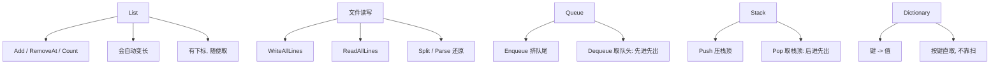

# C# 第 8 周：List、Dictionary、Queue、Stack、文件读写

---

这周的主线是**从「装不下」到「装得下、存得住、撤得回」**。

上周写日志系统时，数据都是现成的；这周要自己管一堆待办——**用户想加几条你不知道**、**关掉程序还想留**、**手滑删了还想撤回**。三个愿望，对应四组容器和一次磁盘往返。

这周的博客分两大块：**容器篇**（List / Queue / Stack / Dictionary 各管什么）和**落地篇**（把对象写进文件，再读回来）。

> [!NOTE]
> 标题带【进阶】的节第一遍可以跳过，不影响后面读。想一次吃透就顺着读。

## 0. 这周的学习地图



一句话概括这周：**List 是「一堆东西」，Queue 和 Stack 是「只能从一头取的一堆东西」，Dictionary 是「按名字直接翻到那一页」。**

---

## 1. List：一个会自动变长的数组

### 1.1 先看数组的三个死穴

**① 长度写死在编译期**

```csharp
string[] todos = new string[3];      // 只能放 3 个
todos[3] = "第四个";                 // 运行时: IndexOutOfRangeException
```

**② 删掉中间一个，只留个洞**

```csharp
todos[0] = "买菜";
todos[1] = "写代码";
todos[2] = "睡觉";
todos[1] = null;                     // 结果: [买菜] [空] [睡觉]
```

后面的元素**不会自动往前补**。你以为删了，其实是挖了个坑。

**③ 想扩容得自己搬家**

```csharp
string[] bigger = new string[6];
Array.Copy(todos, bigger, 3);        // 一个个搬过去
todos = bigger;
```

### 1.2 List 的形状

```csharp
List<Todo> todos = new();                     // 装 Todo 的列表

todos.Add(new Todo("买菜", Priority.Low));    // 加一个，自动变长
todos.RemoveAt(0);                            // 按位置删，后面自动补位
todos.Remove(某个对象);                        // 按对象删
todos.RemoveAll(t => t.Content == "买菜");     // 按条件批量删
todos.Count;                                  // 有几个
todos[0];                                     // 取第 0 个（下标从 0 起）
```

尖括号里的 `T` 是**泛型**：告诉 List「我要装什么」。装了 `Todo` 就只能放 `Todo`，塞个字符串进去编译期就拦。

| 你要干的事 | 写法 |
|---|---|
| 加一个 | `list.Add(x)` |
| 删一个（按内容） | `list.Remove(x)` |
| 删一个（按位置） | `list.RemoveAt(0)` |
| 按条件批量删 | `list.RemoveAll(t => t.X == y)` |
| 有几个 | `list.Count` |
| 全清空 | `list.Clear()` |
| 取第几个 | `list[0]` |

### 1.3 Count 和 Capacity 不是一回事

数组问数量用 `Length`，List 用 `Count` —— 名字不同是因为含义不同：**Length 是「修了多长」，Count 是「现在装了几个」。**

List 内部其实还是个数组，只是它会自己扩容。实测：

```text
刚创建:        Count=0, Capacity=0
加了 1 个:     Count=1, Capacity=4      <- 一次备了 4 个格子
加了 2 个:     Count=2, Capacity=4
加了 3 个:     Count=3, Capacity=4
加了 4 个:     Count=4, Capacity=4      <- 满了
加了 5 个:     Count=5, Capacity=8      <- 自动翻倍
```text

> [!TIP]
> `Capacity` 平时不用管。只有想省掉反复扩容开销（比如一次要加十万条）时，才先 `new List<T>(100000)`。日常只认 `Count`。

### 1.4 【进阶】List 的家人，和它不擅长的事

| 类型 | 特点 | 什么时候用 |
|---|---|---|
| `List<T>` | 有下标，随意增删 | 绝大多数「一堆东西」 |
| `T[]` | 定长，最快 | 数量确定且不变 |
| `LinkedList<T>` | 插入删除 O(1)，找第 n 个 O(n) | 频繁在中间插 |
| `HashSet<T>` | 自动去重，查存在 O(1) | 「这玩意儿有没有」 |

**List 不擅长的事**：`RemoveAt(0)` 是 O(n)。删掉第 0 个之后，后面所有元素都要往前挪一格。频繁「从头取」的场景，该用 Queue。

## 2. Queue 和 Stack：只能从一头取的两种「堆」

### 2.1 一句话区分

| | 生活类比 | 放进去 | 拿出来 | 顺序 |
|---|---|---|---|---|
| Queue | **排队买饭** | Enqueue | Dequeue | 先来先得 |
| Stack | **叠盘子** | Push | Pop | 后来先得 |

实测：

```csharp
var q = new Queue<string>();
q.Enqueue("A"); q.Enqueue("B"); q.Enqueue("C");
while (q.Count > 0) Console.Write(q.Dequeue() + " ");

var s = new Stack<string>();
s.Push("A"); s.Push("B"); s.Push("C");
while (s.Count > 0) Console.Write(s.Pop() + " ");
```

输出：

```text
A B C        <- 先进先出
C B A        <- 后进先出
```

### 2.2 和 List 最本质的区别：查看 vs 消耗

```csharp
// List：看一遍，东西都还在
for (int i = 0; i < todos.Count; i++)
    Console.WriteLine(todos[i]);
Console.WriteLine(todos.Count);       // 还是 n 个

// Queue：取一个少一个
while (q.Count > 0)
    Console.WriteLine(q.Dequeue());
Console.WriteLine(q.Count);           // 0 个
```

**Peek 是中间派：看一眼，不拿走。**

```csharp
q.Peek();        // 返回队头，队列不变
q.Dequeue();     // 返回队头，队列少一个
```

实测三行输出：

```text
1        <- Dequeue 拿走 1 并返回它
2        <- Peek 只看队头，还是 2，不拿走
2        <- Count 剩 2 个（3 个减掉被拿走的 1 个）
```

### 2.3 空的时候硬取会炸

```csharp
var empty = new Queue<string>();
empty.Dequeue();                       // 炸
```

```text
InvalidOperationException: Queue empty.
```

稳妥的写法是 TryDequeue，跟你熟了的 int.TryParse 一个套路：

```csharp
while (q.TryDequeue(out var task))
    DoWork(task);                      // 有就取，没就自动停
```

> [!TIP]
> C# 里凡是 TryXxx 都是「试一下，失败返回 false 不抛异常」：int.TryParse、Enum.TryParse、Queue.TryDequeue、Dictionary.TryGetValue。见到 Try 就知道它不会炸。

### 2.4 【进阶】为什么撤销一定要用 Stack

想想「撤销」这个词的意思：**撤销最近的那一次**。

```text
操作历史: [添加A] [添加B] [删除C]     <- 最新的在右边
           ^                    ^
      Queue 弹出这里      Stack 弹出这里
      (撤最早那次)        (撤最近那次) 对
```

用 Queue 记历史，撤销会一直撤最早的操作 —— 那不叫撤销，那叫「从头重放」。

## 3. Dictionary：按名字直接翻到那一页

### 3.1 形状

```csharp
Dictionary<键类型, 值类型> dict = new();

dict[Priority.High] = 2;                    // 写（有则改，无则建）
Console.WriteLine(dict[Priority.High]);     // 读 -> 2
dict.ContainsKey(Priority.High);            // 有没有这个键 -> true
```

类比：**字典不是「翻到第一页开始找」，是「直接翻到 A 那一页」。**

### 3.2 三条硬规矩

| 情况 | 结果 |
|---|---|
| 读**不存在**的键 | 炸：KeyNotFoundException |
| 写**已存在**的键 | 覆盖，不报错 |
| 用 Add 塞**重复**键 | 炸：ArgumentException |

```csharp
var dict = new Dictionary<string, int>();
dict["苹果"] = 1;
dict["苹果"] = 2;        // 覆盖
dict["苹果"] = 3;        // 又覆盖
// 结果：dict 里只有 1 个键，值是 3
```

> [!IMPORTANT]
> 所以**写一律用 `dict[key] = value`，不要用 `Add`**。前者幂等（写几次结果一样），后者第二次就炸。

### 3.3 【进阶】分组：Dictionary of List

这是 Dictionary 最实用的一个套路 —— **键是分类，值是这一类的东西**。

```csharp
Dictionary<Priority, List<Todo>>     // 按优先级分组
Dictionary<string, List<Todo>>       // 按日期分组
Dictionary<int, List<string>>        // 按周几分课
```

固定两行：

```csharp
var groups = new Dictionary<Priority, List<Todo>>();

foreach (var t in todos)
{
    if (!groups.ContainsKey(t.Level))
        groups[t.Level] = new List<Todo>();      // 第一次见这个键，先建空列表
    groups[t.Level].Add(t);                       // 再塞进去
}
```

输出：

```text
[Low] 1 条
    买菜
[High] 2 条
    写代码
    修bug
[Normal] 1 条
    睡觉
```

**`groups[t.Level]` 拿到的不是「一个值」，是「一个列表容器」** —— 拿到容器才能往里塞东西。

> [!CAUTION]
> **Dictionary 的遍历顺序不保证。** 实测：同一批数据，换插入顺序，输出顺序跟着变。今天看着像按插入顺序，明天加两条就可能不一样。要固定顺序（比如高优先级排前面），必须自己按 enum 的值写循环，不能指望容器。

### 3.4 【进阶】Dictionary 不是什么都快

20 万条数据实测：

```text
[List 统计]  Low=66972 Normal=66480 High=66548  耗时 = 2ms
[Dict 统计]  Low=66972 Normal=66480 High=66548  耗时 = 13ms    <- 慢 6 倍

[查找 1 万次] List 遍历 = 11217ms   Dictionary 直取 = 0ms      <- 快 11 秒
```

| 场景 | 谁快 | 为什么 |
|---|---|---|
| 遍历全部 + 简单累加 | **List** | 三个 if + 整数 +1，没有哈希开销 |
| 按键找单个元素 | **Dictionary** | 算一次哈希直达；List 要扫全表 |

**这就是数据结构课上的 O(n) 和 O(1)** —— 1 万次查找 × 20 万条 = 20 亿次比较，整整 11 秒。

## 4. 文件读写：让数据活过进程退出

### 4.1 存文件只有三步

```csharp
// ① 造一个路径（写和读必须一模一样）
const string SavePath = "todos.txt";

// ② 把对象拼成一行行字符串
List<string> lines = new();
foreach (var t in todos)
    lines.Add($"{t.Content}|{t.Level}|{t.IsDone}");

// ③ 一次写出去（覆盖）
File.WriteAllLines(SavePath, lines);
```

文件内容：

```text
买菜|Low|False
写代码|High|True
```

**为什么用 `|` 分隔**：内容里可能有空格、逗号、中文，但基本不会出现竖线。分隔符的选择标准就是「数据里几乎不会出现的字符」。

| 方法 | 干什么 |
|---|---|
| `File.WriteAllLines` | 覆盖写，一个字符串一行 |
| `File.AppendAllText` | 追加，不清空 |
| `File.ReadAllLines` | 全读，返回 string[] |
| `File.Exists` | 文件在不在 |

### 4.2 读回来要多做两件事：拆 + 还原类型

文件里全是**字符串**。读回来的时候，`Low` 不是 `Priority.Low`，`False` 不是 `false`。必须手动还原。

```csharp
if (File.Exists(SavePath))
{
    foreach (var line in File.ReadAllLines(SavePath))
    {
        string[] parts = line.Split('|');            // [买菜][Low][False]

        var level = Enum.Parse<Priority>(parts[1]);  // "Low" -> Priority.Low
        var todo = new Todo(parts[0], level);         // 前两个进构造函数
        todo.IsDone = bool.Parse(parts[2]);           // 第三个事后赋值
        todos.Add(todo);
    }
}
```

**三个字段三种待遇，因为属性写法不一样：**

| 字段 | 属性写法 | 怎么进对象 |
|---|---|---|
| 内容 | `Content { get; }` | 构造函数的第 1 个参数 |
| 优先级 | `Level { get; }` | 构造函数的第 2 个参数 |
| 是否完成 | `IsDone { get; set; }` | new 完之后单独赋值 |

反过来说：**想让某个字段能事后改，属性就必须写 `{ get; set; }`。**

### 4.3 类型还原的 Parse 家族

| 从 | 到 | 怎么写 | 失败会怎样 |
|---|---|---|---|
| string | `int` | `int.Parse(s)` | 抛 FormatException |
| string | `bool` | `bool.Parse(s)` | 抛 FormatException |
| string | 枚举 | `Enum.Parse<T>(s)` | 抛 ArgumentException |
| string | 上面任意 | `Xxx.TryParse(s, out var v)` | **返回 false，不炸** |

> [!WARNING]
> Parse 遇到脏数据直接抛异常，整个程序崩。文件是用户可以手改的东西 —— **凡是读外部文件，一律用 TryParse 兜住**，否则用户把文件改坏一个字符，你的程序就再也打不开了。

### 4.4 为什么泛型版 Enum.Parse 更好

Enum.Parse 有两个版本：

```csharp
// 老版本：返回 object，必须强转
object o = Enum.Parse(typeof(Priority), "High");
Priority p1 = (Priority)o;

// 新版本：泛型，直接返回 Priority
Priority p2 = Enum.Parse<Priority>("High");
```

实测 typeof 版：

```text
返回类型是 Priority，值=High
强转之后才能当 Priority 用：High
```

**为什么要泛型版**：`new Todo(parts[0], Enum.Parse<Priority>(parts[1]))` 能直接塞进构造函数，因为返回的就是 `Priority`。非泛型版返回 `object`，塞进去编译期报 `CS1503`。

> [!TIP]
> 现代 C# 里凡是同时有「泛型版」和「传 Type 版」的方法，**一律用泛型版** —— 返回类型准确，不用强转。

### 4.5 【进阶】路径、编码、大文件、JSON

**① 相对路径相对于什么？**

`"todos.txt"` 是相对路径，相对的是**当前工作目录**。`dotnet run` 时通常是项目目录，但双击 exe 时是 exe 所在目录 —— 同一个程序行为不一样。

稳妥写法：

```csharp
string path = Path.Combine(AppContext.BaseDirectory, "todos.txt");
```

**② 编码**：`File.WriteAllLines` 默认写 UTF-8 无 BOM。用记事本或 Excel 打开中文可能乱码 —— 不影响读回来，只影响人眼看。

**③ 大文件**：`ReadAllLines` 会把整个文件一次读进内存，几 GB 会炸。那种情况用 `File.ReadLines`（按行懒加载）。

**④ 更正式的存档格式**：现在这个「竖线分隔」是 CSV 的变体。真实项目一般用 **JSON**（C# 内置 `System.Text.Json`），嵌套结构、转义、类型都能自动处理，不用自己写 Split/Parse。

```csharp
string json = JsonSerializer.Serialize(todos);
File.WriteAllText("todos.json", json);

var back = JsonSerializer.Deserialize<List<Todo>>(File.ReadAllText("todos.json"));
```

> [!NOTE]
> JSON 的代价：`Todo` 需要一个无参构造函数，且属性要能读写。所以一旦上了 JSON，类的写法就得跟着调整 —— **格式选择会反过来约束数据结构**，这是真实项目里的常见连带改动。

---

## 5. 四种容器怎么选（一张表收尾）

| 你想要 | 用 | 关键方法 |
|---|---|---|
| 一堆东西，随意增删、要下标 | `List<T>` | Add / RemoveAt / [i] / Count |
| 按顺序一个个处理完 | `Queue<T>` | Enqueue / Dequeue / Peek |
| 撤销最近一次 | `Stack<T>` | Push / Pop / Peek |
| 按键快速查 / 分组 | `Dictionary<K,V>` | dict[k] / ContainsKey / 遍历 |
| 只关心有没有 | `HashSet<T>` | Add / Contains |

**记忆抓手：**

```text
List   = 一摞纸，能抽中间的
Queue  = 一根管子，从左进右出
Stack  = 一个桶，从上进上出
Dict   = 一本字典，按名字直达
```

---

## 6. 六个真踩过的坑

> 这节不按时间顺序，按「你也有可能踩」的顺序排。每个坑都给报错原文或错误输出。

### 坑 1：变量声明在循环体里，每轮重置

最典型的一处：打印待办列表的编号。

```csharp
foreach (var t in todos)
{
    int i = 1;                        // 每轮新建，每次都是 1
    Console.WriteLine($"{i} {t.Content}");
    i++;                              // 加完就扔了
}
```

输出：

```text
1 买菜
1 写代码
1 睡觉
```

**根因**：循环体每执行一次，里面的局部变量就重新诞生一次。上一轮那个 `i` 已经死了。

**正确做法**：要编号就用 `for`，循环变量天然活在循环里：

```csharp
for (int i = 0; i < todos.Count; i++)
    Console.WriteLine($"{i + 1}. {todos[i].Content}");
```

**同一个坑踩过四次**：第 3 周排序的 `int max`、第 6 周找最长叫声的 `string longest`、这周的 `int i` 和 `var history = new Stack`。

> [!IMPORTANT]
> 口诀：**「跨轮要用的东西，都在圈外面」。** 判断标准：这个变量下一轮还要用吗？要，就挪出去。

### 坑 2：break 只跳出最近的一层

两次都栽在这上面：

```csharp
// 第一次：想退出程序，结果菜单又回来了
while (true)
{
    switch (n)
    {
        case 5:
            break;          // 只跳出 switch，while 还在转
    }
}

// 第二次：想跳过这一个任务，结果后面全没了
while (q.Count > 0)
{
    if (输入为空)
        break;              // 直接跳出 while，剩余任务不再问
}
```

**判断表：**

| 想干什么 | 用什么 |
|---|---|
| 跳过这一轮，进下一轮 | `continue` |
| 整个循环不要了 | `break` |
| 只跳出 switch | `break`（switch 自带一层） |
| 结束方法 / 结束程序 | `return` |

### 坑 3：文件名是契约，写和读必须是同一个字符串

```csharp
if (File.Exists("todos.txt"))              // 读 todos.txt
File.WriteAllLines("todo.txt", lines);     // 写 todo.txt（少了个 s）
```

**不报错、不警告、就是永远读不到。** 这种 bug 最耗时间，因为没有任何线索告诉你哪里错了。

**正确做法**：抽成常量，从源头消灭笔误：

```csharp
const string SavePath = "todos.txt";
// 之后所有地方都用 SavePath
```

### 坑 4：编译过了但文件被进程锁着

NaN

warning MSB3026: 无法将 apphost.exe 复制到 bin\Debug\net10.0\week8.exe
The process cannot access the file ... 文件被"week8 (2452)"锁定
```

**判据**：`error` 数量为 0，但出现「文件被 xxx (数字) 锁定」→ 上一个运行窗口没关，不是代码问题。

```csharp
Get-Process week8 | Stop-Process -Force
```

### 坑 5：Dictionary 遍历顺序不保证

```csharp
var groups = new Dictionary<Priority, List<Todo>>();
// 按 Low -> High -> Normal 插入
```

输出可能是 `Low, High, Normal`，也可能换一批数据后变成别的顺序。**别拿输出顺序当逻辑。**

要固定顺序就自己写循环：

```csharp
foreach (var level in new[] { Priority.High, Priority.Normal, Priority.Low })
{
    if (!groups.ContainsKey(level)) continue;
    // ...
}
```

**根因**：Dictionary 内部按哈希存放，不是按插入顺序，也不是按字母排序。

### 坑 6：用「内容」当身份标识

撤销的历史记录里存了任务名：

```csharp
history.Push($"done|{todos[n1 - 1].Content}");
```

如果列表里有**两个「买菜」**，撤销会把**两个都改回未完成**。

**正确做法**：给 `Todo` 加唯一 ID，历史里存 ID 而不是内容。

```csharp
class Todo
{
    private static int _nextId = 1;
    public int Id { get; }

    public Todo(string content, Priority level)
    {
        Id = _nextId++;
        Content = content;
        Level = level;
    }
}
```

> [!NOTE]
> 这就是数据库「主键」的由来 —— 用业务字段（名字）识别记录永远有重名风险。代价是 ID 也要存进文件、读回来也要恢复，**加一个字段会牵动整个存档格式**。

---

## 7. 练习题（答案折叠，先自己写）

### 7.1 基础（8 题）

**1.** 用 `List<string>` 存三个任务，然后删掉第二个，打印结果。

<details>
<summary>答</summary>

```csharp
var todos = new List<string> { "买菜", "写代码", "睡觉" };
todos.RemoveAt(1);                     // 下标 1 = 第二个
Console.WriteLine(string.Join(",", todos));   // 买菜,睡觉
```
</details>

**2.** 下面输出什么？

```csharp
var q = new Queue<int>();
q.Enqueue(1); q.Enqueue(2); q.Enqueue(3);
Console.WriteLine(q.Dequeue());
Console.WriteLine(q.Peek());
Console.WriteLine(q.Count);
```

<details>
<summary>答</summary>

```text
1        <- Dequeue 拿走 1
2        <- Peek 只看，不拿走
2        <- 剩 2 个
```text
</details>

**3.** 把 1、2、3 依次 `Push` 进 `Stack`，再 `Pop` 两次，输出是什么？栈里还剩几个？

<details>
<summary>答</summary>

输出 `3`、`2`；栈里还剩 1 个（值 1）。
</details>

**4.** 数组和 List 问数量的属性分别叫什么？为什么不一样？

<details>
<summary>答</summary>

数组用 `Length`，List 用 `Count`。数组的长度是构造时**写死**的，问它等于问「修了多长」；List 的长度会变，问它等于「现在数出来几个」。
</details>

**5.** 把这三个任务存进文件，一行一条，格式自定。

<details>
<summary>答</summary>

```csharp
var todos = new List<string> { "买菜", "写代码", "睡觉" };
File.WriteAllLines("todos.txt", todos);
// 文件内容：每行一个任务
```
</details>

**6.** 读回来上一题的文件，打印出来。

<details>
<summary>答</summary>

```csharp
foreach (var line in File.ReadAllLines("todos.txt"))
    Console.WriteLine(line);
```
</details>

**7.** `dict["苹果"] = 1; dict["苹果"] = 2;` 之后，`dict` 里有几个键？值是多少？

<details>
<summary>答</summary>

1 个键，值是 2。`dict[key] = value` 是「有则改、无则建」，第二次是改写不是新增。
</details>

**8.** 用 `List` 找出所有未完成的任务并打印。

<details>
<summary>答</summary>

```csharp
foreach (var t in todos)
    if (!t.IsDone)
        Console.WriteLine(t.Content);
```
</details>
### 7.2 进阶（8 题）

**9.** 用 `Dictionary` 统计每个优先级有几条任务，不用三个 if。

<details>
<summary>答</summary>

```csharp
var counts = new Dictionary<Priority, int>();
foreach (var t in todos)
{
    if (!counts.ContainsKey(t.Level)) counts[t.Level] = 0;
    counts[t.Level]++;
}
```
</details>

**10.** 下面这段为什么可能出错？

```csharp
var groups = new Dictionary<Priority, List<Todo>>();
foreach (var t in todos)
    groups[t.Level].Add(t);
```

<details>
<summary>答</summary>

漏了 `ContainsKey` 判断。`groups[t.Level]` 是**在读**，读一个不存在的键会抛：

```text
KeyNotFoundException: The given key 'Low' was not present in the dictionary.
```text

正确要两行：先 `if (!groups.ContainsKey(...)) groups[...] = new List<Todo>();`，再 Add。
</details>

**11.** 写一个方法，把 `List<Todo>` 里所有已完成的任务删掉。

<details>
<summary>答</summary>

```csharp
todos.RemoveAll(t => t.IsDone);      // 一行搞定

// 或者用 for 倒着遍历（为什么不正着遍历？因为删除会让后面的元素前移，会漏删）
for (int i = todos.Count - 1; i >= 0; i--)
    if (todos[i].IsDone) todos.RemoveAt(i);
```
</details>

**12.** 为什么「撤销」要用 Stack 不能用 Queue？

<details>
<summary>答</summary>

撤销要撤**最近一次**。Stack 是后进先出，弹出的是最后一个操作；Queue 是先进先出，弹出的会是最早那个操作 —— 那不叫撤销，叫「从最早的开始重放」。
</details>

**13.** 让 `Todo` 加一个唯一 `Id`，并说明这个改动会牵动哪些地方。

<details>
<summary>答</summary>

```csharp
class Todo
{
    private static int _nextId = 1;
    public int Id { get; }
    public string Content { get; }
    public Priority Level { get; }
    public bool IsDone { get; set; }

    public Todo(string content, Priority level)
    {
        Id = _nextId++;
        Content = content;
        Level = level;
    }
}
```

牵动三处：

1. **存档格式**要加一列：`Id|Content|Level|IsDone`
2. **读回来**要先 `int.Parse(parts[0])`，而且 `_nextId` 要恢复成「最大 Id + 1」，否则新任务会撞号
3. **撤销记录**改成存 Id：`done|3`，凭 Id 找任务

这就是「加一个字段」的真实成本 —— 一个字段牵动存档、加载、撤销三处。
</details>

**14.** `File.WriteAllLines` 和 `File.AppendAllText` 什么时候用哪个？

<details>
<summary>答</summary>

- `WriteAllLines`：**全量覆盖**。适合保存当前完整状态（每次存都写全部任务）。
- `AppendAllText`：**追加不清空**。适合日志（第 7 周的 `FileLogger` 就是它）。

判据：**每次存的内容是否覆盖旧内容**。是 → WriteAllLines；只在末尾加一条 → AppendAllText。
</details>

**15.** 用户把 `todos.txt` 改成 `买菜|ABC|False`（优先级写错了），你的程序会怎样？怎么防？

<details>
<summary>答</summary>

`Enum.Parse<Priority>("ABC")` 会抛 `ArgumentException`，程序启动就崩，用户再也打不开。

```csharp
if (Enum.TryParse<Priority>(parts[1], out var level))
    todos.Add(new Todo(parts[0], level));
else
    Console.WriteLine($"跳过错行（优先级不合法）：{line}");
```

**判据**：凡是读外部文件（用户可以手改的东西），一律 TryParse 兜住。
</details>

**16.** 队列练习：把「未完成」的任务按优先级从高到低放进 Queue，然后按顺序处理。

<details>
<summary>答</summary>

```csharp
var q = new Queue<Todo>();
foreach (var level in new[] { Priority.High, Priority.Normal, Priority.Low })
    foreach (var t in todos)
        if (!t.IsDone && t.Level == level)
            q.Enqueue(t);

while (q.TryDequeue(out var task))
    Console.WriteLine($"处理：{task.Content}");
```

注意：外层按 enum 值循环，因为 Dictionary/List 都不保证按优先级排。**顺序要自己造，不能等容器给你。**
</details>
### 7.3 挑战（4 题）

**17.** 实现「撤销 + 重做」双栈。撤销两次后再做新操作，`redoStack` 怎么处理？为什么？

<details>
<summary>答</summary>

```csharp
Stack<string> undo = new();
Stack<string> redo = new();

// 每次执行新操作：
undo.Push(op);
redo.Clear();          // 关键：新操作让历史分叉，旧的重做链作废

// 撤销：
var last = undo.Pop();
执行反向(last);
redo.Push(last);

// 重做：
var again = redo.Pop();
执行正向(again);
undo.Push(again);
```

**必须清空 redo。** 撤销两次后历史停在「两步之前」，此时做新操作，原来那两条被撤销的操作永远回不去了。留着 redo 会重做出一个不属于当前历史的东西。

> 真实编辑器都这么做：**一旦产生新操作，重做链立即作废。**
</details>

**18.** 写一个方法，把 `List<Todo>` 存成文件，再用 JSON 版本重写一次，对比两种写法的取舍。

<details>
<summary>答</summary>

```csharp
// 分隔符版
List<string> lines = new();
foreach (var t in todos) lines.Add($"{t.Content}|{t.Level}|{t.IsDone}");
File.WriteAllLines("todos.txt", lines);

// JSON 版（.NET 内置，不用装包）
string json = JsonSerializer.Serialize(todos);
File.WriteAllText("todos.json", json);
```

| | 分隔符版 | JSON 版 |
|---|---|---|
| 代码量 | 自己写拼/拆/Parse | 两行 |
| 转义 | 内容里有竖线就炸 | 自动处理 |
| 嵌套对象 | 得自己设计 | 天生支持 |
| 人眼可读 | 好 | 一般（一堆括号） |
| 对类的要求 | 无 | 需要无参构造 + 可读写属性 |

**取舍**：小项目、格式简单 → 分隔符够用且零依赖；真实项目 → JSON，因为迟早会遇到嵌套和特殊字符。
</details>

**19.** 现在的存档格式是「内容|优先级|完成」，如果任务内容里**本身含竖线**（比如 `a|b`），会发生什么？怎么解决？

<details>
<summary>答</summary>

存的时候 `line.Add($"{t.Content}|{t.Level}|{t.IsDone}")` 会写出 `a|b|Low|False`。

读的时候 `Split('|')` 得到**4 段**，`parts[1]` 变成 `"b"` → `Enum.Parse` 抛异常。**整个存档坏掉。**

三种解法：

1. **存前转义**：把内容里的 `|` 换成别的字符（但要选一个也不出现的，递归问题）
2. **改分隔符**：换成 `\t` 或某个更罕见的字符（治标）
3. **用 JSON**：序列化自动转义 `"a|b"`，根本不用管（治本）

> [!IMPORTANT]
> 这是「自己发明数据格式」的经典死穴 —— **只要格式有分隔符，就必须处理「数据里含分隔符」**。JSON/XML/CSV 规范里都有专门的转义规则，就是因为这件事必然发生。
</details>

**20.** 用 `List<Todo>` 实现「按优先级排序输出」，不许用 `OrderBy`（第 11 周才学），只能手写。

<details>
<summary>答</summary>

复用第 3 周的插入排序，比较条件换成 enum 的数值：

```csharp
for (int i = 1; i < todos.Count; i++)
{
    var key = todos[i];
    int j = i - 1;
    while (j >= 0 && (int)todos[j].Level < (int)key.Level)   // 高优先级在前
    {
        todos[j + 1] = todos[j];
        j--;
    }
    todos[j + 1] = key;
}
```

`(int)Priority.High` 是 2，`(int)Priority.Low` 是 0 —— enum 底层就是整数，所以能直接比大小。
</details>

---

## 8. 检查标准

过完这周，应该能**不查资料**做到：

- [ ] 说出数组的三个死穴，以及 `List` 分别怎么解决
- [ ] 说清 `Count` 和 `Capacity` 的区别
- [ ] 说清 `for` 和 `foreach` 各适合什么场景
- [ ] 说出 `break` / `continue` / `return` 各跳出什么，并举出 `switch` 套 `while` 的反例
- [ ] 写出「对象 → 文件 → 对象」的完整往返，包括 `Split` 和三种 `Parse`
- [ ] 说清 JSON 和分隔符格式的取舍
- [ ] 说出 `Queue` / `Stack` / `Dictionary` 各解决什么问题，并举一个自己项目里的例子
- [ ] 解释 `Dictionary<K, List<T>>` 分组的两行套路
- [ ] 解释为什么「撤销」必须用 `Stack`
- [ ] 说出 `dict[k] = v` 和 `dict.Add(k, v)` 的区别

**验收题**（第 8 周总验收，150 行以内）：

> 写一个待办清单，要求：① 增删改查 ② 存读文件（关掉重开数据还在）③ 按优先级分组显示 ④ 撤销上一次操作。全部功能不崩、不丢数据。

---

## 9. 下一周预告

第 9 周：**委托 / 事件 / Action·Func**。

这周所有功能都是「我自己调用」—— `case 3` 里标记完成后，我手动写 `PrintList()`、手动写 `history.Push(...)`。**如果以后再加一件事（比如「完成后自动保存」），我还得回来改 `case 3`。**

下周开始学**「别人调我」**：让 `Todo` 在状态变化时自己通知感兴趣的代码，而 `Todo` 完全不知道通知是怎么发的。这就是**事件**。

先把这周的代码跑通，下周直接在这个待办清单上加事件 —— 委托的第一个真实用处就在这儿。
