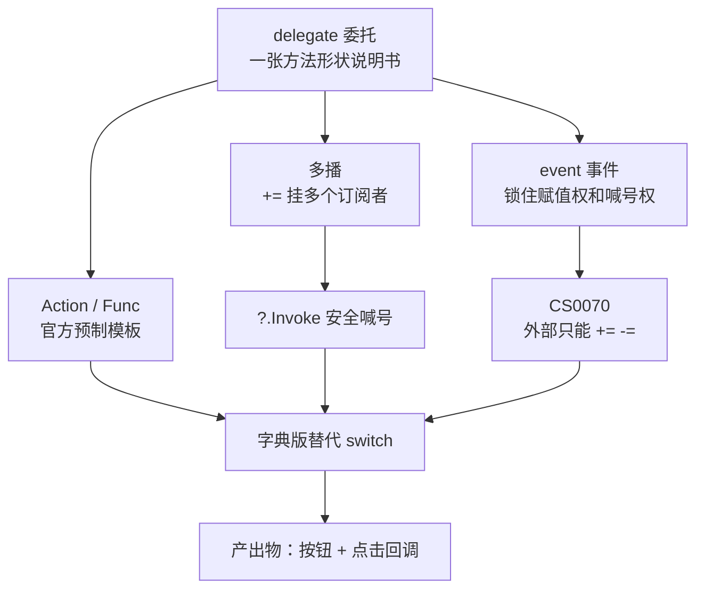

# C# 第 9 周：委托、事件、Action、Func

---

上周的待办清单已经能存文件、能撤销了，但它有个死结：**主循环里那个 `switch` 越来越长**。八个 case 堆在一起，加第九个功能要改三处，删一个功能要小心翼翼不碰坏旁边的。

更麻烦的是另一件事——**按钮不知道点它之后该干嘛**。这在 Unity 里是每天都要面对的问题：同一个 Button 预制件，这个场景里用来开始游戏，那个场景里用来退出。按钮本身是通用件，它凭啥认识你的业务代码？

这周学的**委托（delegate）**，就是解这两个死结的钥匙。它是整个 C# 学习阶段最关键的一周——Unity 里按钮点击、碰撞回调、协程完成通知，底层全是它。


> [!NOTE]
> 标题带「【进阶】」的节第一遍可以跳过，不影响后面。

## 0. 这周的学习地图



一句话概括：**委托把「做什么」从「什么时候做」里拆出来**，按钮只管喊，不管谁应。

## 1. 委托：一张外卖订单

你打开外卖 App 下单。你不知道骑手叫什么、男的女的、骑电动车还是自行车——**你只需要知道「有人会来送」**。

C# 里管这个叫委托。它不存数据，存的是**方法**。

### 1.1 形状是说明书，不是方法

```csharp
delegate void ClickHandler();          // 无参数、无返回值
```

这一行**不是在定义方法**，是在定义「什么样的方法能接这张单」。返回值类型 + 参数列表 = 形状。形状对得上的方法，都能装进来。

### 1.2 装法：把方法名塞进去

```csharp
ClickHandler? OnClick;      // 一个空盒子，能装「无参无返回」的方法
OnClick = SayHi;            // 把 SayHi 装进去
OnClick();                  // 执行盒子里的方法 == SayHi()
```

> [!IMPORTANT]
> `OnClick` 不是「调用了 SayHi」，而是「存着 SayHi」。什么时候执行，看你在哪写 `()`。

### 1.3 最容易错的一条：`=` 和 `+=` 差一个加号

```csharp
OnClick = SayHi;     // 盒子清空，只留 SayHi
OnClick += SayBye;   // 再加一个，SayHi 还在
```

「两行 `=` 只打印最后一个」——因为第二个 `=` 把第一个覆盖了。

### 1.4 【进阶】多播的返回值陷阱

`Action` 多播：三个方法全执行，顺序 = 挂的顺序。
`Func` 多播：**三个方法也全执行**，但只有一个返回值能留下——**最后一个的**。

```csharp
Func<int,int,int> calc = (a,b) => a + b;
calc += (a,b) => a * b;
Console.WriteLine(calc(3, 4));   // 12，不是 7
```

前面算出来的全扔了。所以业内 `Func` 基本只单播。

## 2. 事件：给订单簿上把锁

### 2.1 敞开字段的三个麻烦

```csharp
public ClickHandler? OnClick;    // 谁都能动
```

外部能做的坏事：`btn.OnClick = SayHi;` 覆盖别人、`btn.OnClick = null;` 全清、`btn.OnClick();` 冒充按钮喊号。

### 2.2 一个词解决问题

```csharp
public event ClickHandler? OnClick;
```

| 动作 | 普通字段 | 加了 event |
|---|---|---|
| `+=` 订阅 | 能 | 能 |
| `-=` 退订 | 能 | 能 |
| `=` 赋值 | 能 | **CS0070** |
| `.Invoke()` 外部喊号 | 能 | **CS0070** |

### 2.3 注意：外面的 `?.Invoke` 也会被拦

```csharp
btn.OnClick?.Invoke(5);   // 照样 CS0070
```

> [!WARNING]
> 被拒的原因**不是 null 安全，是权限**。`?.` 保得住 null，保不住权限。同一个事件，在类内部随便 `Invoke`，出了类只能 `+=`。

## 3. Action 和 Func：微软预制好的模板

手写 `delegate void ClickHandler(int times);` 太啰嗦，「无参无返回」这种形状又太常见，微软早做好了。

```csharp
Action            // 无参、无返回
Action<int>       // 一个 int 参数、无返回
Func<int>         // 无参、返回 int      ← 注意！不是「传一个 int」
Func<int,int,int> // 两个 int 参数、返回 int（最后一个才是返回值）
```

### 3.1 最容易错的一条

`Func<int>` 是「**不传参**、返回 int」。第一次用几乎必错这个。

### 3.2 Func 的返回值怎么拿

```csharp
return OnCalc?.Invoke(a, b);        // ❌ CS0266
return OnCalc?.Invoke(a, b) ?? 0;   // ✅
```

为什么？`?.` 碰上 null 得返回个「空值」，`int` 自动升成 `int?`，装不进 `int`。`??` 就是来补这个缺口的。

> [!TIP]
> `?.` 的返回值**永远是可空版**。`Action` 不受影响，因为它本来就不返回东西。

## 4. 产出物：按钮 + 点击回调

```csharp
// 场景一：Action——按钮被按下，通知所有订阅者
class Counter
{
    public event Action<int>? OnClick;

    public void Press(int times)
    {
        Console.WriteLine($"[按钮被按下了 {times} 次]");
        OnClick?.Invoke(times);
    }
}

// 场景二：Func——计算器，交出去算，把结果拿回来
public class Calculator
{
    public event Func<int, int, int>? OnCalc;

    public int Run(int a, int b)
    {
        int result = OnCalc?.Invoke(a, b) ?? 0;
        Console.WriteLine($"{a} + {b} = {result}");
        return result;
    }

    public void SelfTest()
    {
        int r = OnCalc?.Invoke(1, 1) ?? -1;
        Console.WriteLine($"[类内部喊号] 结果 = {r}");
    }
}

class Program
{
    static void Main()
    {
        static void SayTimes(int t) => Console.WriteLine($"我被通知了，次数 = {t}");
        static int Add(int a, int b) => a + b;

        var btn = new Counter();
        btn.OnClick += SayTimes;
        btn.Press(7);

        var calc = new Calculator();
        calc.SelfTest();        // 先喊：还没人订阅，走 ?? -1
        calc.OnCalc += Add;     // 后登记
        calc.Run(3, 5);
        calc.SelfTest();        // 再喊：这次有人应了
    }
}
```

运行结果：

```
[按钮被按下了 7 次]
我被通知了，次数 = 7
[类内部喊号] 结果 = -1
3 + 5 = 8
[类内部喊号] 结果 = 2
```

第二行的 `-1` 和第四行的 `2` 对比，就是「先喊后登记等于没人应」——**Unity 里 Awake 喊号、Start 才订阅，就是这个坑**。

## 5. 落在真实代码里：字典替掉 switch

第 8 周的待办清单，`switch` 八个 case 排到底。用委托能压成一张表：

```csharp
var actions = new Dictionary<string, Action>
{
    ["1"] = Add,   ["2"] = PrintList, ["3"] = MarkDone, ["4"] = Delete,
    ["5"] = Quit,  ["6"] = Save,      ["7"] = SearchTodo, ["8"] = Cancel,
};

while (true)
{
    Console.Write("请选择: ");
    string? key = Console.ReadLine();
    if (key != null && actions.TryGetValue(key, out Action? act))
        act?.Invoke();
    else
        Console.WriteLine("没有这个选项");
}
```

三件事变了：

1. **`int.TryParse` 可以删了**——键本来就是字符串，不用绕一圈转成 int
2. **加功能改 2 处**（写方法 + 字典加一行），switch 版要改 3 处
3. **每个动作成了独立方法**，可以单独测，不会互相碰坏

## 6. 五个真踩过的坑

### 坑 1：`if` 拦住之后忘了 `return`

反例：

```csharp
if (string.IsNullOrWhiteSpace(input))
{
    Console.WriteLine("不能为空");
}
todos.Add(new Todo(input, Priority.Normal));   // input 是 null 照加
```

报错原文：`Unhandled exception. System.InvalidOperationException: Stack empty.`

根因：**拦住 ≠ 中断**。`if` 只是让那一句不执行，后面的照跑。

正确写法：

```csharp
if (string.IsNullOrWhiteSpace(input))
{
    Console.WriteLine("不能为空");
    return;
}
```

> [!CAUTION]
> 这个坑本轮踩了 4 次：`Add` 漏 `return`、`Cancel` 漏 `return` 导致空栈 `Pop`、`Delete` 的 `RemoveAt` 写在 `if` 外、`MarkDone` 上限写成 `<`。**防护逻辑覆盖不全**是最容易复发的类型。

### 坑 2：魔法数字 `idx < 9`

反例：

```csharp
if (int.TryParse(Console.ReadLine(), out int idx) && idx < 9 && idx > 0)
```

列表超过 8 条时，第 9 条永远删不掉。上限必须跟着数据走：`idx <= todos.Count`。

### 坑 3：`<` 和 `<=` 差一个等号

反例：

```csharp
if (n1 < todos.Count && n1 > 0)      // 1 条任务时，选 1 被判无效
```

下标从 0 开始、序号从 1 开始，中间差 1；`Count` 是数量不是最大下标。**两个「差一」叠在一起，就是最经典的 off-by-one**。

### 坑 4：`Func` 的返回值没接住

反例：

```csharp
public void Test()
{
    OnCalc?.Invoke(1, 1);    // 算出来了，然后扔进垃圾桶
}
```

方法确实跑了，结果没人要，控制台一片空白。

### 坑 5：`=` 写成 `==`

反例：

```csharp
btn.OnClick == SayHi;    // 编译错误 CS0201
```

报错原文：`error CS0201: 只有 assignment、call、increment、decrement 和 new 对象表达式可用作语句`

`==` 是提问「相等吗」，`=` 才是往里装。

## 7. 练习题

### 7.1 基础（6 题）

<details><summary>1. 这三行输出什么？</summary>

```csharp
Action a = () => Console.Write("A");
a += () => Console.Write("B");
a -= a;   // 注意这里
```

答：`a -= a` 是把自身从链上摘掉（实际会摘掉第一个匹配），容易出玄学结果。**不要拿同一条委托链做自减**，改用具名变量。

</details>

<details><summary>2. Action 和 Action&lt;int&gt; 有什么区别？</summary>

答：前者不接受参数，后者接受一个 int。都不返回值。

</details>

<details><summary>3. Func&lt;int&gt; 是什么意思？</summary>

答：**不传参**、返回 int。不是「传一个 int」。这是最高频的误解。

</details>

<details><summary>4. 为什么外面不能写 btn.OnClick?.Invoke()？</summary>

答：CS0070。`event` 只允许 `+=` / `-=`，喊号权留给类自己。跟 null 安全无关。

</details>

<details><summary>5. `?.` 和 `??` 各管什么？</summary>

答：`?.` 碰上 null 就跳过并返回可空值；`??` 在可空值为 null 时给一个兜底值。

</details>

<details><summary>6. 一个委托没人订阅时直接 Invoke 会怎样？</summary>

答：`NullReferenceException`。所以写 `?.`。

</details>

### 7.2 进阶（6 题）

<details><summary>1. 多播里中间一个抛异常，后面还执行吗？</summary>

答：**不执行**。委托链是顺序调用，异常直接中断。Unity 里表现为「按钮点了没反应」，因为后面的监听器全被跳过了。防御办法：每个订阅者内部自己 try/catch。

</details>

<details><summary>2. Func 多播返回值取哪个？</summary>

答：最后一个订阅者的。前面全部执行但返回值被丢弃。

</details>

<details><summary>3. 为什么字典版能删掉 int.TryParse？</summary>

答：字典的键是 string，用户输入本来就是 string，不用绕一圈转 int 再 switch。

</details>

<details><summary>4. `?? 0` 删掉会报什么？</summary>

答：CS0266，`int?` 无法隐式转换为 `int`。

</details>

<details><summary>5. 字典建在 while 里面，每轮 new 一个，要紧吗？</summary>

答：要紧。每轮都分配新对象，GC 压力大。应该建在循环外，只建一次。这是第 10 周 GC 笔记的伏笔。

</details>

<details><summary>6. 事件为什么比 public 字段好？</summary>

答：字段敞开后外部能覆盖、清空、冒充喊号；`event` 只留订阅权。控件应该是「被控方」，不能被外部随意改写。

</details>

### 7.3 挑战（4 题）

<details><summary>1. 用委托实现一个「血量低于阈值就报警」的系统</summary>

```csharp
class Health
{
    public event Action<int>? OnLow;
    private int hp = 100;
    public void Damage(int n)
    {
        hp -= n;
        if (hp < 30) OnLow?.Invoke(hp);
    }
}
```

</details>

<details><summary>2. 把 week8 的 8 个 case 全部改造成字典版</summary>

关键：`return` 不能直接放进字典（它是语句不是方法），要包一层 `void Quit()`。更干净的写法是用 `bool running` 做循环条件。

</details>

<details><summary>3. 设计一个「订阅者出错不影响其他人」的多播</summary>

```csharp
foreach (Action h in handlers.GetInvocationList())
{
    try { h(); } catch (Exception e) { Console.WriteLine(e.Message); }
}
```

`GetInvocationList()` 把委托链拆成数组，逐个调用、逐个兜底。

</details>

<details><summary>4. 【伏笔】`factor` 改了之后，闭包里的值跟着变吗？</summary>

```csharp
int factor = 10;
Func<int,int> f = x => x * factor;
factor = 99;
Console.WriteLine(f(2));   // 198，不是 20
```

Lambda 捕获的是**变量本身**，不是快照。第 10 周专讲。

</details>

## 8. 检查标准

- [ ] 能说清「委托是装方法的盒子」，不是「调用方法」
- [ ] 能说清 `=` 和 `+=` 的区别，并解释「只打印最后一个」
- [ ] 亲手撞过 CS0070，知道它挡的是「赋值」和「外部喊号」
- [ ] 能说出 `Action` / `Func` 怎么选，以及 `Func<int>` 的坑
- [ ] 撞过 CS0266，知道 `??` 补的是什么
- [ ] week8 的 switch 改造成字典版并跑通
- [ ] 三个崩溃场景（删越界、撤销空栈、标记越界）全部不崩

**验收题**：一句话 + 行为判据表

| 输入 | 判据 |
|---|---|
| 删不存在的序号 99 | 「序号无效」，不崩，列表还在 |
| 空历史按撤销 | 「没有可撤销的操作」，不崩 |
| 1 条任务按标记完成选 1 | 成功标记，不报「序号无效」 |
| 加了 event 后外部 `=` | CS0070 |

## 9. 下一周预告

第 10 周：**Lambda、闭包、LINQ**。

委托已经让你把「做什么」当值来传了，但那还得先写个具名方法。Lambda 让这个具名方法连名字都不用起——`x => x * 2` 一行就是完整的方法。

然后 LINQ 会把这些 Lambda 串成查询，第 8 周那些 `foreach + if` 的写法能被压缩成一行。同时补上 GC 前置笔记——因为 Lambda 和闭包会产生对象，这是 Unity 里性能问题的常见源头。
