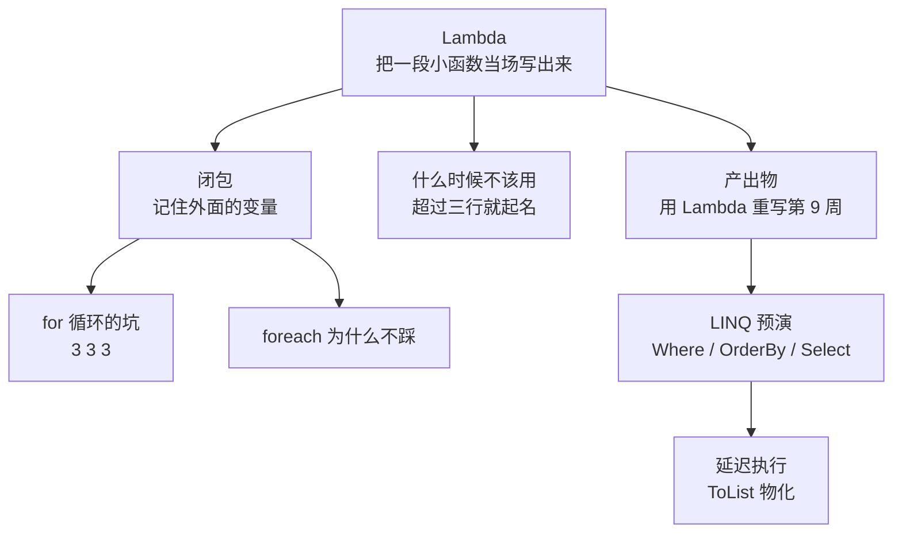

# C# 第 10 周：Lambda、匿名方法、闭包

---

上周学会了把方法当值传——`btn.OnClick += SayTimes`。但每次都得先起个名字、找个地方放，再回头挂上去。一个只用一次的小逻辑，却要走完整套流程。

这周学的 Lambda 就是来解决这个麻烦的：**当场写、不用起名、挂完就走**。

但 Lambda 有个副产品叫**闭包**——它会「记住」外面的变量。这个特性一半是便利，一半是陷阱，这周两个都踩到了。


> [!NOTE]
> 标题带「【进阶】」的节第一遍可以跳过，不影响后面。

## 0. 这周的学习地图



一句话概括：**Lambda 省的不是行数，是「起名字 + 找地方放 + 回头挂上」这个来回**。

## 1. Lambda：路边找个临时工

具名方法像雇正式员工：得起名、写签名、找地方放，以后调用还得记得名字。

Lambda 像路边找临时工：当场喊一声，干完就走，连名字都不必知道。

### 1.1 形状只有一条公式

```
参数 => 干的事
```

| 情况 | 写法 |
|---|---|
| 无参数 | `() => ...` |
| 一个参数 | `t => ...`（括号可省） |
| 两个以上 | `(a, b) => ...`（括号不能省） |
| 只有一条表达式 | `x => x * 2`（自动当返回值） |
| 多条语句 | `x => { ... }` |

### 1.2 三种写法对照

同一件事，三种时代的写法：

```csharp
// ① 具名方法（第 9 周）
static void SayTimes(int t) => Console.WriteLine($"次数 {t}");
btn.OnClick += SayTimes;

// ② 匿名方法（2005 年的老语法，现在基本见不到）
btn.OnClick += delegate (int t) { Console.WriteLine($"次数 {t}"); };

// ③ Lambda（现在的主流）
btn.OnClick += t => Console.WriteLine($"次数 {t}");
```

### 1.3 最容易错的一条：`=>` 有两种身份

```csharp
static void SayTimes(int t) => Console.WriteLine(t);   // ← 表达式体成员，有名字
btn.OnClick += t => Console.WriteLine(t);              // ← Lambda，没名字
```

长得一模一样，含义完全不搭界：

| | 表达式体成员 | Lambda |
|---|---|---|
| 有名字吗 | 有 | 没有 |
| 有 `static` / 返回类型声明吗 | 有 | 没有 |
| 在哪定义 | 类里 / 方法里 | 表达式中间 |

**判据**：左边有 `static`、返回类型、方法名 → 表达式体成员；只有一个 `=>` 直接接表达式 → Lambda。

### 1.4 【进阶】Action / Func 与 Lambda 的形状对表

Lambda 本身没有类型，它靠**被赋给谁**来决定形状：

```csharp
Action<int> a = t => Console.WriteLine(t);        // ✅ void + 一个 int
Func<int, string> f = t => Console.WriteLine(t);  // ❌ CS1643：没返回 string
Func<int, string> g = t => t.ToString();          // ✅ 返回了 string
```

**对表口诀**：`Action<...>` 的尖括号里全是参数；`Func<...>` 的**最后一个类型是返回值**。

## 2. 闭包：Lambda 会「记住」外面的变量

```csharp
int factor = 10;
Func<int,int> f = x => x * factor;
factor = 99;
Console.WriteLine(f(2));   // 198，不是 20
```

**Lambda 抓的是变量本身，不是当时的值。** 这叫闭包（closure）——把外面那个变量「封」进来。

> 类比：学生只在本子上写「看黑板的日期」，不抄具体数字。黑板一改，三个人低头看全是新的。

### 2.1 经典坑：for 循环里的 3 3 3

```csharp
var acts = new List<Action>();
for (int i = 0; i < 3; i++)
    acts.Add(() => Console.WriteLine(i));

foreach (var a in acts) a();   // 3 3 3
```

`i` 只有**一个**，建在循环头上。三个 Lambda 里装的都是同一句话：「读 `i` 现在是几」。循环结束时 `i` 已经是 3。

### 2.2 一行修好：把变量建在循环体里

```csharp
for (int i = 0; i < 3; i++)
{
    int copy = i;                          // ← 每轮新建一个
    acts.Add(() => Console.WriteLine(copy));
}
// 0 1 2
```

| | `i` | `copy` |
|---|---|---|
| 建在哪 | 循环头（外面） | 循环体（里面） |
| 建了几次 | 1 次 | 3 次 |
| 包裹里指向谁 | 唯一的 `i` | 各自的 `copy` |

### 2.3 for / foreach / while 的差异

```csharp
foreach (int i in new[] { 0, 1, 2 })
    list.Add(() => Console.WriteLine(i));
// 0 1 2 —— 不踩
```

C# 5（2012）改过这条规则：**`foreach` 的迭代变量每轮都是新变量**，自动帮你做了 `int copy = i` 这一步。`for` 和 `while` 不管。

| 循环 | 变量几份 | 会踩吗 |
|---|---|---|
| `for (int i...)` | 1 份共用 | ❌ 会踩 |
| `foreach (int i in ...)` | 每轮一份 | ✅ 安全 |
| `while`（变量建在外面） | 1 份共用 | ❌ 会踩 |

### 2.4 【进阶】怎么判断会踩

**只看一件事：这个变量是在循环体的大括号里新建的，还是外面那个。**

- 大括号里面 → 每轮一份 → 安全
- 大括号外面 → 一份共用 → 闭包抓走等于抓了最终值

## 3. 什么时候不该用 Lambda

```csharp
// ❌ 别这样
["1"] = () =>
{
    Console.WriteLine("请添加新代办: ");
    string? input = Console.ReadLine();
    if (string.IsNullOrWhiteSpace(input)) { Console.WriteLine("不能为空"); return; }
    todos.Add(new Todo(input, Priority.Normal));
    history.Push($"add|{input}");
},
```

十行逻辑塞进字典，字典会变成一坨不可读的东西。

| 情况 | 用 Lambda | 用具名方法 |
|---|---|---|
| 一两行、只用一次 | ✅ | 浪费 |
| 三行以上 | ❌ | ✅ |
| 被多处调用 | ❌ | ✅ |
| 调试时要看清它在哪 | ❌ | ✅ |

> 第三个理由最容易被忽略：Lambda 在调用栈里显示成 `<Main>b__0`，谁也看不懂。具名方法能下断点、能看名字。

## 4. 产出物：用 Lambda 重写第 9 周

### 4.1 改前（具名方法）

```csharp
static void SayTimes(int t) => Console.WriteLine($"  次数 = {t}");
static int Add(int a, int b) => a + b;

var btn = new Counter();
btn.OnClick += SayTimes;
btn.Press(7);

var calc = new Calculator();
calc.OnCalc += Add;
calc.Run(3, 5);
```

### 4.2 改后（Lambda）

```csharp
var btn = new Counter();
btn.OnClick += t => Console.WriteLine($"  次数 = {t}");
btn.Press(7);

var calc = new Calculator();
calc.OnCalc += (a, b) => a + b;
calc.Run(3, 5);
```

### 4.3 行数对照

| 版本 | 非空行 |
|---|---|
| 改前（具名方法） | 12 行 |
| 改后（Lambda） | 10 行 |

**只省 2 行。** 这就是重点——**Lambda 的价值不是省行数**。

省的是三件麻烦事：

1. 不用起名（`SayTimes` 三个月后没人记得）
2. 不用找地方放（放类里还是方法里？）
3. 不用回头挂（定义和挂载隔了几行，读代码要跳）

**输出零变化**，这才是判据。

## 5. LINQ 预演：把 foreach + if 压成一行

第 8 周这段查未完成任务：

```csharp
foreach (var t in todos)
    if (!t.IsDone)
        q.Enqueue(t);
```

三行，只为表达「留下没做完的」。LINQ 一句：

```csharp
var 没做完的 = todos.Where(t => !t.IsDone);
```

### 5.1 三个最常用

| 方法 | 要的 Lambda | 干什么 |
|---|---|---|
| `Where(条件)` | 返回 `bool` | 留哪些 |
| `Select(转换)` | 返回任意值 | 变成什么 |
| `OrderBy / OrderByDescending(键)` | 返回排序依据 | 怎么排 |

```csharp
var r = todos
    .Where(t => !t.IsDone)
    .OrderByDescending(t => t.Level)
    .Select((t, i) => $"{i + 1}. {t.Name}({t.Level.ToText()})")
    .ToList();
```

`Select` 多写一个 `i` 参数，它就额外告诉你「这是第几个」（从 0 开始）。

### 5.2 【进阶】延迟执行

```csharp
var nums = new List<int> { 1, 2, 3 };
var evens = nums.Where(n => n % 2 == 0);   // 写这行时，一个数都没算
nums.Add(4);
foreach (var n in evens) Console.Write(n + " ");   // 2 4
```

**`Where` 返回的不是列表，是一张「规则」。** 什么时候遍历，什么时候才算。

### 5.3 【进阶】ToList：把规则变成清单

```csharp
var q = nums.Where(n => n % 2 == 0);   // 规则，跟着 nums 变
var snapshot = q.ToList();             // 快照，独立的一份

nums.Add(6);
Console.WriteLine(q.Count());          // 重新算
Console.WriteLine(snapshot.Count);     // 不动
```

| 不 `ToList()` | 加 `ToList()` |
|---|---|
| 类型是 `IEnumerable<T>` | 类型是 `List<T>` |
| 用 `.Count()` 方法 | 用 `.Count` 属性 |
| 每次遍历都重算 | 只算一次 |
| 不能 `r[0]` | 能下标访问 |

## 6. 五个真踩过的坑

### 坑 1：`Sort` 返回 void，不能塞进 foreach

反例：

```csharp
foreach (var n in nums.Sort((a, b) => b - a))   // ❌
```

报错原文：`error CS1579: "void" 不包含"GetEnumerator"的公共实例或扩展定义，因此 foreach 语句不能作用于"void"类型的变量`

根因：`Sort` **原地改，返回 void**。`foreach` 需要一个能遍历的东西，`void` 不是。

正确写法：

```csharp
nums.Sort((a, b) => b - a);                     // 先排
foreach (var n in nums) Console.Write(n + " "); // 再读
```

> 判据：**名字里没有 `By` 的往往原地改返回 void，有 `By` 的返回新序列。**

### 坑 2：`OrderByDescending` 里又取反，结果排反了

反例：

```csharp
nums.OrderByDescending(n => -n)    // ❌ 输出 1 2 5 9
```

根因：`OrderByDescending` 已经负责降序了，Lambda 只告诉它「按什么排」。再取反等于负负得正。

正确写法：

```csharp
nums.OrderByDescending(n => n)     // ✅ 9 5 2 1
```

### 坑 3：`Console.WriteLine(List)` 打印出类型名

反例：

```csharp
Console.WriteLine(nums);
// System.Collections.Generic.List`1[System.Int32]
```

根因：`WriteLine` 调的是 `ToString()`。`List` 没重写它，用的是 `object` 的默认实现——**只报类型名，不看内容**。

正确写法：

```csharp
Console.WriteLine(string.Join(" ", nums));   // 9 5 2 1
```

> 自己写的类想打印得好看，就重写 `ToString()`：`public override string ToString() => $"{Name}({Level})";`

### 坑 4：for 循环里的闭包，输出 3 3 3

见 2.1 节。修法是把变量建在循环体里，或者改用 `foreach`。

### 坑 5：`switch` 表达式少写 `_`，运行期崩

反例：

```csharp
static string ToText(Priority p) => p switch
{
    Priority.High => "高",
    Priority.Normal => "中",
};   // ← 漏了 _ => "低"
```

编译：`warning CS8509: switch 表达式不处理其输入类型的所有可能的值(它不是穷举)`

运行：`Unhandled exception. SwitchExpressionException: Non-exhaustive switch expression failed to match its input. Unmatched value was Low.`

根因：**`switch` 表达式必须覆盖所有可能**。编译器只给警告，运行到未覆盖的值直接崩。

正确写法：

```csharp
static string ToText(Priority p) => p switch
{
    Priority.High => "高",
    Priority.Normal => "中",
    _ => "低",           // ← 兜底不是可选项
};
```

> 真严谨就写 `_ => throw new ArgumentOutOfRangeException(nameof(p), p)`——**崩得明明白白，比默默给错答案强**。

## 7. 练习题

### 7.1 基础（6 题）

<details><summary>1. Action&lt;int&gt; 能接哪个 Lambda？</summary>

```csharp
Action<int> a = t => Console.WriteLine(t);   // ✅
Action<int> b = () => { };                   // ❌ 少了参数
```

`Action<int>` 要「收一个 int、不返回」。

</details>

<details><summary>2. Func&lt;int, string&gt; 能接 Console.WriteLine 吗？</summary>

不能。`WriteLine` 返回 `void`，`Func` 要求返回 `string` → **CS1643**。

</details>

<details><summary>3. 这个 Lambda 有几个参数？</summary>

```csharp
btn.OnClick += t => Console.WriteLine(t);
```

一个。单参数可以省括号，但不能省成没参数。

</details>

<details><summary>4. 下面输出什么？</summary>

```csharp
int n = 0;
Action a = () => Console.WriteLine(n);
n = 42;
a();
```

`42`。闭包抓的是变量，不是当时的值。

</details>

<details><summary>5. Sort 和 OrderBy 最大的区别？</summary>

`Sort` 原地改、返回 `void`；`OrderBy` 不改原集合、返回新序列，可以继续接 `.Select()`。

</details>

<details><summary>6. ToList() 做了什么？</summary>

把「延迟执行的查询规则」立刻执行一遍，结果装进真正的 `List<T>`。

</details>

### 7.2 进阶（6 题）

<details><summary>1. 这段为什么输出 3 3 3？</summary>

```csharp
for (int i = 0; i < 3; i++)
    acts.Add(() => Console.WriteLine(i));
```

`i` 建在循环头，只有一个。三个 Lambda 都指向它。循环结束时 `i = 3`。

</details>

<details><summary>2. 怎么改成 0 1 2？</summary>

```csharp
for (int i = 0; i < 3; i++)
{
    int j = i;
    acts.Add(() => Console.WriteLine(j));
}
```

或者改用 `foreach`——C# 5 起每轮一个新变量。

</details>

<details><summary>3. 遍历 LINQ 查询时修改源集合会怎样？</summary>

```
Unhandled exception. System.InvalidOperationException: Collection was modified;
enumeration operation may not execute.
```

加 `.ToList()` 后不崩——因为遍历的是快照，不是原集合。

</details>

<details><summary>4. nums.Add(4) 之后，之前建的查询会包含 4 吗？</summary>

会。延迟执行——查询是规则不是快照。

</details>

<details><summary>5. Select((t, i) => ...) 里的 i 是什么？</summary>

下标，从 0 开始。`Where` 也支持同样写法。

</details>

<details><summary>6. 为什么 switch 表达式必须写 _？</summary>

必须覆盖所有可能值。少写只给 warning CS8509，运行期遇到未覆盖值抛 `SwitchExpressionException`。

</details>

### 7.3 挑战（4 题）

<details><summary>1. 用 Lambda 写一个降序排序</summary>

```csharp
nums.Sort((a, b) => b - a);   // 返回正数表示 b 排前面
```

</details>

<details><summary>2. 用扩展方法给枚举加中文名</summary>

```csharp
static class PriorityExt
{
    public static string ToText(this Priority p) => p switch
    {
        Priority.High => "高",
        Priority.Normal => "中",
        _ => "低",
    };
}
```

`this` 前缀是关键；必须放在 `static class` 里。

</details>

<details><summary>3. 改成「订阅者出错不影响其他人」</summary>

```csharp
foreach (Action h in a.GetInvocationList())
{
    try { h(); } catch (Exception e) { Console.WriteLine(e.Message); }
}
```

`GetInvocationList()` 把委托链拆成数组，挨个调用、挨个兜底。

</details>

<details><summary>4. 【伏笔】闭包和 GC 有什么关系？</summary>

Lambda 捕获变量时会生成一个**闭包类**（编译器偷偷造的），变量被搬进去当字段。**每次创建 Lambda 都可能分配一个新对象** → 第 11 周 GC 笔记的主题。

Unity 里在 `Update()` 里写 Lambda 就是在每帧分配，这就是性能问题的源头。

</details>

## 8. 检查标准

- [ ] 能一眼分辨 `=>` 是表达式体成员还是 Lambda
- [ ] 能对表：`Action<...>` 全参数，`Func<...>` 最后一个是返回值
- [ ] 能说清闭包抓的是变量不是值
- [ ] 能说清 `for` 会踩、`foreach` 不踩的原因
- [ ] 知道超过三行的逻辑该起名，并说出三个理由
- [ ] 用过 `Where` / `OrderByDescending` / `Select` / `FirstOrDefault` / `ToList`
- [ ] 亲手撞过 CS1579、CS8509、`Collection was modified`

**验收题**：用 Lambda 重写第 9 周代码，输出零变化

| 版本 | 非空行 | 输出 |
|---|---|---|
| 改前（具名方法） | 12 | 5 行 |
| 改后（Lambda） | 10 | 5 行，一字不差 |

## 9. 下一周预告

第 11 周：**LINQ 正式篇 + GC 前置笔记**。

这周只是预演了 `Where`、`Select`、`OrderBy` 三个方法。下周会把 LINQ 的常用家族走一遍——分组、聚合、Any/All、GroupBy。

同时补上 GC 笔记，因为挑战题 4 已经埋了伏笔：**Lambda 会生成闭包类，Unity 里在 Update() 里写 Lambda 就是在每帧分配对象**，这是性能问题的常见源头。
