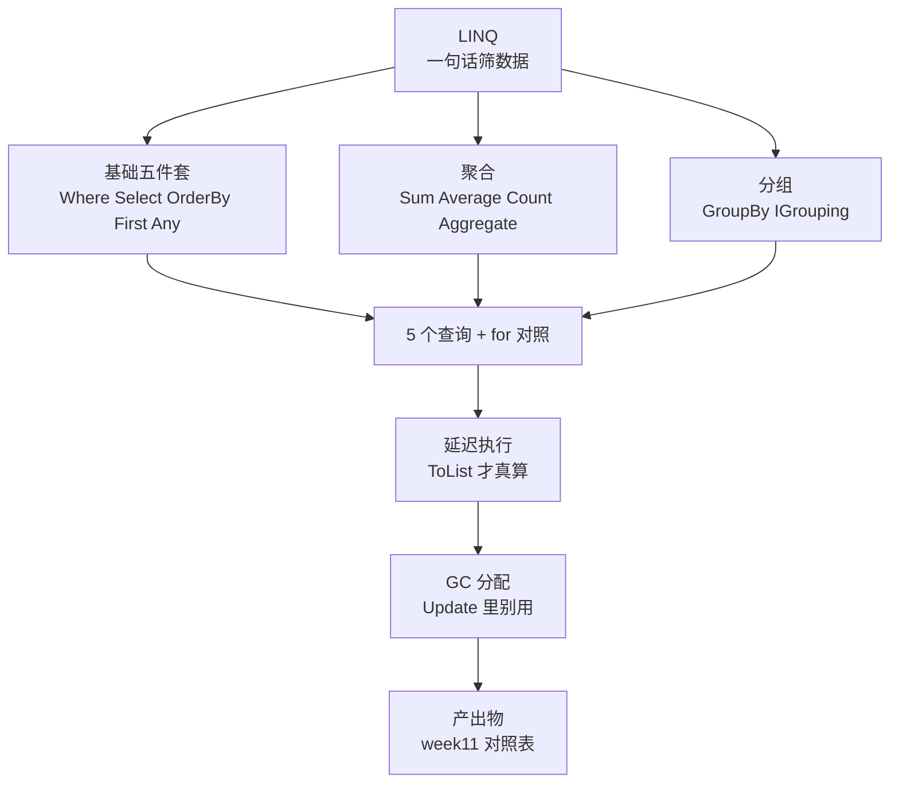

# C# 第 11 周：LINQ、GroupBy、Aggregate、延迟执行

---

前两周学了委托、Lambda，其实一直在给这周铺路。委托让「做什么」能当参数传，Lambda 让「做什么」能当场写——**这两样凑齐，才让 LINQ 成为可能**。

LINQ 干的事一句话说完：**用一句话筛数据。** 面试也爱问，Unity 里初始化、UI 回调到处都是它。但它的坑也很具体——**延迟执行**和**内存分配**，这两点踩过之后才是真的会用。

> [!NOTE]
> 标题带「【进阶】」的节第一遍可以跳过，不影响后面。

## 0. 这周的学习地图



一句话概括：**LINQ 不是新语法，是 `IEnumerable<T>` 上的一批扩展方法 + 你写的 Lambda。**

## 1. LINQ：站在门口的筛子

```csharp
var r = names.Where(s => s.Length >= 3);
```

四个人排队，`Where` 让他们逐个走过来报一句话——**「你够 3 个字吗」**。回答「够」的留下。

**`s` 就是「当前走到门口的那个人」。** 你不用点名，筛子会一个个递过来。

### 1.1 怎么认出一段代码是 LINQ

| 特征 | 例子 |
|---|---|
| 从集合开始 | `scores` |
| 点一串方法 | `.Where` `.OrderBy` `.Take` |
| 每个方法的参数是 Lambda | `s => s.Score > 60` |

**LINQ 没有专门的语法标记**——它就是扩展方法的调用，长得跟 `.ToString()` 一样。

### 1.2 哪些类型能用

**唯一判据：实现了 `IEnumerable<T>`。** 换句话说——**能 `foreach` 就能 LINQ**。

| 类型 | 能用吗 |
|---|---|
| `List<T>` / `T[]` | 能 |
| `HashSet<T>` / `Queue<T>` / `Stack<T>` | 能 |
| `Dictionary<K,V>.Values` | 能 |
| `string`（是 `IEnumerable<char>`） | 能 |
| LINQ 查询自身 | 能，可以继续接 |

```csharp
"hello".Count(c => c == 'l');     // 2 —— 字符串也能 LINQ
```

### 1.3 最容易错的一条：每个方法有固定的「Lambda 形状」

| 方法 | 要的 Lambda 形状 | 一句话 |
|---|---|---|
| `Where` | `T => bool` | 要不要 |
| `Select` | `T => 任意` | 变成什么 |
| `OrderBy` / `OrderByDescending` | `T => 可比较` | 按什么排 |
| `GroupBy` | `T => 分组键` | 按什么分堆 |
| `Any` / `All` | `T => bool` | 有没有 / 是不是全都 |
| `Sum` / `Average` / `Max` | `T => 数字` 或不传 | 汇总 |
| `Aggregate` | `(累计, 当前) => 新累计` | 自定义累积 |
| `Sort`（不是 LINQ） | `(a, b) => int` | 唯一收两个参的 |

**记法：方法名 ↔ 形状。** 写的时候不用查文档。

## 2. 基础五件套

### 2.1 Where / OrderBy / Take / Select：一条流水线

```csharp
var top3 = scores
    .Where(s => s.Score > 60)          // ① 筛：只要及格的
    .OrderByDescending(s => s.Score)   // ② 排：分数高的在前
    .Take(3)                           // ③ 截：只要前 3 个
    .Select(s => s.Name);              // ④ 变：只要名字
```

**为什么能一路点下去**：每个方法都返回**一个新的序列**，上一步的结果成了下一步的输入。**这是流水线，不是一堆数据。**

### 2.2 Take 与 First 的分工

| 方法 | 拿几个 | 够不够会怎样 |
|---|---|---|
| `Take(n)` | n 个（序列） | 不够就给现有的，不崩 |
| `First()` | 1 个 | 没有就抛异常 |
| `FirstOrDefault()` | 1 个 | 没有就返回默认值 |

### 2.3 【进阶】元组的 FirstOrDefault 是个坑

```csharp
var nobody = scores.FirstOrDefault(s => s.Score > 100);
Console.WriteLine(nobody.Name);      // 空行，不崩
```

**元组是值类型，不能返回 `null`。** 实测：

```
Name=[]      Score=[0]      IsDefault: True
```

`default((string, int))` 就是 `(null, 0)`。

**所以元组列表不能靠 `== null` 判断「没找到」**。要判断就在 `Where` 后先看 `Count`。

### 2.4 Any 和 All：问句，不是数数

```csharp
bool hasTop = scores.Any(s => s.Score >= 90);   // 有没有 ≥90 的
bool allPass = scores.All(s => s.Score >= 60);  // 是不是全及格
```

| 方法 | 问什么 | 什么时候停 |
|---|---|---|
| `Any` | 有**一个**满足吗 | 找到**第一个**就停 |
| `All` | **全部**都满足吗 | 找到**第一个不**满足就停 |

`Any()` 比 `Count() > 0` 快——**前者找到一个就收工，后者必须走完全程**。

自己写 for 版时同理：

```csharp
bool hasTop2 = false;
foreach (var s in scores)
    if (s.Score >= 90)
    {
        hasTop2 = true;
        break;      // 少了这句就白用 Any 了
    }
```

## 3. 聚合：把一堆变成一

```csharp
int total = scores.Sum(s => s.Score);
double avg = scores.Average(s => s.Score);
Console.WriteLine($"平均分：{avg:F2}");     // 75.17
```

`F2` 是格式化——**Fixed-point，2 位小数**，自动四舍五入。不写的话会打出 `75.16666666666667`。

### 3.1 【进阶】Aggregate：通用累积器

```csharp
nums.Sum();                                  // 10，只会加法
nums.Aggregate((a, b) => a * b);             // 24，连乘
nums.Aggregate(100, (a, b) => a + b);        // 110，带种子
```

**两个参数的版本**：

```
Aggregate(种子, (累计值, 当前元素) => 新的累计值)
```

| 参数 | 意思 |
|---|---|
| 种子 | 累计的起点（省了就取第一个元素） |
| `a` | 到目前为止的累计结果 |
| `b` | 当前正在处理的元素 |

**`Sum` / `Max` / `Min` / `Average` 都是 `Aggregate` 的特例**——微软把常用的累积写死了，更快也更清楚。

### 3.2 【进阶】Aggregate 的类型规则

```csharp
nums.Aggregate((a, b) => a + "-" + b);       // CS0029
nums.Aggregate("", (a, b) => a + "-" + b);   // 但会多个开头的 -
```

**没给种子时，`a` 第一轮取第一个元素**，所以 `a` 只能是 `int`。加了 `"-"` 就变成 `string`，装不进 `int` → 崩。

**正确做法**：先 `Select` 转成字符串，或者直接给 `string` 种子。

### 3.3 空集合的差异

```csharp
new List<int>().Sum();                        // 0   —— 加法有单位元 0
new List<int>().Average();                    // 抛 InvalidOperationException
new List<int>().Min();                        // 同样崩
new List<int>().Aggregate((a,b) => a * b);    // 崩
new List<int>().Aggregate(1, (a,b) => a * b); // 1，有种子
```

**种子必须填「不影响结果的那个数」**：加法填 0，乘法填 1，拼字符串填 `""`。

## 4. 分组：GroupBy 和 IGrouping

快递站分拣：包裹按「省内、省外、国际」扔进三个筐，每个筐**贴着标签**。

```csharp
var byPass = scores.GroupBy(s => s.Score >= 60 ? "及格" : "不及格");

foreach (var g in byPass)
    Console.WriteLine($"{g.Key}: {g.Count()} 人");
```

### 4.1 IGrouping 是什么

```
byPass 类型: IEnumerable<IGrouping<string, (string Name, int Score)>>
group 类型: Grouping`2
Key 类型: String
```

**它是「一个带标签的篮子」**，三个能力：

| 能力 | 写法 | 来源 |
|---|---|---|
| 标签 | `g.Key` | `IGrouping` 自己的属性 |
| 数几个 | `g.Count()` | 继承 `IEnumerable` |
| 挨个拿 | `foreach (var x in g)` | 继承 `IEnumerable` |

**组里面照样能跑 LINQ**：`g.Select(...)`、`g.Where(...)`、`g.Sum(...)` 全行。

### 4.2 最容易错的一条：g.Count 不存在

```csharp
g.Count          // CS1061
g.Count()        // 对
```

`List<T>` 有 `Count` **属性**（内部记着数）；`IGrouping` 是只读视图，**没有这个属性**，只能遍历一遍数出来。

**属性 vs 方法的判断法**：不加括号能过就是属性，报 CS1061 就是方法。

### 4.3 【进阶】ToLookup：建好的索引

```csharp
var lookup = todos.ToLookup(t => t.Level);
lookup["高"].Count();      // 2 —— 可以反复按 key 查
```

| | `GroupBy` | `ToLookup` |
|---|---|---|
| 返回 | 延迟执行的序列 | 建好的索引（立刻算完） |
| 能下标查吗 | 不能 | 能 |
| 适合 | 遍历一次 | 反复查 |

### 4.4 【进阶】SelectMany：一对多摊平

```csharp
todos.SelectMany(t => new[] { $"开始：{t.Name}", $"结束：{t.Name}" })
// 6 个任务 → 12 个元素
```

| | `Select` | `SelectMany` |
|---|---|---|
| 每个元素 → | 一个值 | 一个序列 |
| 结果 | 6 个元素（有几个数组） | **12 个元素（摊平）** |

## 5. 对比：LINQ 版 vs for 版

第 11 周的产出物就是这个对照。

### 5.1 主查询（判据题）

```csharp
// LINQ：4 行
var top3 = scores
    .Where(s => s.Score > 60)
    .OrderByDescending(s => s.Score)
    .Take(3)
    .Select(s => s.Name);

// for：12 行
var passed = new List<(string Name, int Score)>();
foreach (var s in scores)
    if (s.Score > 60)
        passed.Add(s);                          // 多一个中间容器
passed.Sort((a, b) => b.Score - a.Score);
var result = new List<string>();
for (int i = 0; i < 3 && i < passed.Count; i++)  // 边界得自己兜
    result.Add(passed[i].Name);
```

**输出一字不差**：`小王、小红、小明`。

### 5.2 差的不只是行数

| 差别 | LINQ | for |
|---|---|---|
| 中间容器 | 每步自动产生 | 自己管 |
| 越界保护 | `Take(3)` 自动兜 | `i < 3 && i < passed.Count` 手写 |
| 类型转换 | `Select` 一步到位 | 两种容器都得有 |

### 5.3 行数对照表

| 查询 | LINQ | for | 差 |
|---|---|---|---|
| `Where + OrderByDescending + Take + Select` | 4 行 | 12 行 | 8 |
| `Any` | 1 行 | 4 行 | 3 |
| `Sum` | 1 行 | 3 行 | 2 |
| `GroupBy` | 1 行 | 11 行 | 10 |

## 6. 五个真踩过的坑

### 坑 1：Sort 收的是比较规则，不是字段

反例：

```csharp
result.Sort(s.Score);      // CS1503
passed.Sort(a > b);        // CS0103：a、b 没声明
```

根因：`Sort` 的签名是 `Sort(Comparison<T>)`，而 `Comparison<T>` 就是 `(T a, T b) => int`。

正确写法：

```csharp
passed.Sort((a, b) => b.Score - a.Score);   // 降序
```

**返回值只要正负号有意义**：负数 a 在前，正数 b 在前。

### 坑 2：元组的 FirstOrDefault 不是 null

反例：

```csharp
var nobody = scores.FirstOrDefault(s => s.Score > 100);
if (nobody == null) { ... }      // 永远为 false
```

元组是值类型，返回 `(null, 0)`。判断「没找到」要先用 `Where` 再查 `Count`。

### 坑 3：OrderByDescending 里又取反

```csharp
nums.OrderByDescending(n => -n)     // 输出 1 2 5 9，排反了
```

根因：`OrderByDescending` 已经负责降序，Lambda 只告诉它「按什么排」。再取反 = 负负得正。

### 坑 4：Console.WriteLine(List) 打出类型名

```csharp
Console.WriteLine(nums);
// System.Collections.Generic.List`1[System.Int32]
```

根因：`WriteLine` 调 `ToString()`，`List` 没重写它。

正确写法：

```csharp
Console.WriteLine(string.Join(" ", nums));
```

### 坑 5：分配来自 new，不来自 LINQ

实测（10000 次循环，Release）：

| 写法 | 分配 |
|---|---|
| 循环里 `new List<int>` + foreach | **703.1 KB** |
| List 建在外面 + foreach | **0.1 KB** |
| List 建在外面 + `Sum()` | **0.0 KB** |
| 循环里 `Where(...).ToList()` | **1406.3 KB** |

**703 KB 的锅是 `new List`，不是 `foreach`。** `ToList()` 的 1406 KB 也是因为它内部 `new` 了个 List。

**判据：谁的分配多，看 `new` 在不在循环里。**

## 7. 练习题

### 7.1 基础（6 题）

<details><summary>1. 5 个学生里筛出 >60、降序、取前 3 个名字，怎么写？</summary>

```csharp
scores.Where(s => s.Score > 60)
      .OrderByDescending(s => s.Score)
      .Take(3)
      .Select(s => s.Name);
```

</details>

<details><summary>2. Take 和 First 的区别？</summary>

`Take(n)` 拿 n 个（返回序列）；`First()` 拿 1 个（空集合会抛异常）。

</details>

<details><summary>3. Any(条件) 和 Any() 差在哪？</summary>

`Any(条件)` 问「有没有满足的」，参数是 Lambda；`Any()` 问「集合里有东西吗」，不看条件。

</details>

<details><summary>4. Sum() 和 Sum(s =&gt; s.Score) 什么时候用哪个？</summary>

元素本身就是数字用 `Sum()`；元素是对象/元组，要先取出字段用 `Sum(x => x.Field)`。

</details>

<details><summary>5. 哪些类型能用 LINQ？</summary>

实现 `IEnumerable<T>` 的都行——能 `foreach` 就能 LINQ。

</details>

<details><summary>6. F2 是什么意思？</summary>

格式化保留 2 位小数，自动四舍五入。`$"{avg:F2}"` → `75.17`。

</details>

### 7.2 进阶（6 题）

<details><summary>1. GroupBy 返回什么类型？</summary>

`IEnumerable<IGrouping<TKey, TElement>>`。每个 `IGrouping` 既是「一个组」，又有 `Key`，还能遍历。

</details>

<details><summary>2. g.Count 为什么不合法？</summary>

`IGrouping` 是只读视图，没有 `Count` 属性（`List` 才有）。只能用 `Count()` 方法。

</details>

<details><summary>3. Select 和 SelectMany 的区别？</summary>

`Select` 每个元素变一个值；`SelectMany` 每个元素变一个序列，然后摊平。

</details>

<details><summary>4. TakeWhile 和 Where 的区别？</summary>

`TakeWhile` 遇到第一个不满足的就停；`Where` 会继续检查后面。`{2,4,6,7,8}` 取偶数：前者 `2,4,6`，后者 `2,4,6,8`。

</details>

<details><summary>5. Aggregate 没给种子时有什么限制？</summary>

累计值类型必须和元素类型一致，否则 CS0029。因为第一轮 `a` 取第一个元素。

</details>

<details><summary>6. 空集合时哪些聚合方法会崩？</summary>

`Average`、`Min`、`Max`、不带种子的 `Aggregate` 都会抛 `InvalidOperationException`。只有 `Sum`（有单位元 0）和带种子的 `Aggregate` 安全。

</details>

### 7.3 挑战（4 题）

<details><summary>1. 用 Aggregate 求连乘</summary>

```csharp
nums.Aggregate(1, (a, b) => a * b);   // 种子 1 是乘法单位元
```

</details>

<details><summary>2. 写一个扩展方法 Product()</summary>

```csharp
public static class LinqExt
{
    public static int Product(this IEnumerable<int> src)
        => src.Aggregate(1, (a, b) => a * b);
}
```

`this` 必须放在第一个参数上，外层类必须是 `static`。

</details>

<details><summary>3. 复合链：未完成按等级排序，每级各取前 1</summary>

```csharp
todos.Where(t => !t.Done)
     .OrderBy(t => t.Level)
     .GroupBy(t => t.Level)
     .Select(g => g.First().Name);
```

**排序要在分组之前**，否则组内顺序就是原始顺序。

</details>

<details><summary>4. 【伏笔】这段在 Update() 里每秒跑 60 次，有风险吗？</summary>

```csharp
void Update()
{
    var alive = enemies.Where(e => e.Hp > 0).ToList();
}
```

有。`ToList()` 每次分配新 List + 迭代器对象，**每秒 60 次分配** → 攒够触发 GC → 场景卡顿。

**改法**：缓存列表，只在内容变化时重建；或用对象池；或手写循环 + `List.Clear()`。

</details>

## 8. 检查标准

- [ ] 能写出「筛 >60、降序、取前 3 个名字」的 LINQ
- [ ] 能写出同一个查询的 for 对照版，输出一致
- [ ] 能说出每个常用方法要的「Lambda 形状」
- [ ] 知道 `Take` / `First` / `FirstOrDefault` 的差别
- [ ] 知道元组的 `FirstOrDefault` 返回 `(null, 0)` 不是 `null`
- [ ] 能说清 Any 为什么不走完全程
- [ ] 用过 GroupBy + IGrouping
- [ ] 能写出 Aggregate 的连乘、拼串、带种子三个版本
- [ ] 知道「分配来自 new，不来自 LINQ」
- [ ] 亲手撞过 CS1061、CS0029、CS0103

**验收题**：LINQ 版与 for 版输出完全一致

| 查询 | LINQ 行数 | for 行数 | 输出 |
|---|---|---|---|
| Where+OrderByDescending+Take+Select | 4 | 12 | 小王、小红、小明 |
| Any | 1 | 4 | True |
| Sum | 1 | 3 | 451 |
| GroupBy | 1 | 11 | 及格 4 / 不及格 2 |

## 9. 下一周预告

第 12 周：**用委托 / Lambda / LINQ 重构前 11 周的代码**。

这周最后一句提醒要记住：**LINQ 替的是「筛选 + 转换」，替不了「控制流」。** 需要 `break`、需要边遍历边改集合、需要每帧跑的地方——老老实实写 `for`。

下周会把 `week8` 的待办清单整个重写一遍，用这三个月学到的一切。然后就是第 13 周的验收缓冲：**闭卷写出 100 行以上的控制台程序**。